# Barely Functional Contraptions

A NeoForge mod for **Minecraft 26.1, 26.2 and 26.3** about sheep and slightly questionable machinery.

**Found a bug?** [Report it on the bug report form](https://forms.gle/8xG9pMoQnTG6MVo1A).

**Infuse a sheep with an ingot, a gem or a block at the Infusion Altar and its wool takes on that resource.** Shear it for resource wool, and turn the wool back into the resource in a **Mechanical Separator**. Breed your best sheep to raise their Yield, Growth and Endurance. Every sheep is infused at a powered **Infusion Altar**: the resource, two of its blocks and an item for its rarity. The legendary Wither, Dragon and Warden sheep take more.

Everything runs on Forge Energy. You can make it from mushrooms in a network of **Mycelial Generators**, from sunlight on **Glow Panels**, from Blaze sheep warming a **Blaze Sheep Furnace**, or from burning spare wool. Store it in **Hume Energy Cubes** and move it, along with fluids and items, through cables and pipes. **Automatic Shears**, **Wool Packers** and hoppers can run a whole farm without you.

### Make it your own

- **Config:** four config files, editable in game from *Mods → Barely Functional Contraptions → Config*. Every power rate, buffer, time and chance can be changed, and a world can have its own copy.
- **Data packs:**
  - **Add sheep:** a new sheep needs only a JSON file. It sets the feeding item, the colours, the separator's outputs, its tier and altar catalysts, and extra looks such as wings, extra heads, glowing or a bigger size.
  - **More data:** Wool Burner fuels, furnace heat sources and boost items, and separator recipes are data too.
  - **For other mods:** the `resource_wool` ingredient lets KubeJS, Create and other mods' recipes use resource wool.
- **Modpacks:** `/bfc generate` makes a sheep for every ore and material in the modpack.
- **Resource packs:** they can retexture any wool and rewrite or translate the in-game manual.
- **Optional mods:** JEI and Jade show every recipe and machine status, but the mod runs without them.

### Blue Steel

Every contraption is built from **Blue Steel**: an Iron Ingot crafted with any wool. The mod's recipes take it wherever they'd take an Iron Ingot, and a Block of Blue Steel wherever they'd take a Block of Iron, so your wool has somewhere to go from the very first machine.

## The Contraptions Manual

Craft a book with a Functional Machine Block to get the in-game guide. Its chapters are sorted into **Power**, **Logistics**, **Production** and **Utility** tabs, and the rest of this page follows them in the same order. A fifth tab, **Recipes**, shows every crafting recipe, what each sheep is fed, the altar's catalysts and what every wool and bale separates into, all read from the game so data-pack changes show too. A **WIP** tab is kept for work-in-progress features as they arrive.

| Power | Production |
|---|---|
| 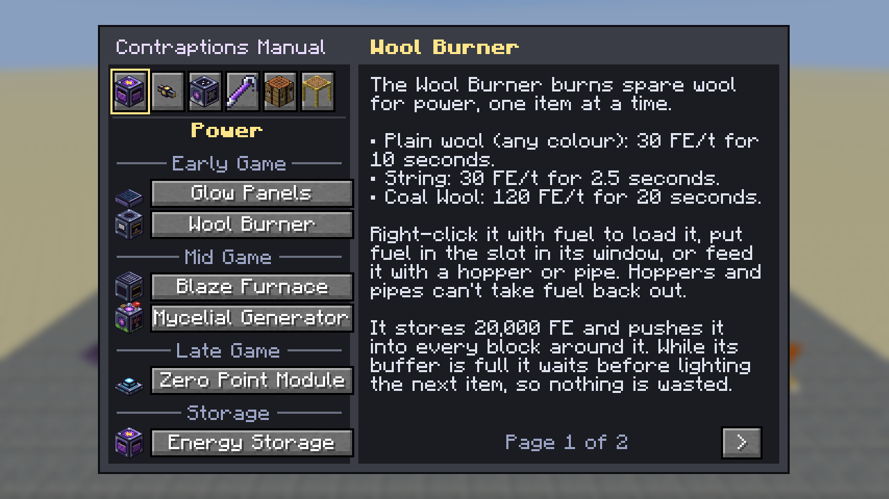 | 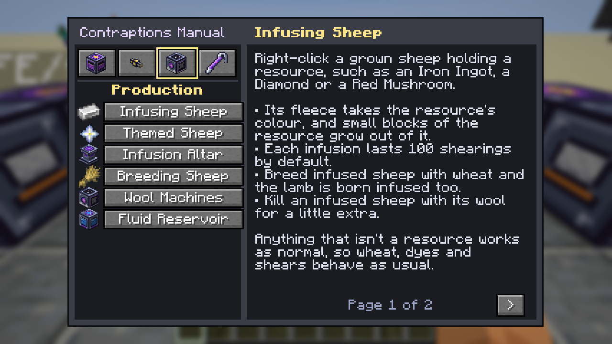 |

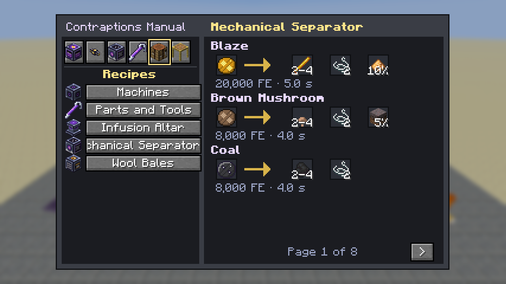

## Power

The manual sorts the generators into tiers.

**Early game:** Glow Panel, Wool Burner and Sheep Treadmill. Cheap to build, but weak.

### Glow Panels

Make up to 60 FE/t from sunlight and up to 40 FE/t from block light; a Glow Lamp gives full power day or night. Their cells glow brighter the more they make, and go dim at dusk and dark at night.

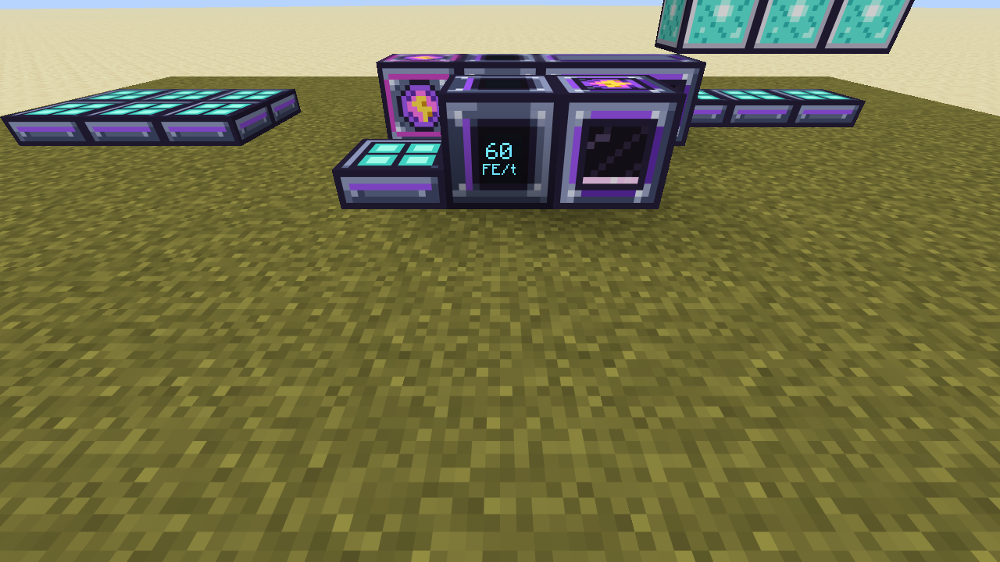

### Wool Burner

Burns spare wool for power, one item at a time: plain wool and string give 30 FE/t, Coal Wool 120 FE/t. It waits while its buffer is full, so nothing is wasted.

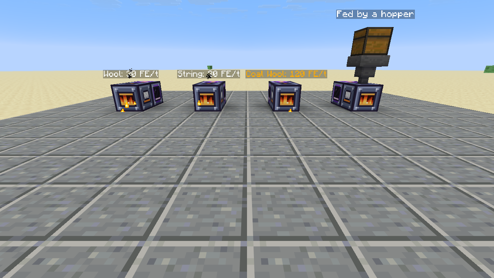

### Sheep Treadmill

A sheep walks its belt for the wheat hanging at the front and makes 20 FE/t, more with Speed or while it's sheared. With food in it, it calls the nearest sheep over to hop on. Keep Wheat or Hay Bales in it, and swap in a fresh sheep when one gets tired: after 2 minutes it rests for 30 seconds, longer walks for sheep bred for Endurance.

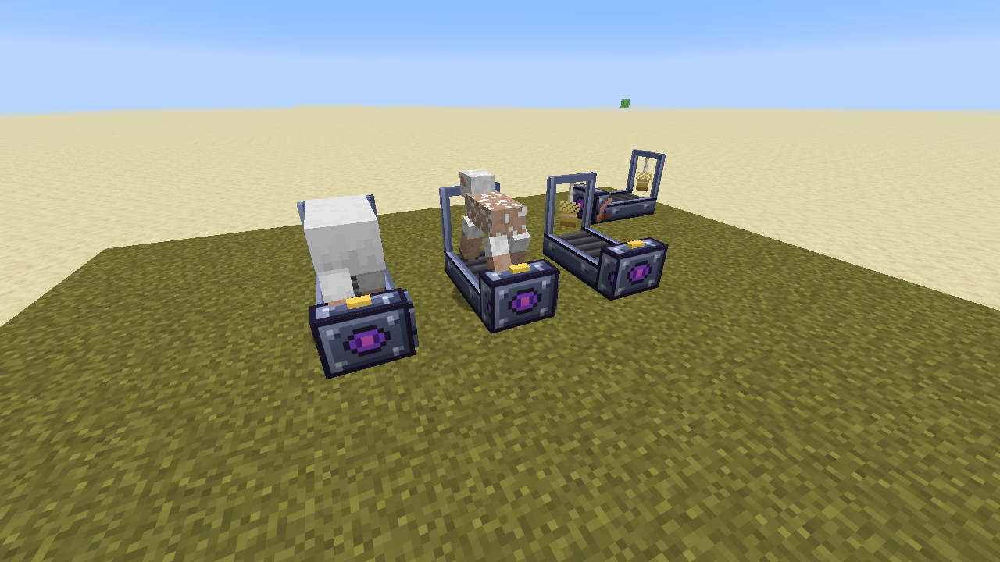

**Mid game:** Blaze Furnace, Mycelial Generator and Static Generator. They need the Nether, a mushroom farm or some copper, and Mycelial networks grow fast.

### Blaze Furnace

Makes power from the heat of Blaze sheep standing round it: 80 FE/t for one, up to 260 FE/t for four. Only a sheep with its blazing fleece on counts, and each Blaze Rod doubles the output for 30 seconds.

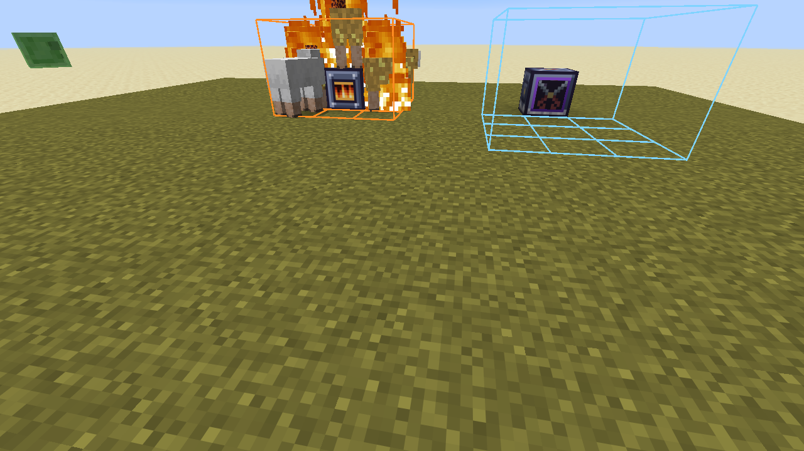

### Mycelial Generator

Burns red or brown mushrooms and water for 200–250 FE/t. Generators that touch form a network, and each running one boosts the whole network's output. Running generators slowly turn nearby dirt into mycelium and sometimes grow huge mushrooms, so they make more of their own fuel.

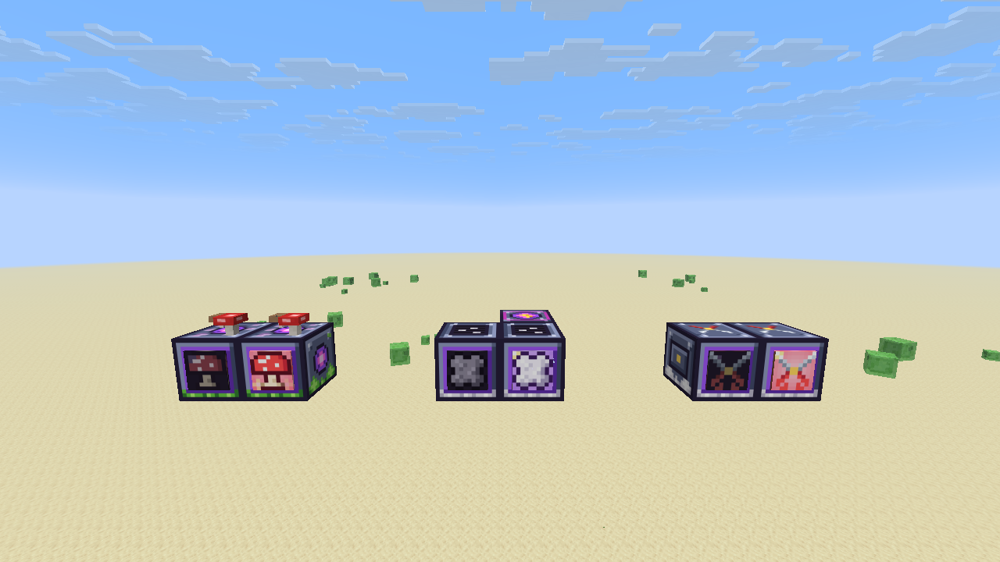

### Static Generator

Two blocks tall, like a Van de Graaff generator. Sheep rubbing against Copper Combs in its pen build up static, and its copper dome arcs it into power: 100 FE/t a sheep, 150 for Copper sheep: 600 FE/t from six plain sheep, 900 from six Copper sheep. The combs oxidise as they're worked, so scrape them with an axe or wax them. If nothing takes its power the dome overcharges and shocks anything in its pen, knocking it back; Woollen Armour insulates.

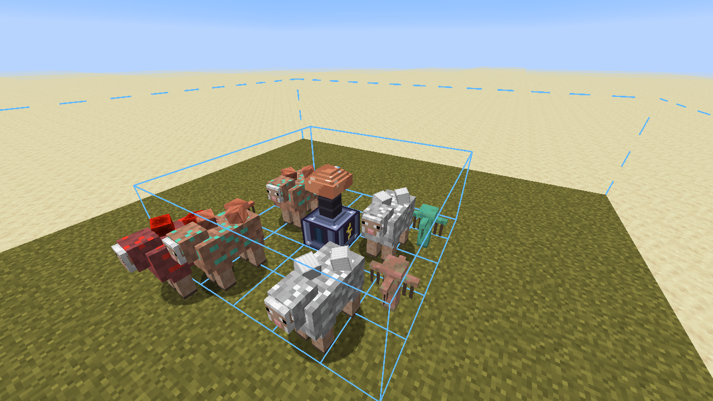

**Late game:** Zero Point Module, Thermal Reaction Chamber and Echo Chamber. They make the most power.

### Zero Point Module

Two modules facing each other across open space link with a beam and make 1,000 FE/t for every block of gap, up to 64. Stained glass in the gap colours the beam, and the beam burns anything that walks into it.

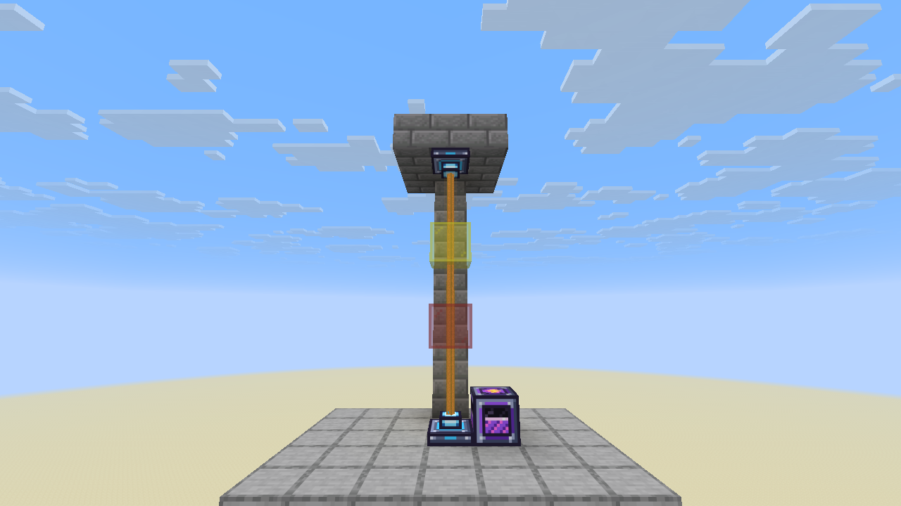

### Thermal Reaction Chamber

Makes power from the difference between hot and cold: Blaze sheep in a pen against its hot side, Snow sheep in a pen against its cold side, and water through the middle. Each Blaze sheep matched by a Snow sheep is a pair: 2,500 FE/t for one, up to about 10,100 FE/t for six, doubled while a Blaze Rod and Blue Ice burn together. Keep the herds even. Left running hot for 30 seconds it melts down and explodes; left running cold, it freezes itself into Packed Ice. It drinks 250 mB of water a tick, and after an hour each sheep's fleece is spent until you infuse it again.

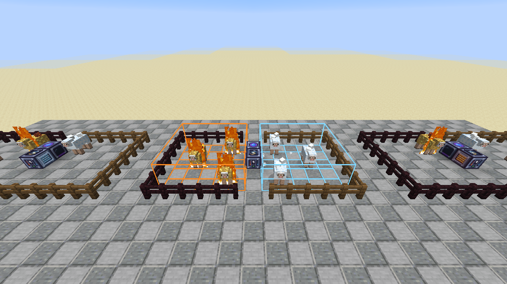

### Echo Chamber

A 3x3x3 generator that turns noise into power. Warden sheep in a pen in front of its dish listen for vibrations, the way a sculk sensor does: one makes 8,000 FE/t, up to 20,000 FE/t from four. Keep the noise steady and in its sweet spot. A note block on a redstone clock works well, and wool walls keep stray noise out. Too quiet for 30 seconds and the sheep fall asleep; too loud for 10 and the room shrieks, giving players nearby Darkness and stopping for a minute. Made from three Sculk Wool Bales (from Warden sheep), an Echo Shard, a Functional Machine Block and four Blocks of Blue Steel.

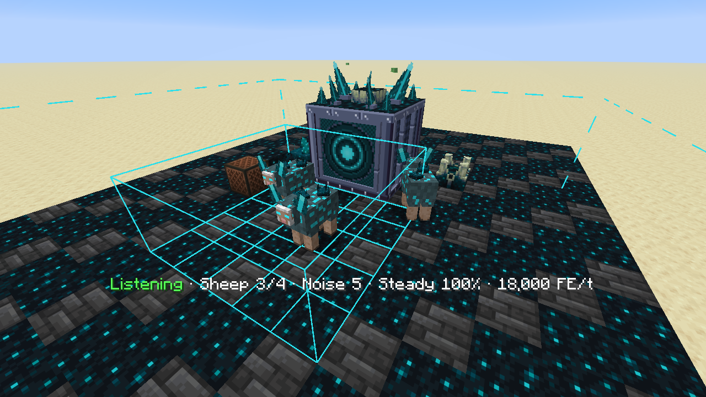

### Hume Field Generator

A late-game 2x2 generator three blocks tall whose field can't make up its mind: every second it makes a new, random 200 to 1,200 FE/t. It has no buffer, so that power goes straight into the cables, Hume Energy Cubes and machines touching it, and whatever they can't take is lost. Every 5 seconds its field pulses with a burst of purple sparks. Made from four Blocks of Blue Steel, Tinted Glass, two Hume Energy Cubes, a Nether Star and a Functional Machine Block.

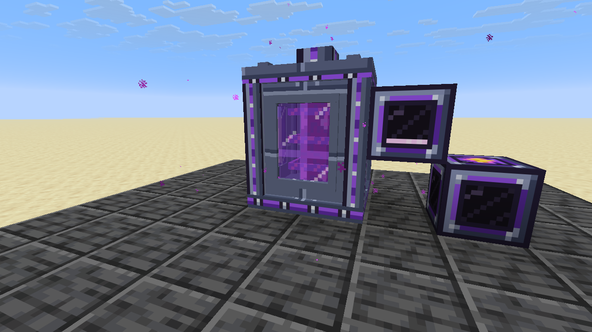

### Energy Sheep

A wireless charger on legs. Infuse a sheep with a Hume Energy Cube (2 Lightning Rods at the altar) and it wears a fleece of cube, crackling with sparks. Pen it within 3 blocks of a Hume Energy Cube bank: it drains up to 2,000 FE/t into its 100,000 FE fleece and shares it out, wirelessly, to every machine and every powered tool or armour piece in nearby players' inventories within 8 blocks. Its fleece glows brighter the more charge it holds (dark when empty, lit up when full), sparks arc to whatever it charges, and Jade shows how much it holds.

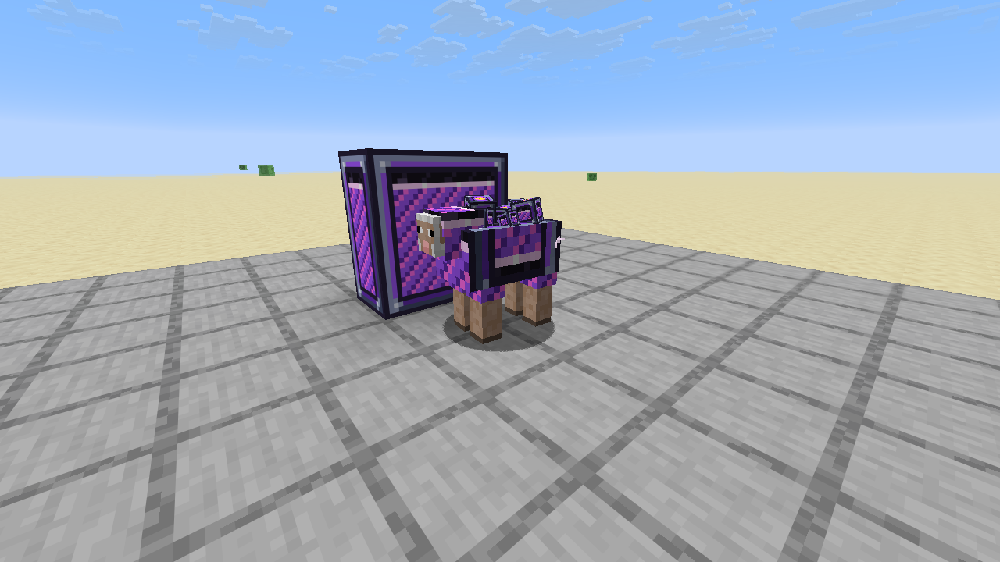

### Energy Storage

Each Hume Energy Cube holds 1,000,000 FE and moves 10,000 FE/t. Touching cubes join into one bigger battery, and a broken cube keeps its charge.

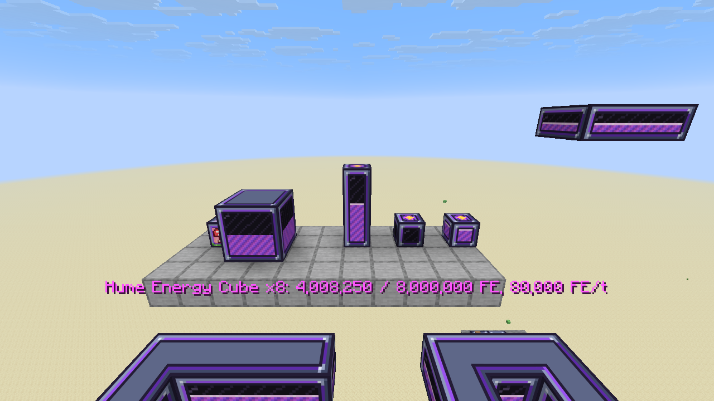

## Logistics

### Cables and Meter

Energy Cables carry up to 100,000 FE/t; generators power machines first and charge cubes with the rest. The Energy Meter shows the FE/t passing through it and gives a comparator signal.

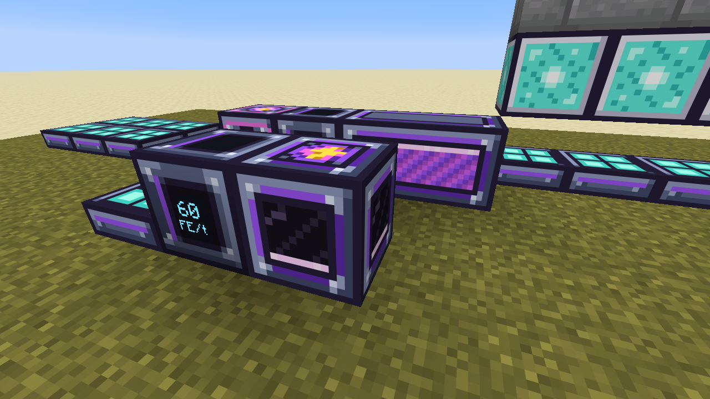

### Tanks and Pipes

A Fluid Tank holds 16 buckets, and touching tanks join into one that fills from the bottom up. Fluid Pipes move 4 buckets a tick and Item Pipes 16 items a tick.

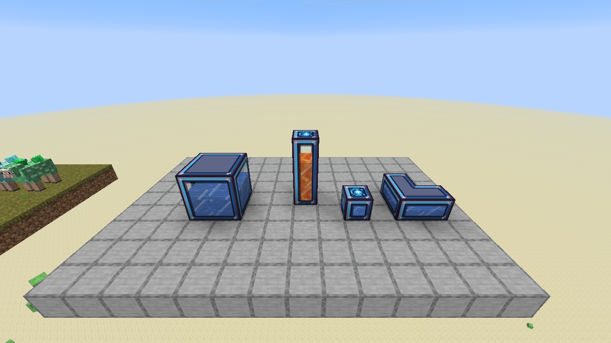

### Pipe Sides

The wrench sets every side of a pipe on its own: Normal, Pull, Push or Off. Each side also has a 3×3 filter that only lets chosen items or fluids through.

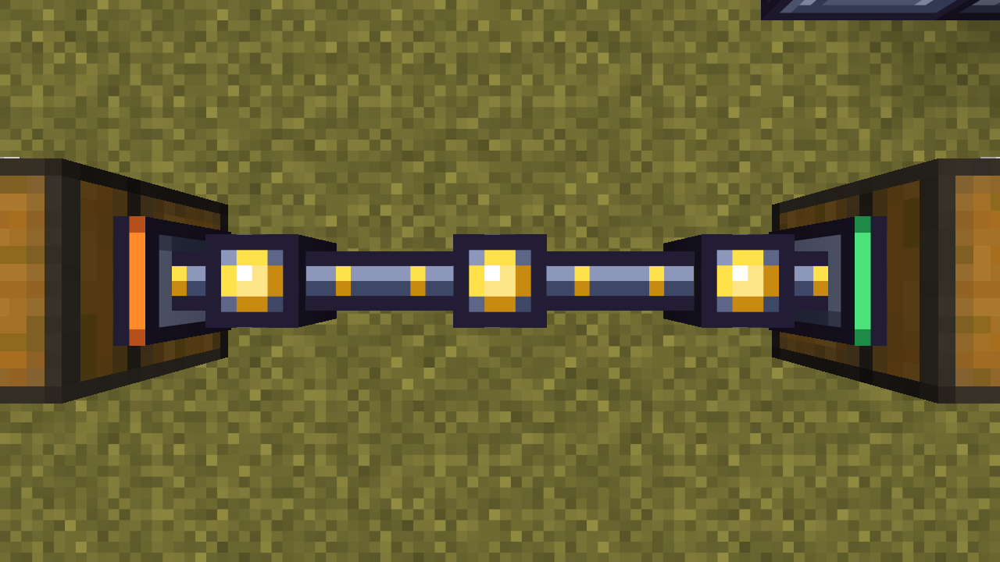

### Wool Packer

Presses 9 of the same resource wool into a Wool Bale. A bale in the Mechanical Separator costs more power but gives 12 wool's worth of resources. Bales stack to 64, can be placed like hay bales and craft back into their 9 wool.

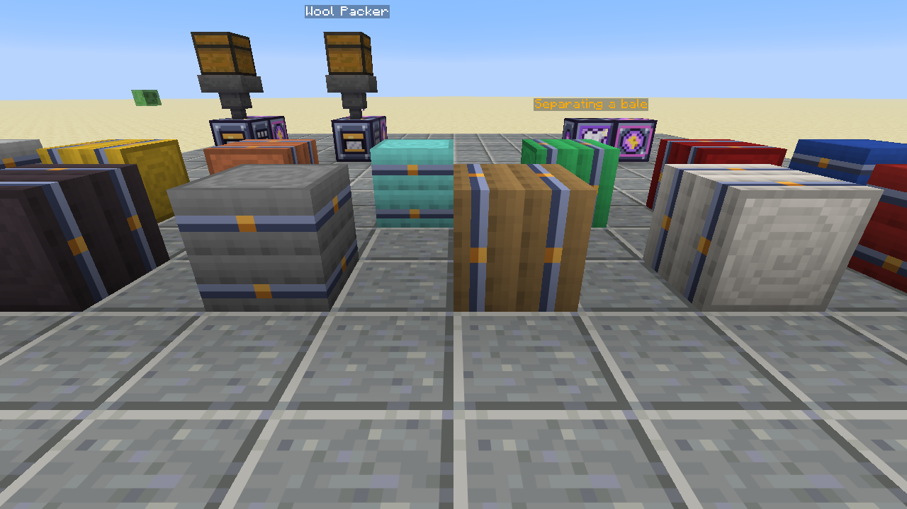

## Production

### Infusing Sheep

Put a resource in the Infusion Altar, such as an Iron Ingot, a Diamond or a Red Mushroom, with 2 of its blocks and a rarity item, and stand a grown sheep beside it. Its fleece takes the resource's colour, and each infusion lasts 100 shearings. Lambs of infused sheep are born infused too. In creative, the Resource Wool tab has a spawn egg for every sheep, which spawns it already infused.

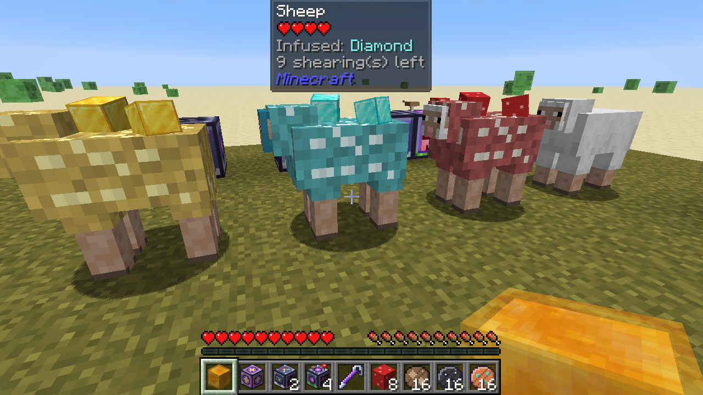

### Themed Sheep

Fourteen resources turn sheep into little versions of their mob: dragon wings, Wither skulls, a giant screaming Ghast, a burning Blaze, a glowing Glow Ink sheep, a Snow sheep that leaves snow where it walks, an Explosive sheep in a TNT fleece that pops its wool off when you light its fuse, an Energy sheep that drains Hume Energy Cubes and charges the machines and tools round it wirelessly, and more. Each has its own advancement.

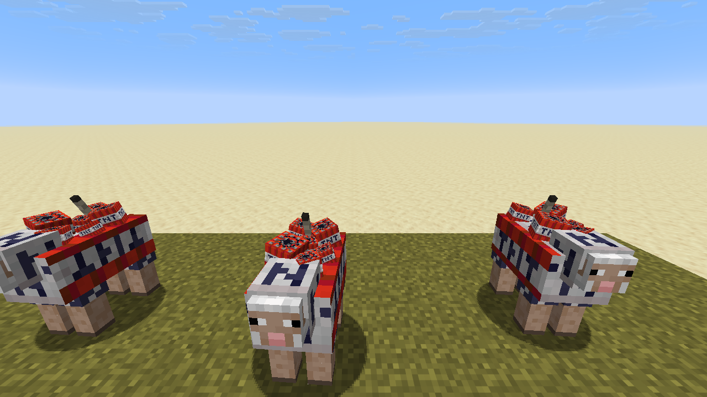

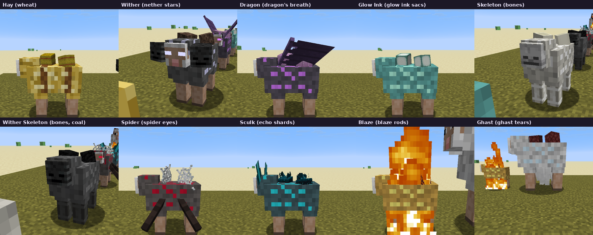

All 25 built-in sheep:

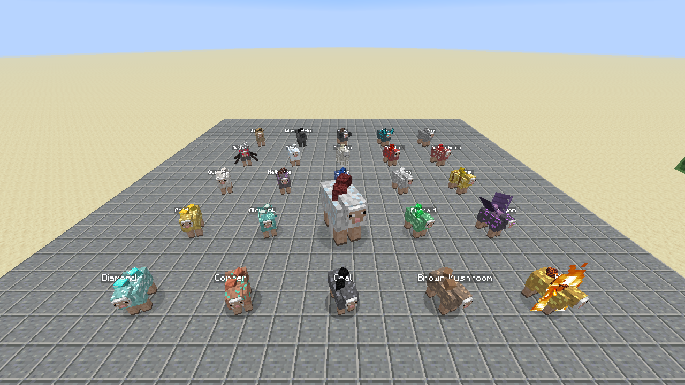

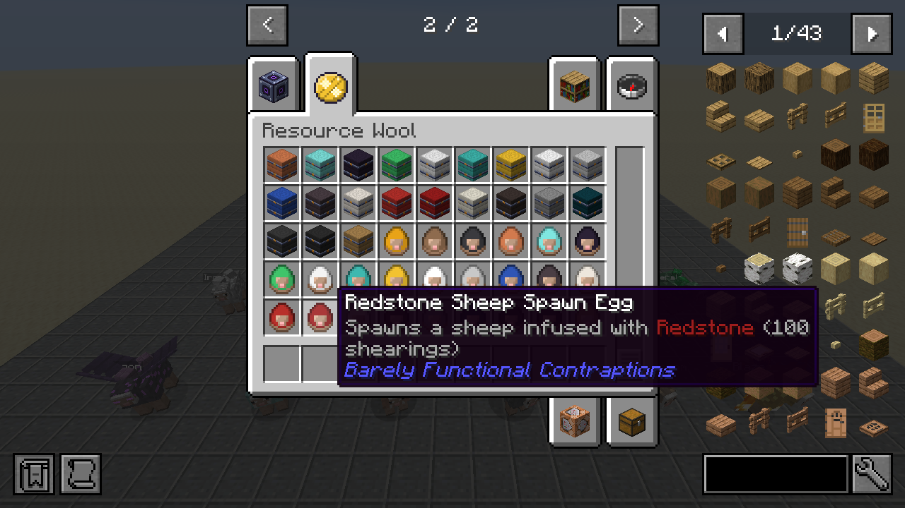

### Infusion Altar

Every sheep is infused here. The resource goes in the centre with 2 of its blocks and a rarity item round it: Wheat for common sheep, a Golden Carrot for uncommon, a Golden Apple for rare and an Eye of Ender for epic. The legendary Wither, Dragon and Warden sheep take bigger catalysts and more power. Stand a sheep within 2 blocks. The altar slows the sheep while it works, and can outline the area the sheep must stand in, like the Automatic Shears and Blaze Furnace. Tier 1 resources work there too, so it can infuse a pen on its own.

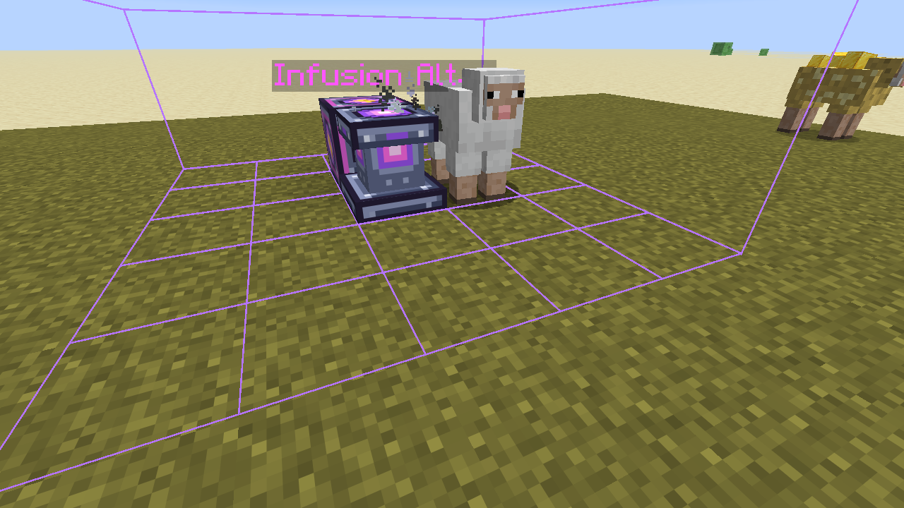

### Breeding Sheep

Every sheep has Yield, Growth and Endurance from 1 to 10. A lamb gets its parents' average with a chance of going up, so breeding your best sheep raises a line toward 10.

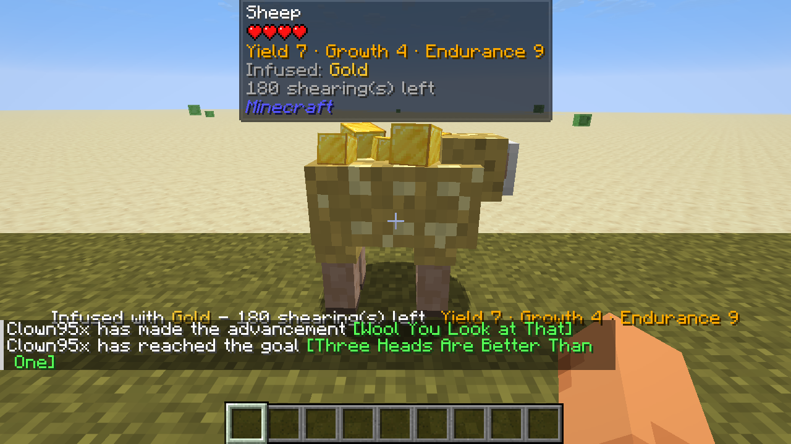

### Powered Furnace

Smelts anything a Furnace can, on power instead of fuel, in a little over half the time. Blaze sheep standing round it speed it up further: about x1.5 with two, x1.8 with four.

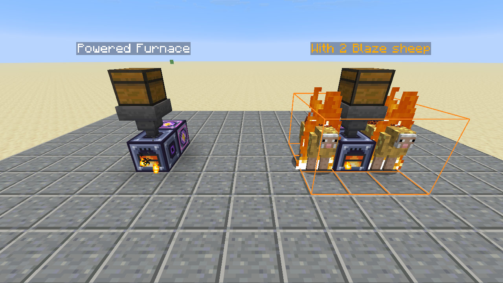

### Snow Sheep Chiller

The Blaze Furnace's icy opposite: Snow sheep standing round it freeze water into Ice, one every 5 seconds with one sheep and about every 1.5 with four. It needs no power, just a bucket of water per Ice, and hoppers can take the Ice out.

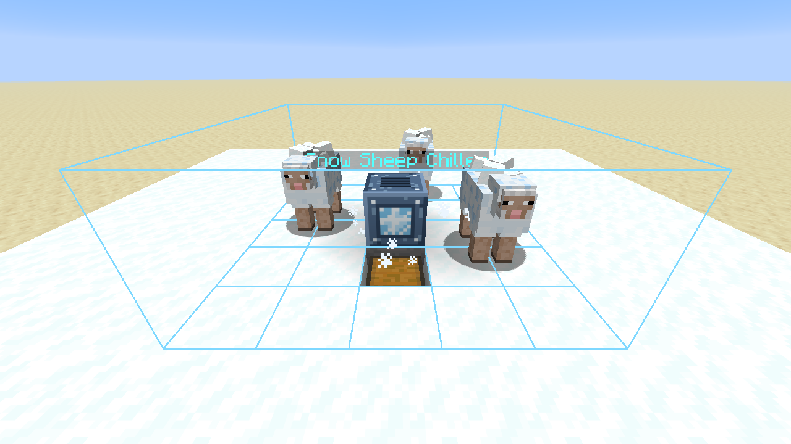

### Grass Seeder

Keeps a sheep pen green. It turns the dirt your sheep have eaten bare back to grass and grows short grass for them, and sheared sheep in its area graze four times as often, so their wool grows back much sooner. It runs on Bone Meal, or on FE and water.

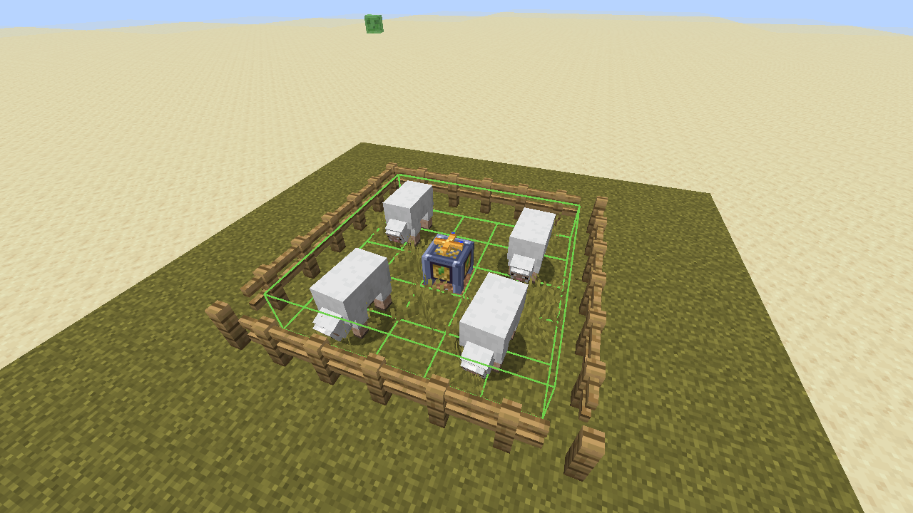

### Fleece Trawler

A dockside winch that fishes the pool in front of it, powered by **Tide sheep** (a new themed sheep with fins and gills) swimming in the water. Give it resource wool as a lure and it hauls up that resource as well as fish; now and then its net tangles and needs cutting free.

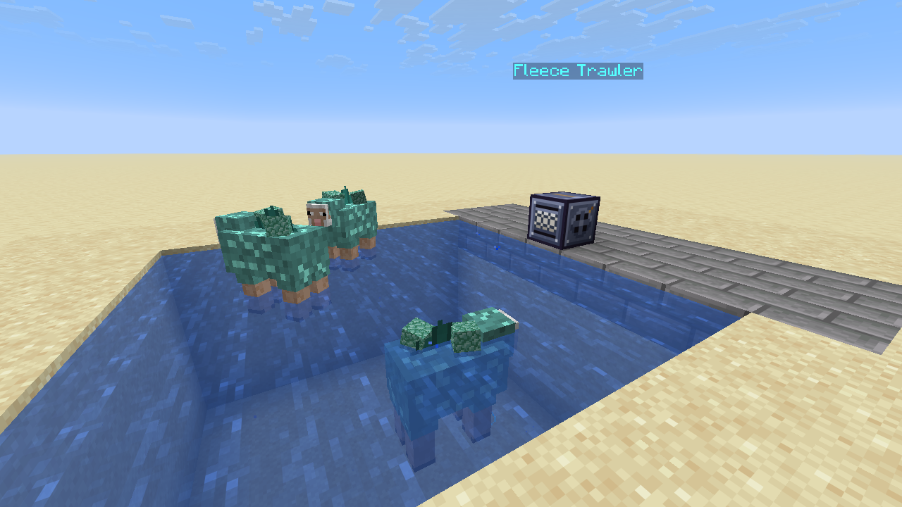

### Implosion Chamber

Cracks **Cobblestone into Gravel, and Gravel into Sand**, with the blasts of **Explosive sheep** in the pen round it. Every 5 seconds it lights one sheep's fuse with a little power; the sheep pops its fleece off (breaking nothing) and the blast cracks 8 items a step. Explosive sheep regrow their wool on their own in about 20 seconds, ready for the next one.

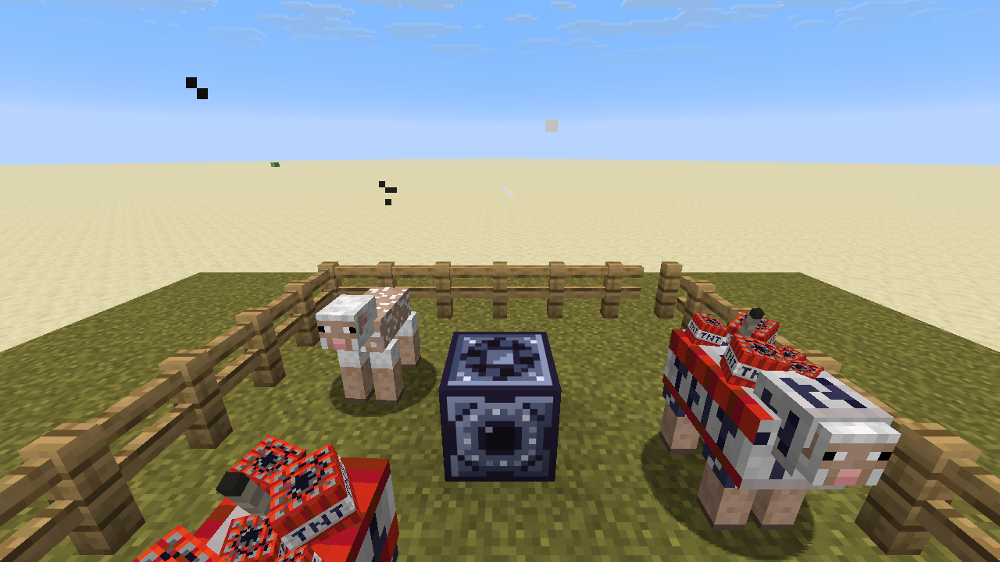

### Herd Counter

A little screen that counts the sheep in the pen in front of it (all of them, the ones ready to shear, the sheared ones, lambs, or ones low on infusion, of every resource or just one) and puts the count on a comparator. Use it to run shears, seeders or breeders only when they're needed.

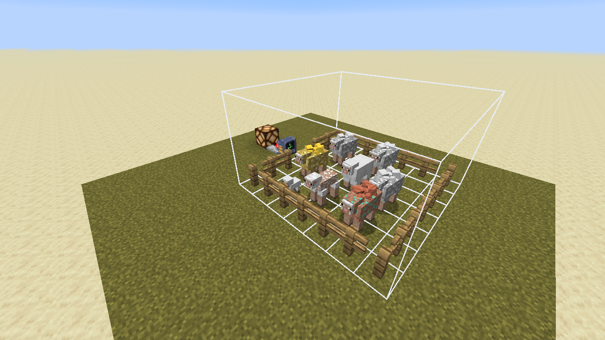

### Wool-Lined Crate

A crate that holds lots of one kind of item (2,048 of most things) and shows it on its front. Its wool lining takes the colour of what it holds (or dye it yourself), pack Wool Bales in to make it bigger, and lock it to its item. Overfill it and it bursts at the seams, unless you strap it shut.

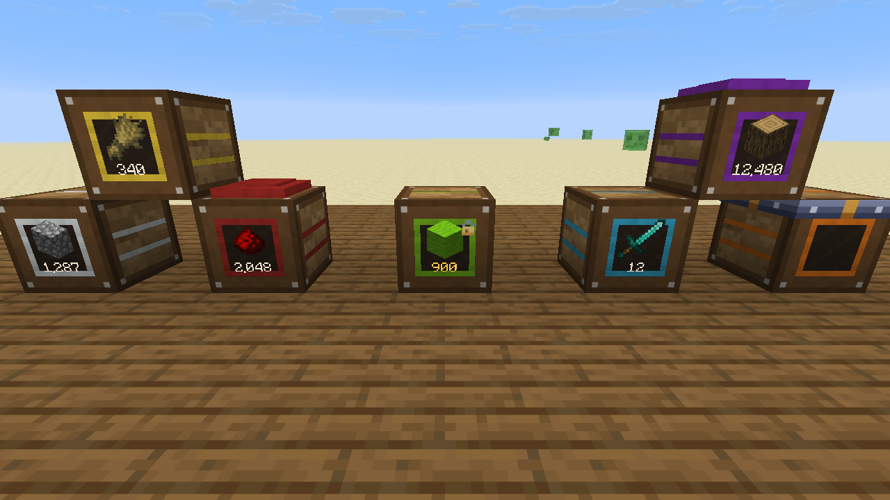

### Crate Controller

Links your Wool-Lined Crates into one store: crates touching it join by themselves, others link with the wrench. Pipes and hoppers on the controller reach every crate, items find the crate they belong in, and the whole store shows as one line on a Machine Status Panel.

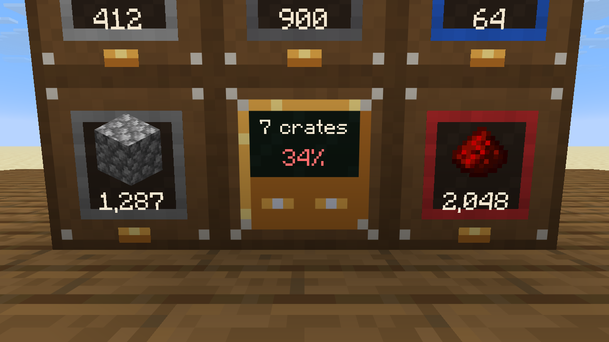

### Machine Status Panel

A wall screen that shows how your machines are doing, all in one place: link them with the Barely Functional Wrench and each gets its name, its status (green, amber, red or grey) and a key number. A comparator reads how many have a problem, for an alarm.

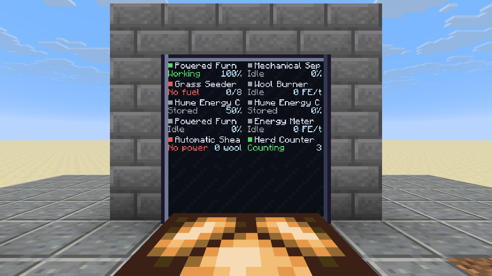

### Wool Machines

The Mechanical Separator turns resource wool back into 2–4 of its resource, string and sometimes a bonus. Automatic Shears shear every sheep in front of them and keep the wool for hoppers and pipes.

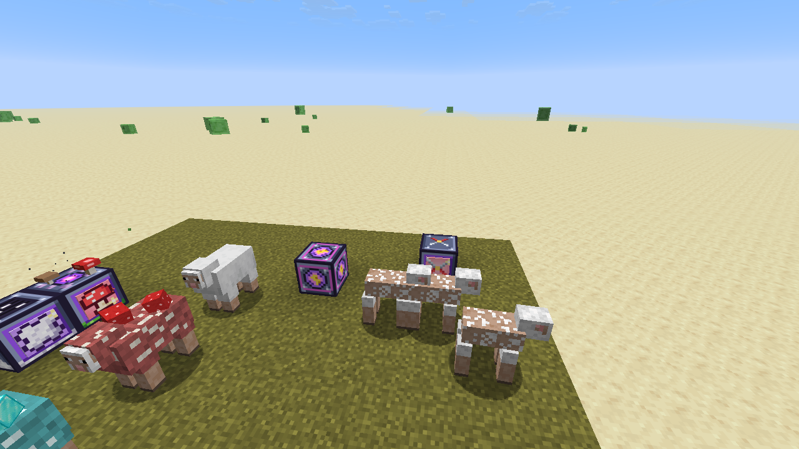

### Fluid Reservoir

Placed on an infinite water source, it makes a bucket of water a second and pushes it into tanks and generators beside it.

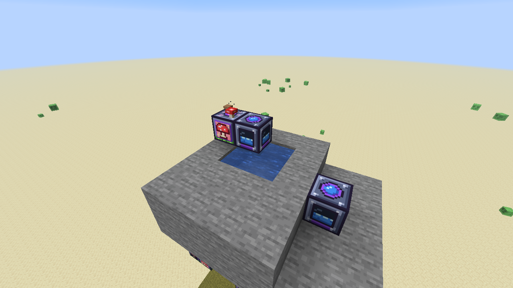

## Utility

### Getting Started

Every machine is built round a Functional Machine Block, crafted from iron, copper and redstone. Generators make FE, sheep grow resources, and Mushroom sheep feed the generators. Sneak-right-click a sheep with an empty hand to see what it is infused with.

The mod's creative tab is split into the same sections as the manual, and the Resource Wool tab into wool, bales and spawn eggs. Click a section's banner to fold it away, or open it again.

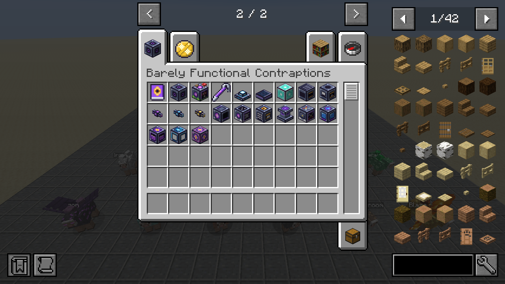

### Wrench and Links

The Barely Functional Wrench links Mycelial Generators into one network up to 64 blocks apart, and links machines to a Machine Status Panel and crates to a Crate Controller. It also sets the sides of pipes, and hitting any contraption with it picks it up at once, straight into your inventory with whatever was inside.

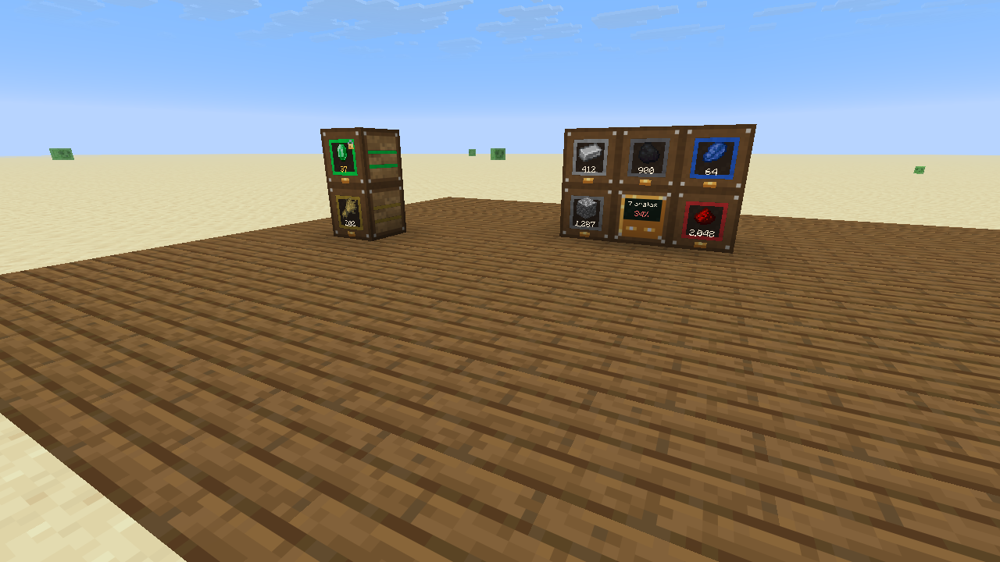

### Woollen Armour

Knit a full set from any coloured wool, in the leather armour shapes: a Beanie, a Jumper, Leggings and Boots. Each piece takes the colour of the wool it's made from, and mixed wool blends the colours. It can be dyed like leather afterwards, is a little tougher and longer lasting than leather, mends with wool, and keeps you from freezing in powder snow.

While you wear the **Woollen Boots** you're **Muffled**: you make no sound, from footsteps and landing to eating and getting hurt, and sculk sensors, shriekers and Wardens can't hear you. It wears off 2 seconds after you take them off.

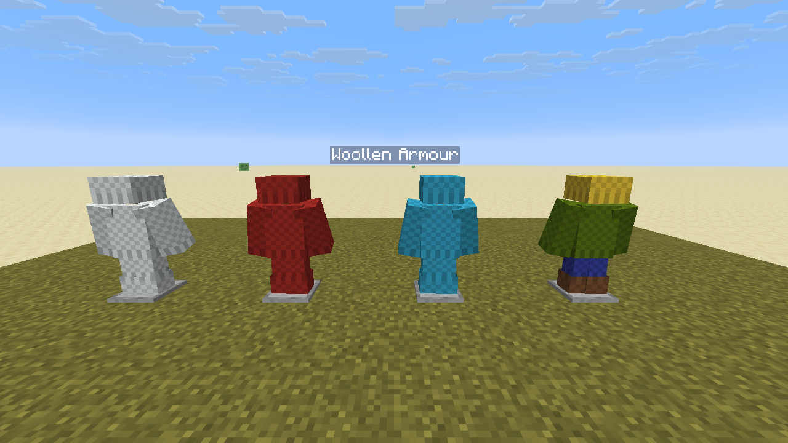

### Data Packs

Sheep, Wool Burner fuels, furnace heat sources and separator recipes are all data. `/bfc generate` makes a sheep for every material in the modpack, and every number can be changed in the config (see *Make it your own* above).

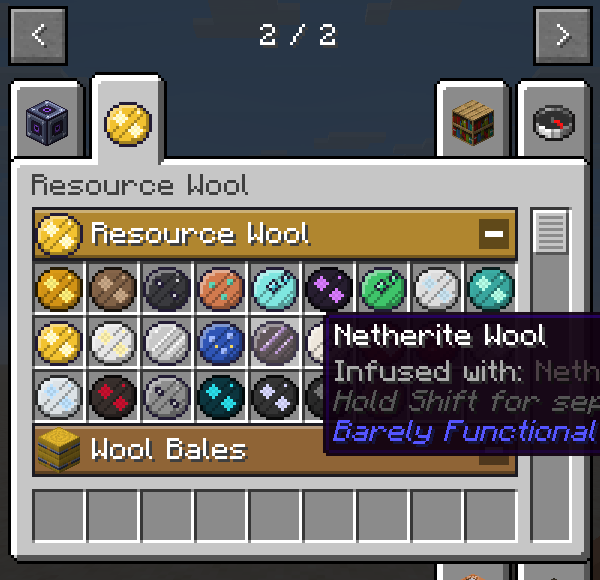

---

Requires NeoForge 26.1, 26.2 or 26.3 (download the jar for your Minecraft version) and Java 25; JEI and Jade are optional. The full guide to every block, setting and data-pack format is in [docs/REFERENCE.md](docs/REFERENCE.md). Test results are in [TESTING.md](TESTING.md). Report bugs on the [bug report form](https://forms.gle/8xG9pMoQnTG6MVo1A). MIT licensed.

Automated test provided by Claude
