# Barely Functional Contraptions


A NeoForge mod for **Minecraft 26.3** (Java 25) that combines two systems, **Mycelial Power** and **Resourceful Sheep**, into one mod. They share one mod id (`barelyfunctionalcontraptions`), one jar, one config screen and two creative tabs (machines and tools, and resource wool), and they are built to work together:

* **Mycelial Power:** the **Mycelial Generator** burns mushrooms and water to make **Forge Energy (FE)**. Generators that touch, or are linked with the **Barely Functional Wrench**, form networks whose output grows **exponentially**. Running generators slowly spread **mycelium** and sprout **huge mushrooms**.
* **Resourceful Sheep:** feed sheep blocks, ingots and gems to **infuse** their wool, shear them for **resource wool**, and turn the wool back into resources in the FE-powered **Mechanical Separator**. The **Fluid Reservoir** draws water from an infinite source to keep generators supplied.

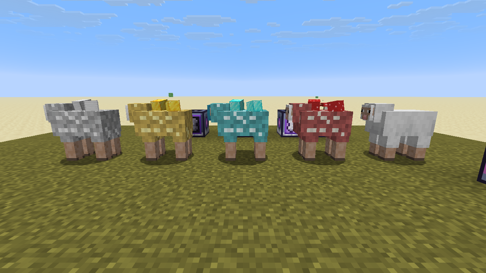

| Mycelial Generator | Mechanical Separator | Mushroom sheep |
|---|---|---|
| 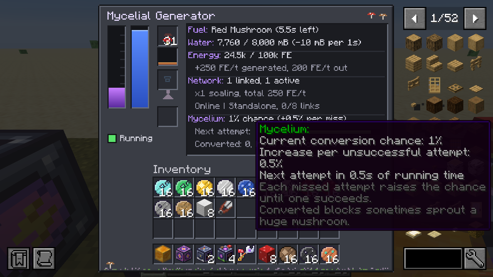 | 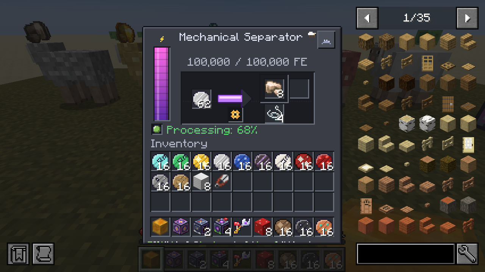 | 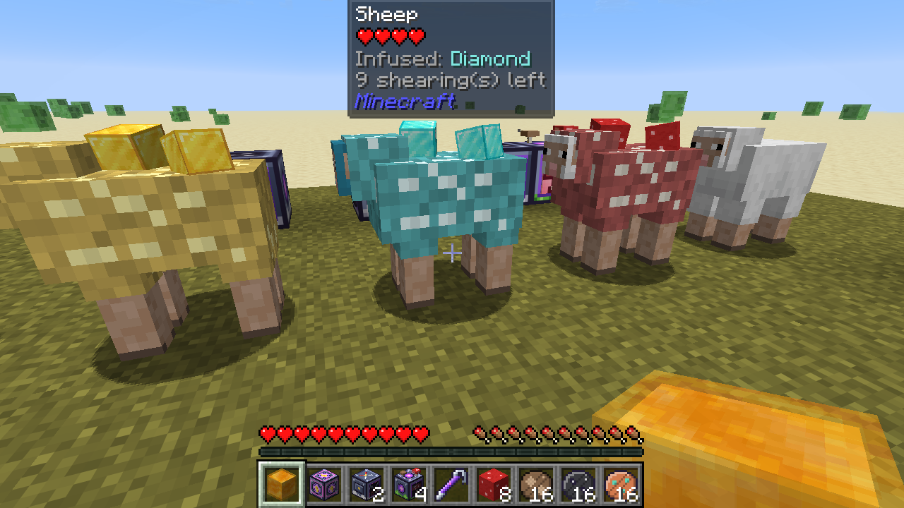 |

*Real screenshots, captured in-game with `./gradlew runClient -PscreenshotHarness`.*

| | |
|---|---|
| Minecraft | 26.3 |
| NeoForge | 26.3.x (built against 26.3.0.101) |
| Java | 25 |
| JEI (optional) | 31.x for 26.3 (built against 31.17.0.109) |
| Jade (optional) | 26.3.x for NeoForge (built against 26.3.5) |

---

## How the two halves work together

```
 mushrooms ──────► feed a sheep ──► shear ──► Mushroom Wool (×100 shearings)
      ▲                                                                │
      │ mycelium spread                                                ▼
 Mycelial Generator ───────── FE (no cables needed) ──────────► Mechanical Separator
      ▲                                                                │
      └──────────────── Red / Brown Mushrooms (fuel) ◄─────────────────┘
```

1. **Generators power separators directly.** Both use NeoForge's standard energy capability, so a Mycelial Generator placed against any energy face of a Mechanical Separator (back, left, right, top or bottom) pushes FE into it. One generator makes 200–250 FE/t, which is exactly what a separator uses for most wool. FE cables from other mods work too.
2. **Mushroom sheep.** Two new built-in sheep resources, **Red Mushroom** and **Brown Mushroom**, are infused with a **Red/Brown Mushroom** (100 shearings per feeding by default). The separator turns each Mushroom Wool into **2–4 mushrooms** + 2 String, with a 5% chance of a **Mycelium** block. Those mushrooms are the Mycelial Generator's fuel.
3. **The loop closes.** Running generators spread mycelium and grow huge mushrooms, which give you mushrooms for the sheep. The sheep give you mushrooms for the generators, and the generators power the separators that process all your other resource wool.
4. **One mod.** Two creative tabs side by side (*Barely Functional Contraptions* for the machines and tools, *Resource Wool* for every wool type, including ones added by data packs and the generate command), one entry in the mod list, one config button listing all four config files, and one JEI and Jade plugin set.

The integration is covered by GameTests, which run in [`IntegrationGameTests`](src/main/java/com/jax3/barelyfunctionalcontraptions/gametest/IntegrationGameTests.java). See [TESTING.md](TESTING.md).

## Installation (players and servers)

1. Install NeoForge 26.3.x for Minecraft 26.3.
2. Put `barelyfunctionalcontraptions-1.5.0.jar` in the `mods/` folder of the client **and** the server.
3. Optional: install JEI 31.x and/or Jade 26.3.x. The mod runs normally without them.

**Machine fronts:** all three machines share one look. Each has a purple-rimmed glass window on its front: a red mushroom in the generator, a wool block in the separator and a pair of shears in the Automatic Shears. The window is dark while the machine is idle and glows with a pulsing halo and sparkles while it runs. The separator and shears also give off a little light while running.

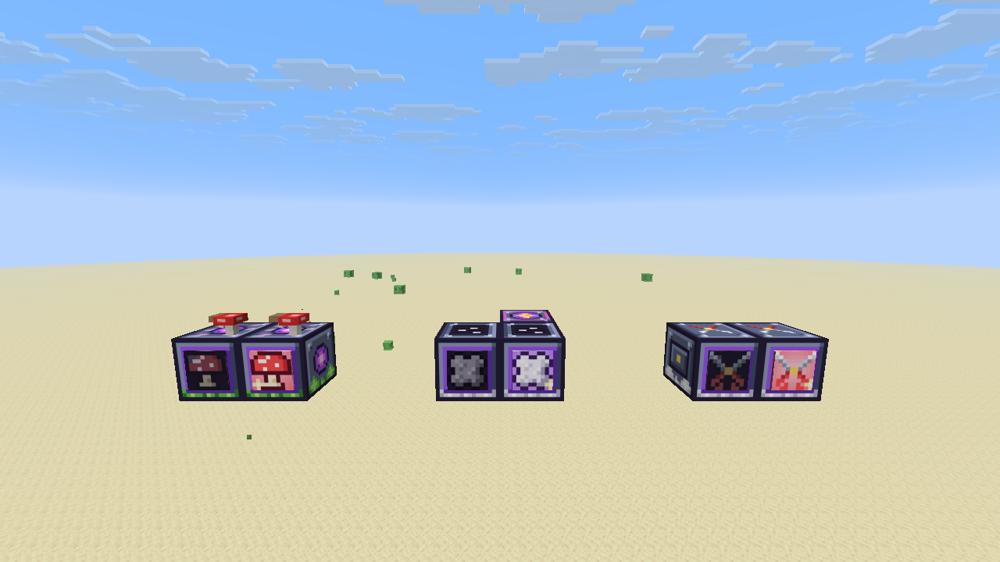

| Creative tab: machines and tools | Creative tab: Resource Wool |
|---|---|
| 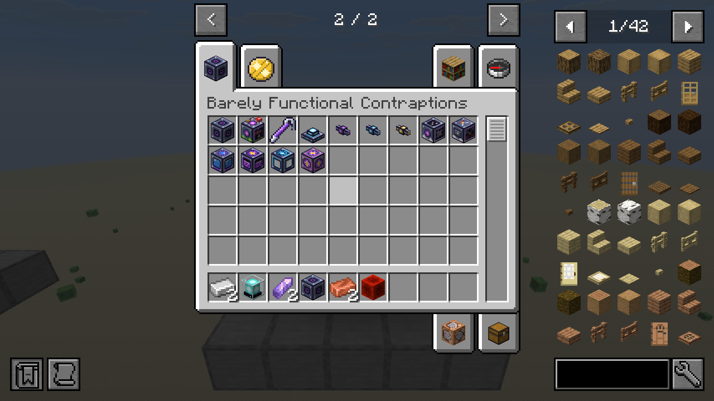 | 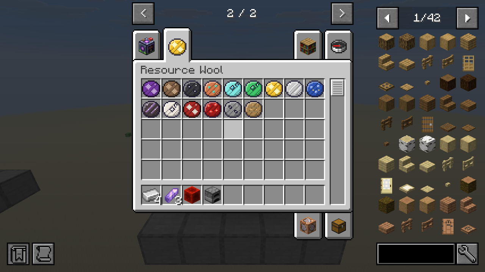 |

### Contraptions Manual (in-game guide)
Craft a **Contraptions Manual** (a book and a redstone dust) and right-click it to read about everything in the mod in game: getting started, each generator and machine, the sheep, fluids, energy, Glow Panels, pipe modes and filters, and data packs.

| Chapters | A chapter |
|---|---|
| 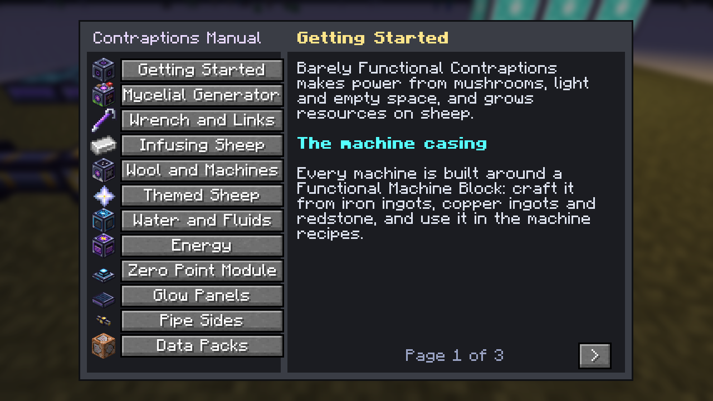 | 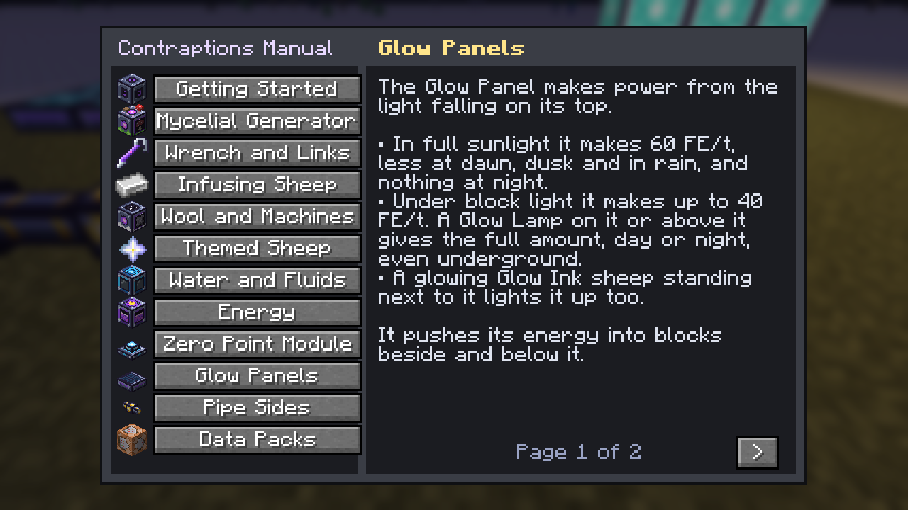 |

- Pick a chapter on the left; long chapters turn over with the arrow buttons.
- The text lives in `assets/barelyfunctionalcontraptions/guide/en_us.json`. A resource pack can replace it or add a translation (`guide/<language>.json`, e.g. `de_de.json`), which is used when the game is in that language. Each chapter has a `title`, an `icon` item and a list of `text` paragraphs; a paragraph starting with `## ` is a heading and one starting with `- ` is a list item.

### Functional Machine Block

Every machine is built around a **Functional Machine Block**: the blue-steel casing of the machines on its own, with corner bolts and an empty, unlit port in the middle. Craft it from 4 iron ingots, 4 copper ingots and 1 redstone, then put one in the recipe of the Mycelial Generator, Mechanical Separator, Automatic Shears, Fluid Reservoir or Hume Energy Cube. It can also be placed as a decorative block (stone pickaxe, drops itself).

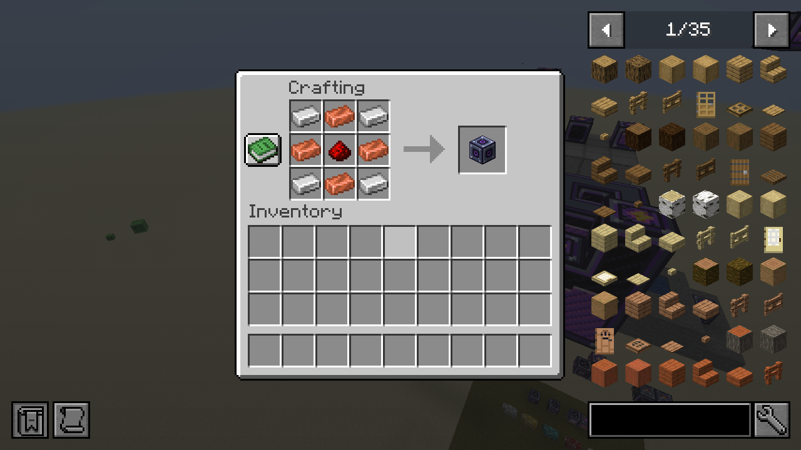

**Placing machines:** every block in the mod sounds like an Iron Block when placed, broken or walked on. the Mycelial Generator, Mechanical Separator and Automatic Shears place with their front facing you. **Hold Shift while placing** to make the front face away from you instead (handy for pointing the shears at a pen from outside it, or the separator's back at a cable).

---

### Advancements

The mod has its own advancement tab, **Barely Functional Contraptions**, with one advancement for making each machine, three special ones, one for each themed sheep and a wool-collecting challenge:

| Advancement | How to get it |
|---|---|
| **Barely Functional Contraptions** | Make a Functional Machine Block (opens the tab) |
| It's Alive... Ish | Craft a Mycelial Generator |
| Some Assembly Required | Craft a Barely Functional Wrench |
| ⭐ **Fungal Network** (goal) | Link two Mycelial Generators together with the Barely Functional Wrench |
| Separation Anxiety | Craft a Mechanical Separator |
| Hands-Free Haircut | Craft Automatic Shears |
| ⭐ **Shear Genius** (goal) | Be within 16 blocks of Automatic Shears when they shear a sheep |
| Bottomless Bucket | Craft a Fluid Reservoir |
| Hume Sweet Hume | Craft a Hume Energy Cube |
| Think Tank | Craft a Fluid Tank |
| Something From Nothing | Craft a Zero Point Energy Module |
| ⭐ **Don't Cross the Streams** (challenge, hidden) | Get vaporised by a Zero Point beam. It stays hidden until you earn it and gives 50 experience. |
| Plugged In | Craft some Energy Cables |
| Pipe Dreams | Craft some Fluid Pipes |
| Special Delivery | Craft some Item Pipes |
| Watt's Going On | Craft an Energy Meter |
| Let There Be Glow | Craft a Glow Panel |
| Wool You Look at That | Infuse a sheep with any resource |
| Hay There, Night Light, Bare Bones, Charred to the Bone, Eight Legs, Four Hooves, Too Hot to Shear, Scream and Shout | Infuse a sheep with a Hay Bale, Glow Ink Sac, Bone Block, Wither Rose, Spider Eye, Blaze Rod or Ghast Tear |
| ⭐ **Three Heads Are Better Than One**, **Here Be Dragons**, **Shh... It's Sculking** (goals) | Infuse a sheep with a Nether Star, Dragon's Breath or Echo Shard |
| ⭐ **Fleece of Every Colour** (challenge) | Collect one of each of the 24 built-in resource wools. Its progress shows which ones you still need, and it gives 100 experience. |

A data pack's own resource can have an advancement too: put it at `data/barelyfunctionalcontraptions/advancement/contraptions/sheep/<name>.json` with a `minecraft:impossible` criterion named `done`, and infusing a sheep with `barelyfunctionalcontraptions:<name>` grants it.

The crafting advancements are earned by getting the item into your inventory however you make it (crafting table, autocrafter or a friend handing it over).

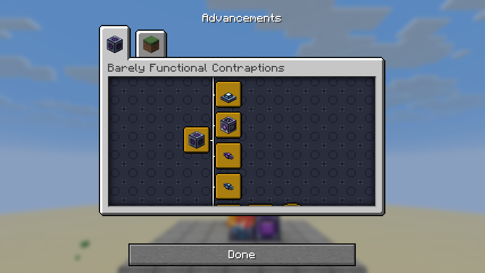

## Mycelial Power

### Crafting

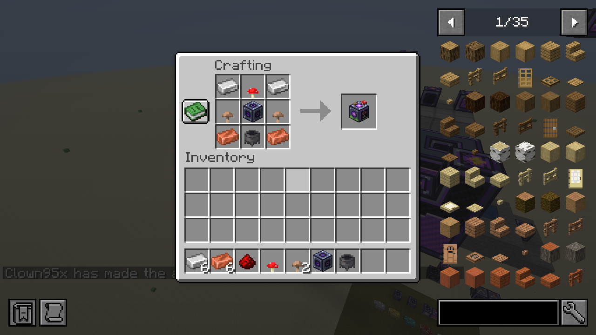

The generator is mined with any pickaxe and drops itself. Its inventory is dropped when it is broken.

### Running a generator

1. Place it. The front window, with a red mushroom behind the glass, faces you. The mushroom lights up and pulses while the generator runs, and stays lit while it is only paused by a full energy buffer.
2. **Water:** right-click with a water bucket, put a bucket in the bucket slot (the empty bucket comes out below), or pipe water in.
3. **Fuel:** put red or brown mushrooms (or any configured fuel) in the top slot. Hoppers and pipes can insert from any side.
4. Energy is pushed into adjacent cables and machines (any block exposing NeoForge `IEnergyStorage`). Pipes can also pull it out.

| Fuel (default) | Burn time | Energy | FE/t alone | FE per item |
|---|---|---|---|---|
| Brown Mushroom | 400 ticks (20 s) | ×1.0 | 200 | 80,000 |
| Red Mushroom | 600 ticks (30 s) | ×1.25 | 250 | 150,000 |

A generator stops when it runs out of fuel or water. When its buffer is full it pauses and keeps its fuel progress (configurable).

### Networks

Generators connect automatically in all six directions. By default only **running** generators count towards `N`, so a network grows as more members are fed. Networks update instantly when generators are placed, broken, loaded or unloaded. Generators in unloaded chunks simply stop counting, and **no chunk is ever loaded by the mod**. Networks are capped at 64 members by default.

### Barely Functional Wrench (wireless links)

A stylized crowbar, in the same art style as the blocks: purple-painted shaft, steel claw and chisel tip.

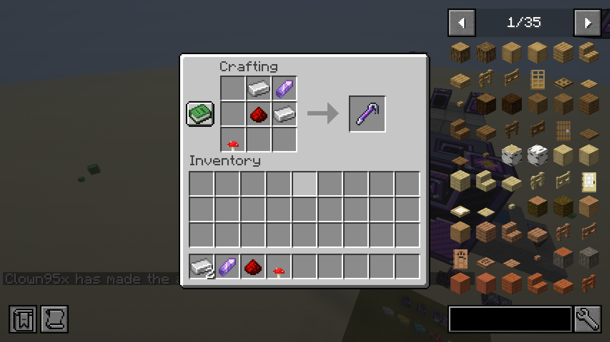

* **Right-click** a generator to select it. It gets a purple outline while you hold the wrench, and the wrench glints.
* **Right-click another generator** to link them. Red and white particles run between the two, the action bar confirms the link, and the wrench flashes with the enchantment glint for 2 seconds.
* **Shift + right-click** a generator to remove all of its manual links. Shift + right-click the air to clear the selection.
* Linked generators form **one network**, exactly like touching ones, and every running member counts towards the exponential boost. Touching and linked generators can be mixed freely. Each generator keeps its own mushrooms, water and energy (unless the server enables resource sharing).
* By default, links reach **64 blocks**, each generator can have **8** links, links stay in one dimension, and wrenches never wear out. All of this is configurable in `[network.wrench]`.
* Links are saved with the world. Breaking a generator removes its links. A link to a generator in an unloaded chunk is kept, and only counts while both chunks are loaded; the mod never loads chunks to keep a link working.
* The generator GUI's status line shows how it is connected (*Physical*, *Manual*, *Physical + manual* or *Standalone*) and its link count.

#### Wireless power to machines
The wrench can also power a **Mechanical Separator** or **Automatic Shears** from a generator that isn't touching it.

* **Right-click the generator, then the machine** (or the machine first, then the generator). The same red and white particles run between them.
* The generator sends the machine FE as if it were touching it. This comes out of the generator's normal output (`outputTransferRate` per tick), after any machines it actually touches. When it powers several machines, it shares the energy evenly between them.
* One generator can power up to **8** machines (`max_power_links_per_generator`), within the usual **64 block** limit (`max_link_distance`), in the same dimension. A machine can be powered by several generators.
* Machines don't join the generator's network, so they don't count towards its boost.
* **Shift + right-click a machine** to remove its wireless links. Shift + right-clicking a generator removes all its links, including wireless ones.
* Right-clicking a machine with the wrench selects it instead of opening its GUI.
* Breaking the machine or the generator removes the link. Links are saved with the world, and they only carry power while both blocks are loaded.
* Which machines can be powered is the block tag `#barelyfunctionalcontraptions:wireless_power_receivers`. A data pack can add other mods' FE machines to it.
* **Generator screen:** a small **wireless button** (signal bars) under the *Running* lamp. The bars are purple while linked machines are getting power, yellow when every link is idle, and grey with no links. Next to it, a count shows how many machines are powered out of how many are linked, e.g. *2/2*. **Hover over the button** for the details: the limit, the FE/t being sent, and each machine with its position. Machines in unloaded chunks are marked *(not loaded)*, and links a lowered range limit no longer allows are marked *(inactive)*.

| Linking a generator to two machines | The separator running on wireless power only |
|---|---|
| 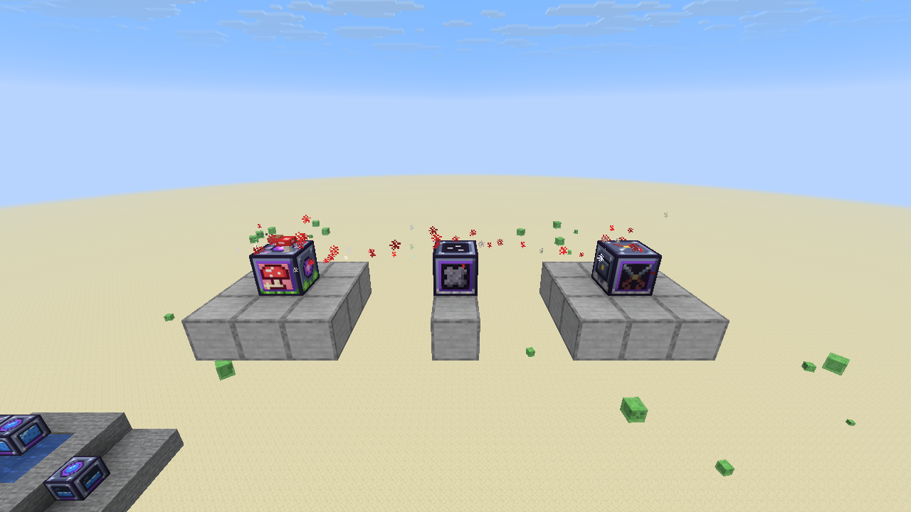 | 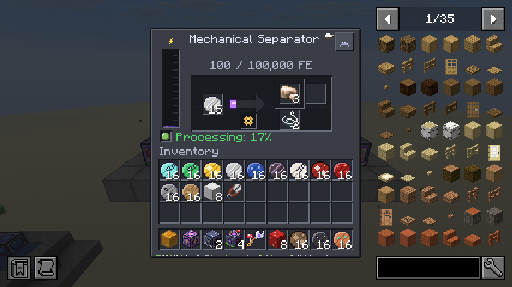 |

| The wireless button under the lamp | Hovering it shows the machines |
|---|---|
| 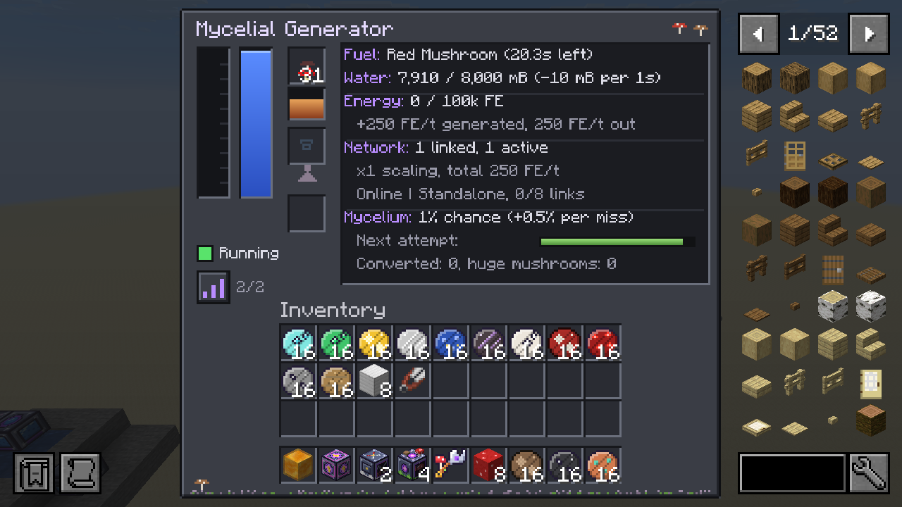 | 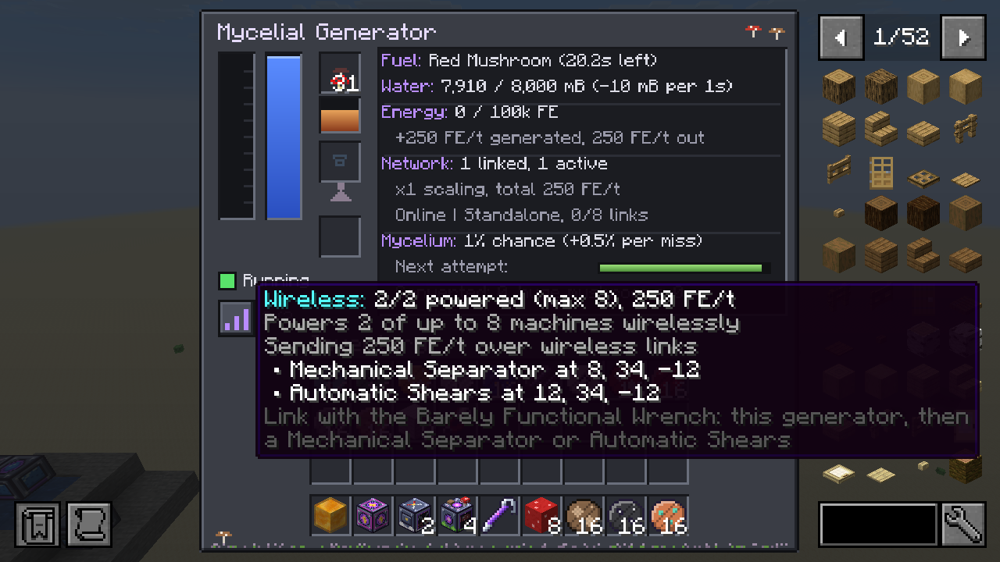 |

### Mycelium

Converted blocks at least 3 blocks from the generator have a 5% chance to sprout a **huge red or brown mushroom**, if there's room. It only grows into empty space and never loads chunks.

Every 100 running ticks a generator tries to convert a dirt block with air above it, within 4 blocks, into mycelium. The first attempt has a 1% chance. Each failed attempt adds 0.5 percentage points, so attempt 100 has 50.5% and attempt 199 is guaranteed. After a success the chance resets. Attempts with no valid dirt nearby do not change the chance. Conversions fire a block place event so claim and protection mods can block them, and they respect spawn protection and the world border.

### GUI

* Bars: **energy** (left) and **water tank** (right). The orange box is the remaining burn time of the current mushroom.
* The info panel shows fuel and time left, water and consumption rate, stored, generated and extracted FE, network size, active count, multiplier, total FE/t and status, and the mycelium chance, increase, next-attempt progress, conversions and huge mushrooms grown this session.
* Hover over any bar or line for exact numbers and explanations. The lamp shows the machine state.
* All values are computed on the server and sent to the viewing player.

---

### Jade (optional)
With [Jade](https://www.curseforge.com/minecraft/mc-mods/jade) installed (26.3.x for NeoForge), looking at a Mycelial Generator shows:
- **State** (Running, No fuel, No water, Energy full) and the **FE/t** it is generating.
- The **mushroom burning** and how long it has left, with a fuel progress bar.
- **Network** size, active generators and scaling, and the network's total FE/t when several generators are linked.
- Stored **energy**, the **water tank** and the **fuel slots**. These come from Jade's built-in support for NeoForge's energy, fluid and item capabilities.

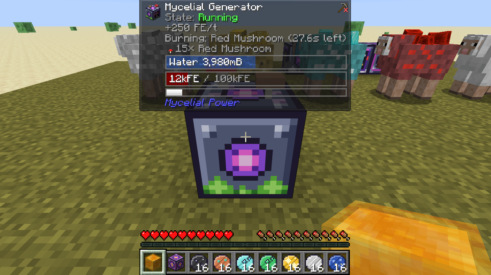

Each part can be switched off in Jade's settings under *Plugins → Barely Functional Contraptions*. Jade is optional: the mod runs fine without it.

Full configuration reference: [docs/CONFIGURATION-MYCELIAL.md](docs/CONFIGURATION-MYCELIAL.md). Defaults: [docs/barelyfunctionalcontraptions-mycelial-synced.toml](docs/barelyfunctionalcontraptions-mycelial-synced.toml).

Adding a modded fuel takes one line in `config/barelyfunctionalcontraptions-mycelial-synced.toml`:

[fuel]
	fuels = ["minecraft:brown_mushroom;burn=400", "minecraft:red_mushroom;burn=600;energy=1.25", "#c:mushrooms;burn=400"]
```


---

## Resourceful Sheep

### 1. Infuse a sheep
Right-click an **adult** sheep while holding a resource, for example an **Iron Ingot**.

- One item is consumed (this is configurable). You'll see coloured particles and hear a chime.
- The sheep's fleece takes on the resource colour with glinting strands, and **small blocks of the resource grow out of it**: Blocks of Iron on an iron sheep, Blocks of Diamond on a diamond sheep, Red Mushroom Blocks on a red mushroom sheep, Cobblestone on a stone sheep. The cluster shrinks as the infusion is sheared away. The block is the resource's storage block (`<name>_block`, found from the feeding item or the separator output), or the item itself when it is already a block (Oak Log). A data pack can choose another with `growth_item`.
- Its dye colour still shows through slightly, so a blue diamond sheep looks different from a white one.
- **Each infusion lasts 100 shearings by default**, whatever the resource (`infusionUsesOverride` in the config). Set that to `-1` to use each resource's own count instead: iron, gold, copper, redstone, lapis and coal last **9** shearings, and diamond, emerald, netherite scrap, cobblestone, oak log, quartz and the mushrooms last **1** or **3**.
- Feeding an item that isn't a resource does nothing special, so wheat breeding, dyes and so on work as normal.
- Sneak + right-click a sheep with an empty hand to see its infusion and how many shearings it has left.
- **Breeding keeps the infusion.** Breed infused sheep with wheat as normal and the lamb is born infused with its parents' resource, with a **full set of shearings**. Its fleece shows the resource colour straight away, and the resource blocks grow in once it's an adult. Its wool, like any lamb's, can only be sheared once it has grown up.
  - Two parents with **different** resources (Diamond + Emerald) pass on **one of the two at random**.
  - **One** infused parent is enough by default, so an Iron sheep and a plain white one have an Iron lamb (set `breedingNeedsBothParents` to require both).
  - The parents keep their own infusions, so a pair of infused sheep can breed a whole flock. Set `breedingKeepsInfusion` to false to turn this off.

  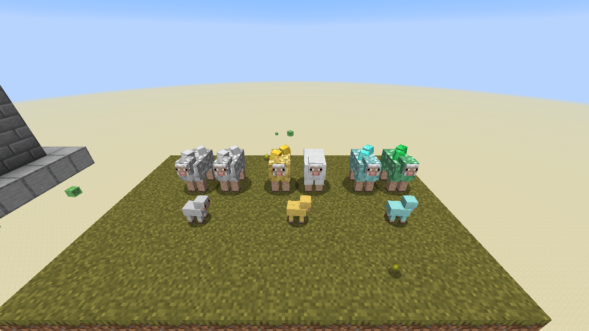

### 2. Shear it
Shears and dispensers both work. An infused sheep drops **resource wool** (e.g. *Iron Wool*) **instead of** its normal wool. When the infusion runs out the sheep goes back to normal.

**Or kill it.** An infused sheep that still has its wool drops a little more when it dies than one shearing gives: **one extra resource wool** (2 Iron Wool instead of 1) **plus the resource itself**, one separator's worth of it (2–4 Raw Iron for an iron sheep, 2–4 Diamonds for a diamond sheep). Its mutton still drops. Shearing is still the better deal over time, since a living sheep can be sheared again and again; killing gets you a bigger payout once. A sheep that has just been sheared has no wool, so killing it gives only normal loot. Any death counts, including mob farms. Turn it off or tune it with `killDropsEnabled`, `killWoolBonus` and `killDropsResource`.

### 3. Separate the wool
Put the wool into a **Mechanical Separator** and supply Forge Energy (FE).

| Example | Value |
|---|---|
| Input | 1 Iron Wool |
| Energy | 20,000 FE (200 FE/t) |
| Time | 100 ticks (5 s) |
| Output | **2–4** Raw Iron (random each time) + 2 String (+10% chance of 3 Iron Nuggets) |

**Balance:** every wool separates into **2–4** of its resource (3 on average). With the default of 100 shearings per feeding, one Iron Ingot yields about 300 Raw Iron and one Diamond about 300 Diamonds, so infused sheep **multiply** resources a lot. (With `infusionUsesOverride = -1`, one Iron Ingot gives about 27 Raw Iron and one Diamond about 3 Diamonds.) The cost is the shearing time and the machine's energy. To tone it down, lower `primaryOutputMultiplier` (e.g. `0.34` brings it back to about 1 per wool), lower `infusionUsesOverride` (or set it to `-1`) or `infusionUsesMultiplier`, or set `primary_count` per resource.

### Crafting the separator
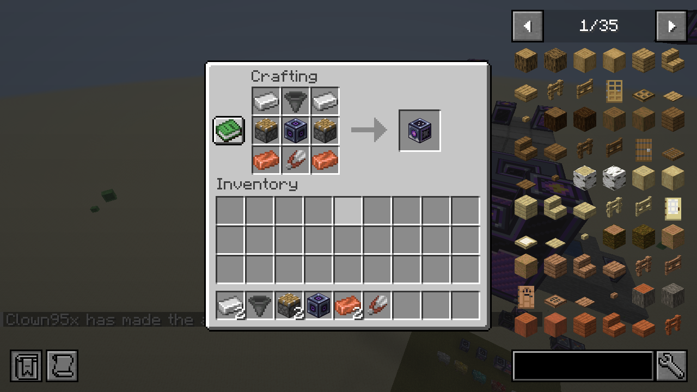
- Requires a stone pickaxe or better.
- Hardness 3.5, blast resistance 6.
- When broken, it keeps its stored energy and redstone mode.

### Automatic Shears
An FE-powered machine that shears sheep for you and keeps the wool.

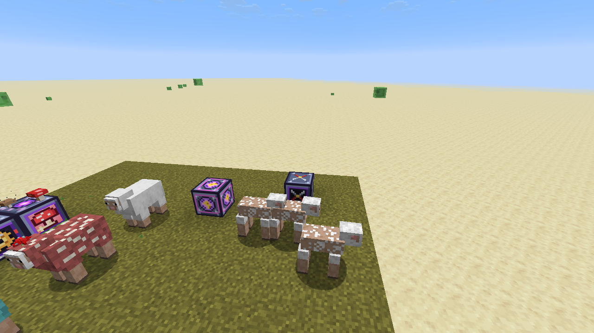

- **Where it shears:** the **3×3 area in front of its face** (the face with the crossed blades, which points at you when you place it). That's the three block columns 1–3 blocks out, one column either side, from one block below the machine to one block above it. A sheep counts when its feet are in that area.
- **Power:** it runs on Forge Energy and uses **2,000 FE per sheep sheared** (`energyPerShear`). It holds 50,000 FE and accepts up to 1,000 FE/t on every face except the front, from any FE cable or generator. A Mycelial Generator placed against its back powers it directly. Without enough FE it waits, showing *No Energy*.
- **How often:** every second by default (`shearInterval` in `[automatic_shears]`), shearing every ready sheep in the area each time. Once a sheep eats grass and regrows its wool, it gets sheared again.
- **Infused sheep:** these work exactly like hand shears. They drop their resource wool and use up one infusion shearing.
- **GUI:** right-click to open it. It's in the same style as the Mechanical Separator: an energy gauge, a status lamp and line (*Waiting for Sheep*, *Shearing*, *No Energy*, *Storage Full*, *Disabled by Redstone*), the redstone button, a shears icon that snips while it works, a bar counting down to the next sweep, and its 9 storage slots. Hover over things for details.
- **Inventory:** 9 slots. Take the wool out by hand (shift-click works), or put a **hopper underneath** (or any pipe) to pull it out automatically. Nothing can be put *into* it. A comparator reads how full it is.
- **When it's full:** it stops shearing until there is room again, so wool is never thrown away. If one sheep's drops only partly fit, the rest drop on the ground at the sheep.
- **Redstone:** the same four modes as the separator, cycled with the button in the top-right corner: *Ignored* (default), *Active with Signal*, *Active without Signal*, *Disabled*.
- **Which mobs:** only those in the entity tag `#barelyfunctionalcontraptions:auto_shearable`, which is sheep by default. It never turns a mooshroom into a cow or takes a snow golem's pumpkin.
- Its shears never wear out. Mine it with a stone pickaxe or better. When broken it keeps its stored energy and redstone mode, like the separator, and its wool drops on the ground.

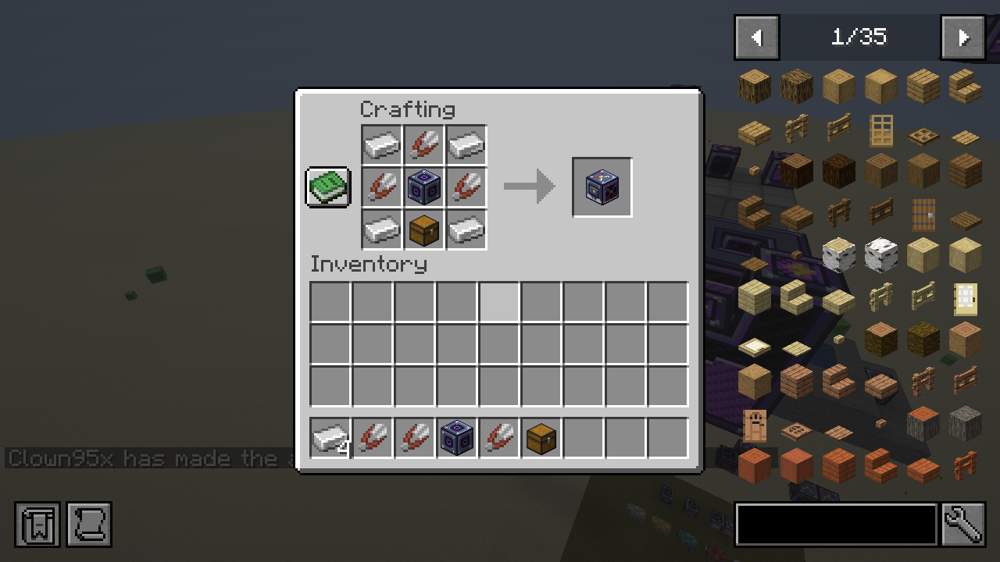

| GUI |
|---|
| 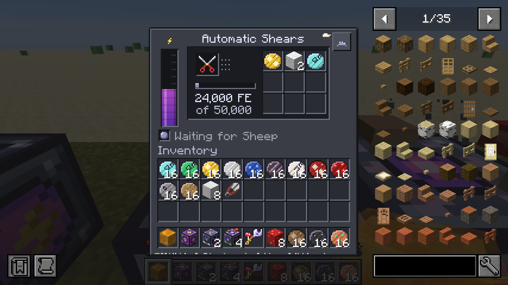 |

### Fluid Reservoir
A water source for your machines. Put it **directly on top of an infinite water source** and it fills its **10-bucket tank** with water.

| In the world | GUI |
|---|---|
| 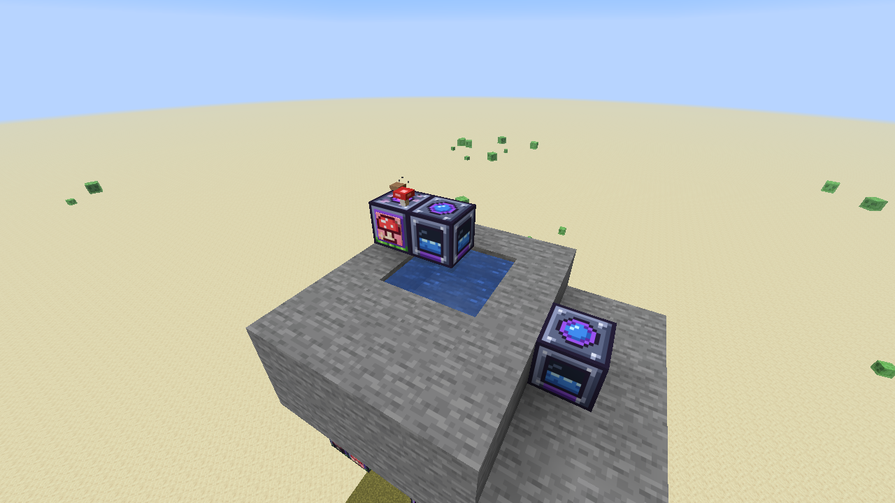 | 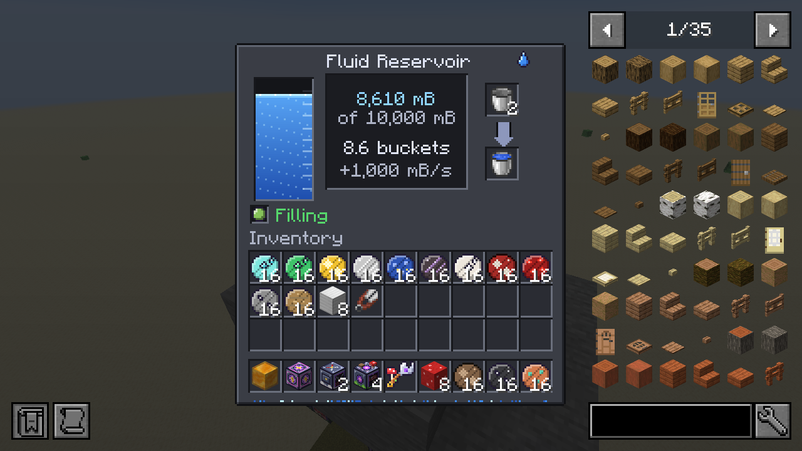 |

- **Infinite source:** the water block under it must refill itself, by vanilla's rule: it needs **at least two neighbouring water sources** and something solid (or more water) under it. A 2×2 pool, or the middle of a 3-long line, works. A lone source, or two sources side by side, does not. The source is never used up. Set `requireInfiniteSource = false` to allow any water source.
- **Speed:** 1 bucket (1,000 mB) a second by default (`waterPerSecond`), so it fills in 10 seconds. It then stops until water is taken out.
- **Getting water out:**
  - Right-click it with an empty bucket (or any other fluid container) to fill it.
  - Put empty buckets in the top slot of its GUI; it fills them into the bottom slot. Hoppers and pipes can also feed in empty buckets and take water buckets out.
  - Pipes can pull water from any side.
  - It **pushes water into tanks beside it or on top** (up to 1,000 mB/t, `outputPerTick`). A **Mycelial Generator placed next to it never runs dry**.
- Nothing can be poured *into* it. It's a water source, not a storage tank.
- **Windows:** the glass on its sides shows the water level. A comparator reads how full it is.
- **GUI:** right-click with an empty hand. It shows a water gauge with a mark per bucket, the stored amount, the bucket slots, and a status lamp: *Filling*, *Tank Full*, *Source Not Infinite* or *No Water Source*. Hover over things for details.
- Mine it with a stone pickaxe or better. The water in it is lost when it's broken.


Any glass block works.

### Hume Energy Cube
A Forge Energy battery. FE goes **in and out on every side**, and **cubes that touch join into one bigger battery**: every cube adds to the group's buffer and its transfer rate.

| Groups connect into one casing | From below |
|---|---|
| 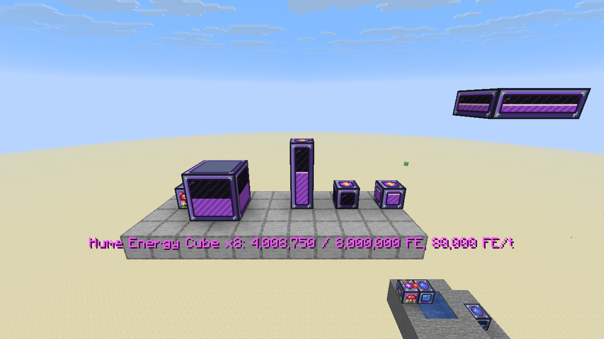 | 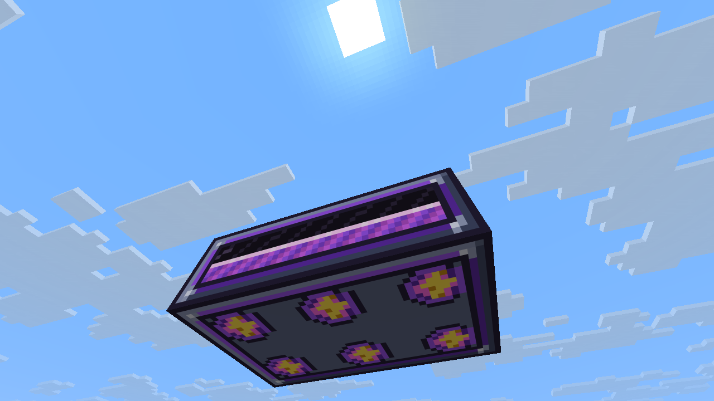 |

Any shape works, not just full boxes. L-shapes, rings and walls with bends get proper inside corners where the frame turns. Where the structure folds inward (a wall standing on a slab, a staircase), each face keeps its frame along the fold, so a window never runs into the plate beside it.

| Inside corners | Folds (wall on a slab, staircase) |
|---|---|
| 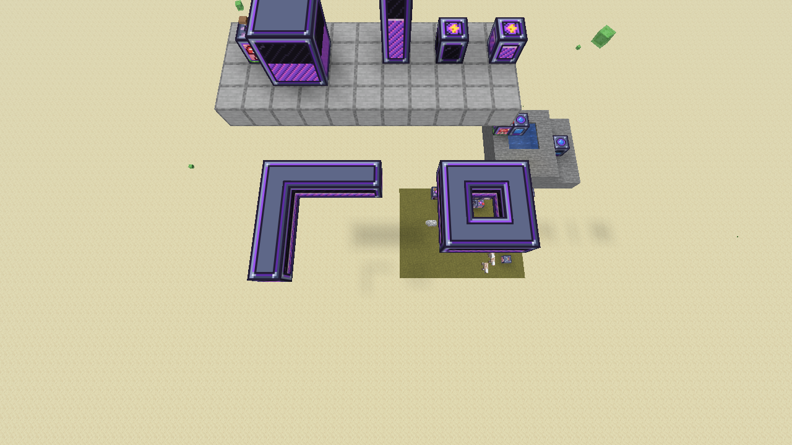 | 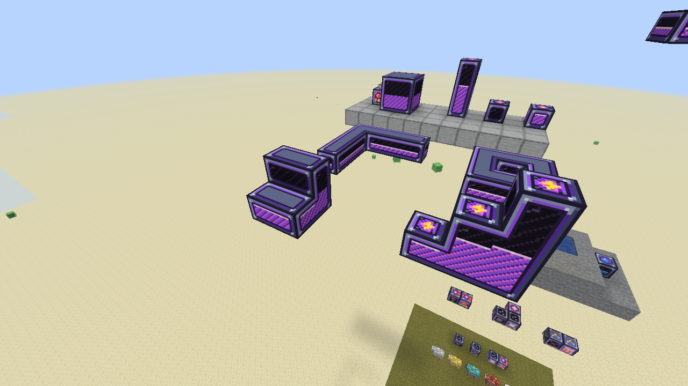 |

- **One cube:** 1,000,000 FE buffer, 10,000 FE/t transfer rate (`capacityPerCube`, `transferPerCube`).
- **A group of N touching cubes** (faces touching, in any shape) has **N x** the buffer and **N x** the transfer rate. A 2x2x2 block of 8 cubes holds 8,000,000 FE and moves 80,000 FE/t. Every cube in the group shares the same energy, so you can feed one end and take power out of the other.
- **Output:** the group **pushes energy into any machine or cable touching it** (`autoOutput`), up to its transfer rate each tick. Machines and cables can also pull from it, and any generator or cable can charge it. It never pushes into other cubes.
- **Breaking a cube** splits the group if it was holding it together. Each cube keeps its own share of the energy, and a broken cube keeps its share in the item (shown in its tooltip), so no energy is lost.
- **Looks like one big block:** touching cubes connect. Their frames only run around the outside of the group, so a 2x2x2 group looks like a single large cube with one big window, and a tower looks like one tall tank. The windows fill with swirling purple energy **from the bottom layer up**, like a tank of liquid: a 2-high stack at 75% shows a full bottom layer and a half-full top layer. The top and bottom join into one plain metal plate (only a cube with nothing beside it, like a lone cube or the top of a one-wide tower, shows the purple bolt port), and the cubes glow brighter as they charge. A comparator reads how full the group is.
- **GUI:** right-click a cube to open it. It's in the same slate style as the other machines:
  - an energy gauge with a mark for every eighth;
  - the stored energy and buffer (*4,020,500 FE of 8,000,000 FE*);
  - the group's cube count and transfer rate (*x8 · 80,000 FE/t*);
  - the energy actually flowing **in** and **out**, averaged over the last second;
  - a status lamp: *Charging*, *Discharging*, *Full*, *Empty* or *Idle*.
  It shows the whole group, whichever cube you open. Hover over things for details.

  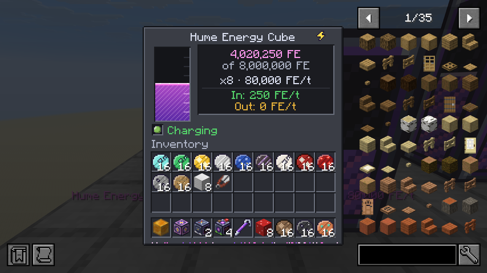
- **Wireless:** a Mycelial Generator can charge a cube from a distance with the Barely Functional Wrench, like the other machines.
- Groups are limited to 64 cubes (`maxGroupSize`); extra cubes form another group. Mine it with a stone pickaxe or better.

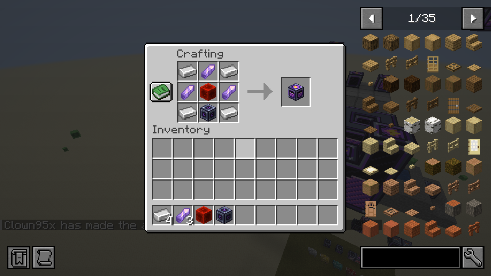

### Fluid Tank
The Hume Energy Cube's twin for fluids. It stores **one fluid** (water, lava or any modded fluid) behind **glass windows**, so you can see the level, and touching tanks join into **one big tank** with the same connected casing as the cube.

| Water, lava and an L of tanks | Up close |
|---|---|
| 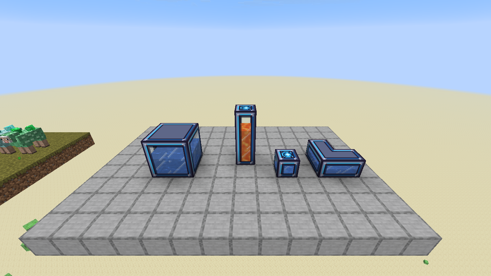 | 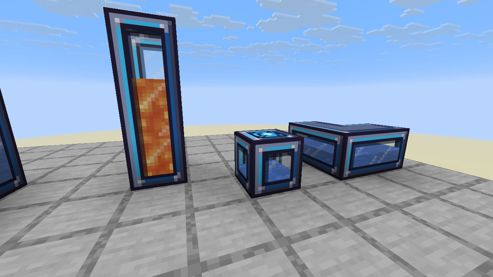 |

- **One tank:** holds **16,000 mB** (16 buckets) and moves up to **1,000 mB/t** (a bucket a tick) in or out.
- **Multiblock:** tanks touching on any face form **one tank**. Every tank adds 16,000 mB to the capacity and 1,000 mB/t to the transfer rate, up to 64 tanks. It fills **from the bottom up** like a real tank: the bottom layer fills first, the tanks of a layer share their fluid evenly, and the windows show **one level running across the whole group**. Tanks holding different fluids never join, even when they touch.
- **Connected casing:** the frame drops where tanks touch, so a 2x2x2 looks like one big tank with one window on each side and one plain top plate. Inside corners turn properly, just like the Hume Energy Cube. A lone tank shows a blue valve on top.
- **Filling and emptying:** right-click with a **bucket** (or any fluid container) to pour it in or take it out. Fluid goes in and out on **every side**, so Fluid Pipes, the Fluid Reservoir and other mods' pipes all work. The tank also **pushes its fluid into machines touching it** every tick, such as a Mycelial Generator's water tank (`autoOutput`), but never into another tank.
- **With Fluid Pipes:** pipes give fluid to **machines first** and fill tanks with what's left. They never move fluid from one tank to another, so two tanks on one network don't pass it back and forth. The tank pushes into pipes itself.
- **Breaking:** a broken tank keeps **its own share** of the fluid; the item's tooltip shows *Holds 7,000 mB of Lava*. Place it again and the fluid is back.
- **GUI:** right-click with an empty hand. The gauge shows the fluid's own texture and colour, along with the fluid's name, *mB of capacity*, the group size and rate, and the flow in and out over the last second. The status lamp reads *Filling*, *Draining*, *Full*, *Empty* or *Idle*.

  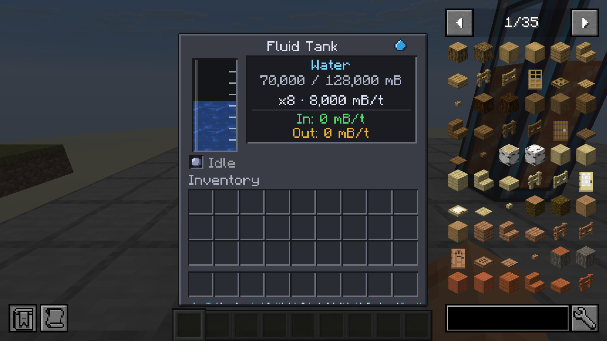
- A **comparator** reads how full the whole group is. Lava glows through the glass. Mine it with a stone pickaxe or better.

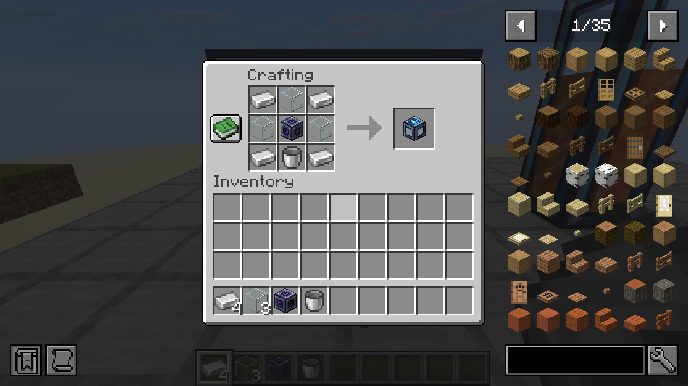

### Zero Point Energy Module
A generator that comes in pairs. Put one module on the floor and another on the ceiling **directly above it**, or one on each of **two walls facing each other**, with open space between them. The two link with a **blue beam** and make Forge Energy out of the gap: **the farther apart they are, the more power they make**.

| A linked pair, 5 blocks apart | Jade on the floor module |
|---|---|
| 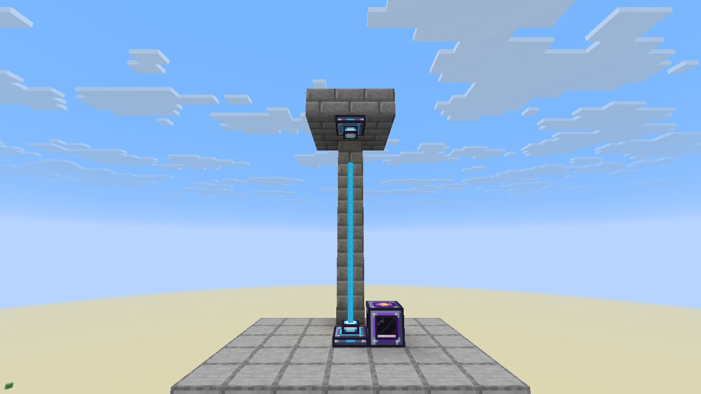 | 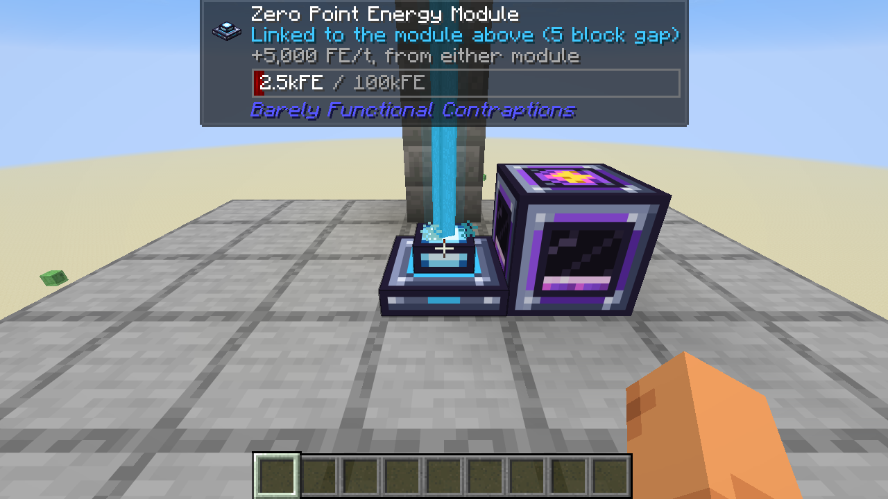 |

- **Placing:** it goes on like an end rod, pointing **away from the block you place it against**. On top of a block the emitter points **up**, on the underside of a block (a ceiling) it points **down**, and on the side of a block (a wall) it points **straight out from the wall**.
- **Sideways pairs:** two modules on facing walls work exactly like a floor and ceiling pair: same power per block of gap, same beam (stained glass colours it, and it burns anything that walks through it), same GUI. A beam running along the floor is a handy mob trap.

  | Wall-to-wall pairs | The GUI of a wall module |
  |---|---|
  | 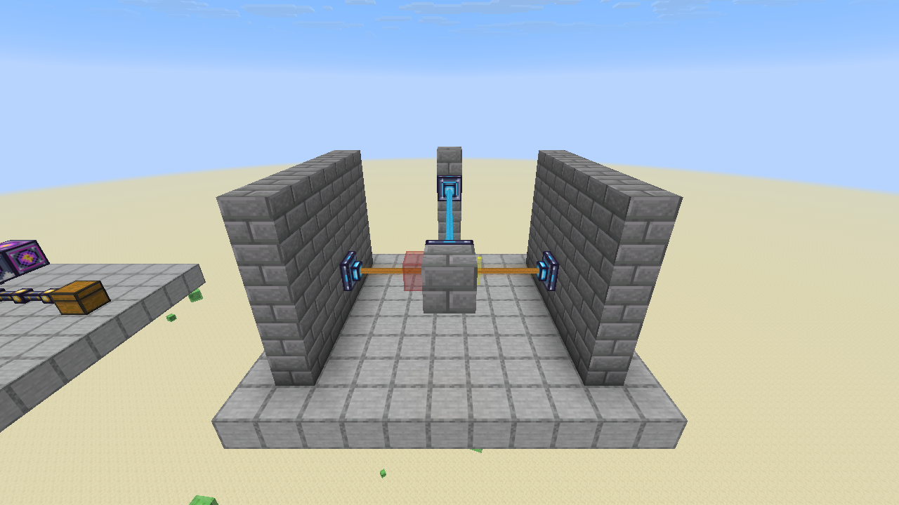 | 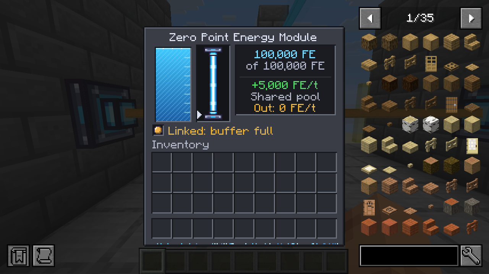 |
- **Linking:** a module links with the **nearest module straight ahead of its emitter** (above it, below it, or across the room) that points back at it. The two must:
  - face each other (two modules pointing the same way never link);
  - have at least one block of open space between them (`minGap`), and be no more than 64 blocks apart (`maxRange`);
  - have nothing solid in the way. The beam passes through air, glass, panes, leaves and anything else see-through, so you can build a glass tube around it. Any solid block breaks the link.
  Modules check for their partner a few times a second, so breaking a block in the way, or one of the modules, switches the beam off almost straight away.
- **Power:** a linked pair makes **1,000 FE/t for every block of gap** (`energyPerBlock`). A 5-block gap makes 5,000 FE/t, and a 63-block gap, the largest, makes 63,000 FE/t.
- **Take it from either end:** the two modules share **one pool of energy**, so **the pair's full output can be taken from either module**. You only need to connect one of them: a machine on the floor module gets all 5,000 FE/t, not half. Each module adds a 50,000 FE buffer to the pool (100,000 FE for the pair).
- **Output:** each module **pushes energy from the pool into every machine or cable touching it**, up to 100,000 FE/t (`maxOutput`), and **never less than the pair's whole output**: if the pair makes more than `maxOutput`, the limit rises to match, so one module can always give out everything the pair makes. Cables can also pull from it. If both ends have machines, they share what the pair makes. Modules don't accept energy and never push into each other.
- **Looks:** while linked, the emitters glow bright blue, pulse and give off light, and blue sparks drift around them. Unlinked modules are dull grey-blue.
- **Sound:** linked modules give off a deep, low **energy hum** (built on 55 Hz) with a faint electric shimmer. It fades in when the beam connects and winds down when it breaks, and bigger gaps hum a little higher. Its subtitle is *Zero Point Energy Module hums*, and it follows the *Blocks* volume slider.
- **The beam burns:** anything living that touches the beam (mobs, animals and players) takes **4 damage** (2 hearts, `beamDamage`) and is **set on fire for 5 seconds** (`beamBurnSeconds`). It keeps hurting them twice a second while they stay in it, and its death message is *"was vaporised by a Zero Point beam"*. Players in creative or spectator mode are safe, and fire-immune mobs like blazes take the damage but don't burn. Set `beamDamage` to 0 for a harmless beam. Dropped items are left alone.
- **Built-in Looting:** mobs the beam kills drop as if killed with a **Looting I** sword (`beamLooting`, up to 10): every stack in their normal drops gets up to one extra item, so a pig drops 1-4 porkchops instead of 1-3. Since they burn to death, meat comes out cooked. Only the mob's own drops get the bonus, not armour or weapons it was holding.
- **Counts as a player kill:** mobs the beam kills **drop experience** and **player-only loot** (blaze rods, a zombie's rare iron ingot, a wither skeleton's skull), just as if you had killed them yourself (`beamCountsAsPlayerKill`). The kill is credited to a fake player called *[Zero Point Beam]*, so it works even when nobody is nearby. A beam-and-hopper mob farm needs no player.

  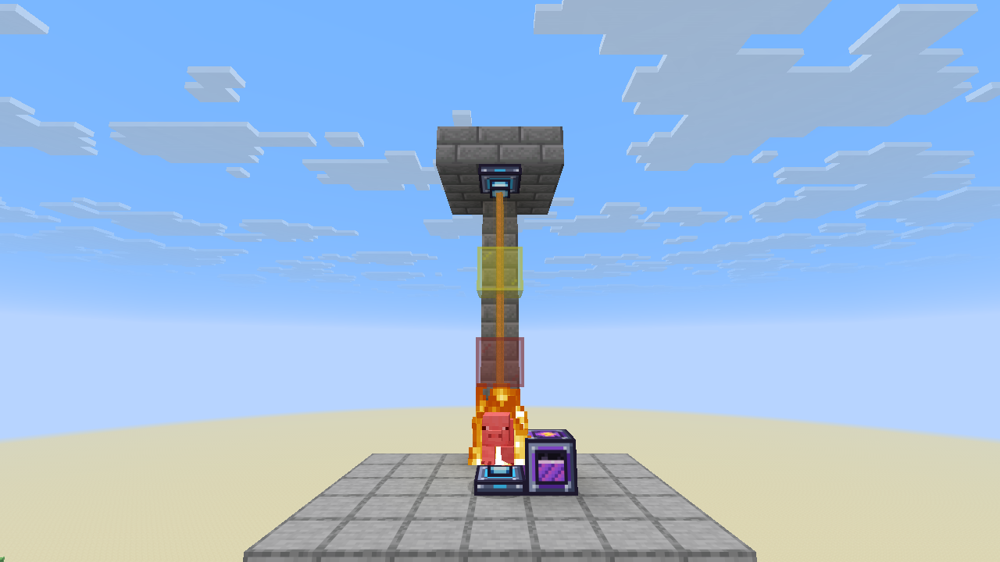
- **Coloured beams:** stained glass colours the beam. Put a stained glass block or pane anywhere in the gap and the **whole beam**, from one module to the other, takes its colour. Several colours mix the way a beacon beam's do (each different colour blends with the colour so far), so red and then yellow make an orange beam. Glass of the same colour in a row changes nothing. The colour is only for looks: the power is the same.

  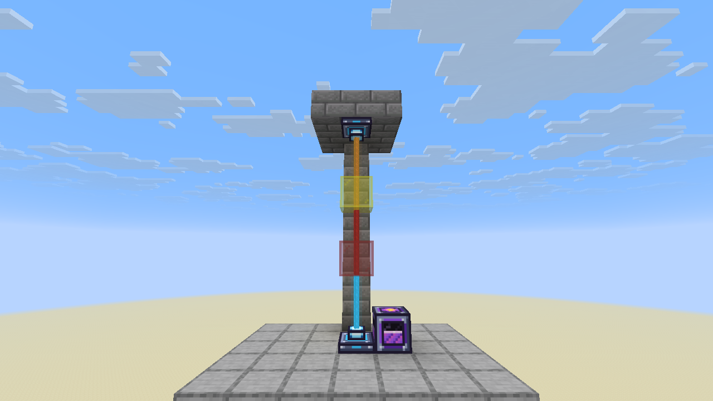
- **GUI:** right-click a module to open it. It's in the same slate style as the other machines:
  - an energy gauge for the pair's shared pool;
  - a **beam diagram**: the column with this module marked by a pointer, and at the far end what it found. When linked, both modules are lit with the animated beam between them. Otherwise it shows why: a blocking block (with a red cross) part of the way along, a partner that points the wrong way, a partner too close, or a dashed outline where a partner should go;
  - the pair's pooled energy (*of 100,000 FE*), what the pair makes (*+5,000 FE/t*, *Shared pool*) and the energy leaving the pool through either module, averaged over the last second;
  - a status lamp: *Linked: 5 block gap* (green), *Linked: buffer full* (orange, nothing is taking the energy), or in red *Beam blocked 3 above*, *Partner faces wrong way*, *Partner too close*, or grey *No module above*.
  Hover over the diagram or the lamp for what to do about it.

  | Linked | Beam blocked |
  |---|---|
  | 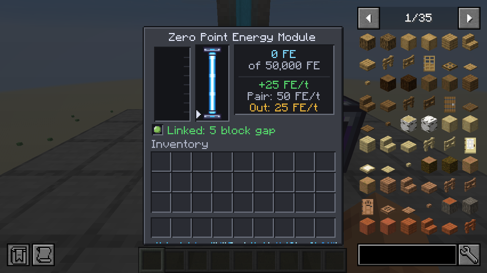 | 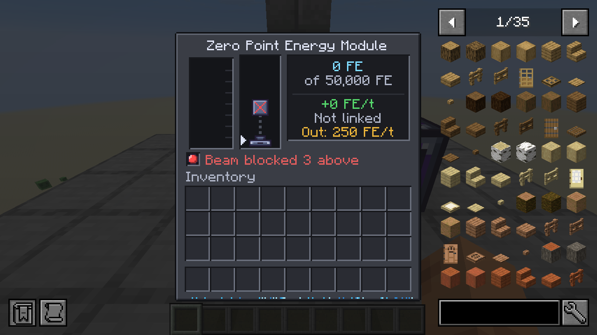 |
- **Jade** shows whether a module is linked, the gap to its partner and how much it and the pair make. If it isn't linked, it tells you it needs a module facing it in the same column.
- The recipe makes **two** modules, one pair. Mine them with a stone pickaxe or better.

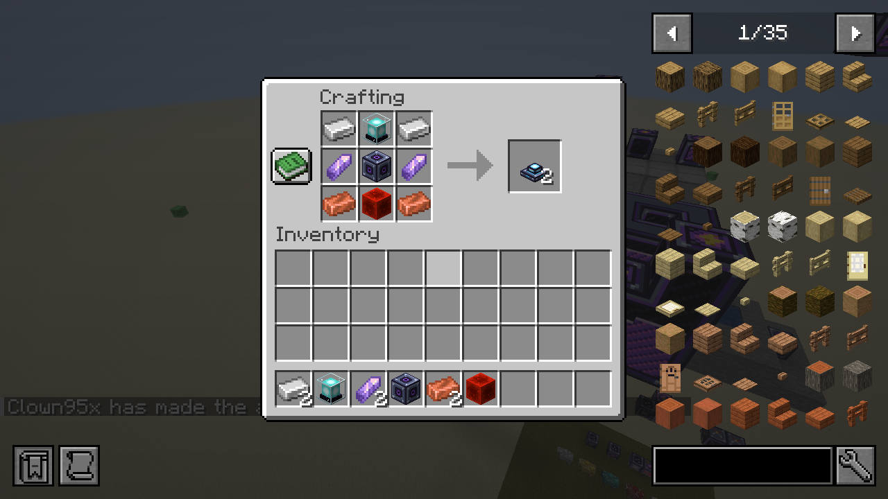

### Glow Panel and Glow Lamp
The **Glow Panel** is a thin, solar-style generator that makes Forge Energy from the **light falling on its top**. The **Glow Lamp** is a full-brightness lamp of glow ink that keeps the panels going at night and underground.

| By day | At night |
|---|---|
| 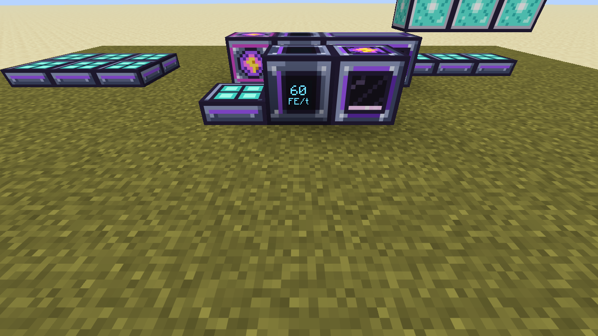 | 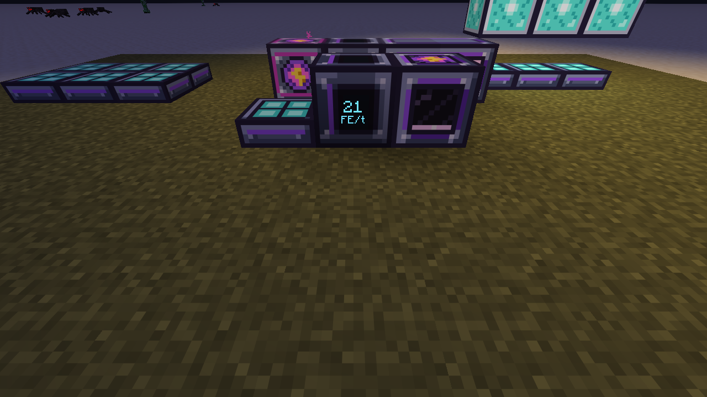 |

- **Sunlight:** with open sky above it, a panel makes up to **60 FE/t** (`sunRate`). It reads the sun the way a daylight detector does: less at dawn and dusk, in rain and in shade, and **nothing at night**.
- **Glow light:** it also makes up to **40 FE/t** (`lightRate`) from **block light** on its top, scaled by the light level. A **Glow Lamp** sitting on it or above it gives the full 40 FE/t, and so does glowstone or any other light-15 block. A glowing **Glow Ink sheep** (light 12) standing right beside a panel lights it to about 29 FE/t. The panel uses whichever of sun or glow gives more.
- **Shade:** a solid block on top that doesn't glow (stone, a machine) shades it completely.
- **Output:** it stores 10,000 FE and pushes up to 1,000 FE/t into blocks **beside and below** it (cables, machines, Hume Energy Cubes, other mods' FE blocks). Cables and machines can also pull from it. Panels don't charge each other, and nothing can be pushed into a panel.
- Its cells light up while it is making power. **Right-click** or **Jade** shows how much it makes and from which light. Every number is in `[glow_panel]` in the synced config.
- **Recipes:**
  - Glow Panel: a row of glass, a daylight detector between two quartz, and iron ingots around redstone.
  - 2 Glow Lamps: glass in the corners, Glow Ink Sacs on the sides and glowstone dust in the middle.
- Mine the panel with a pickaxe. The lamp breaks by hand.

### Energy Cable
Cables carry Forge Energy from the **power generators** (Mycelial Generator, Zero Point Energy Module, Creative Generator) and the **Hume Energy Cube** to the machines that use it, so a machine no longer has to touch its power source.

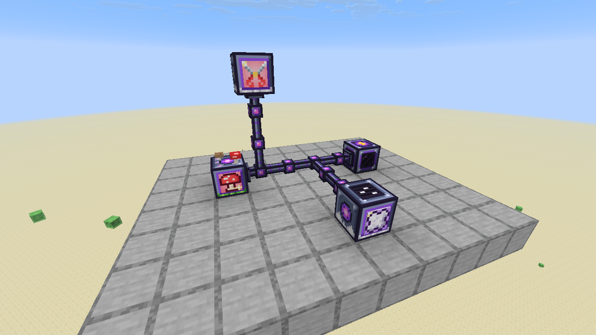

- **Placing:** cables join up with every cable they touch, and **plug into any block with a Forge Energy connection** on the side facing them: generators, cubes, the separator, the shears and other mods' energy blocks. A plugged-in side shows a square plug plate. Blocks with no energy connection (or a side that has none, like the front of the Automatic Shears) are ignored, so cables can run straight past them.
- **Networks:** every cable that touches another forms **one network**. Energy put into any cable comes straight out at the blocks plugged in anywhere else on that network, however long it is, shared evenly between them. Cables don't store energy themselves.
- **Where energy goes:**
  - Energy from a **generator** goes to the **machines first**, and anything they can't take charges the **Hume Energy Cubes** on the network. Put a cube on the network as a battery, and it fills up while the generator makes more than the machines use.
  - Energy from a **Hume Energy Cube** only goes to **machines**, never into another cube, so two cubes on one network don't pass the same energy back and forth.
  - Energy never goes back into the block it came from.
- **Push and pull:** generators and cubes push into cables on their own, and each tick the network also **pulls** from any plugged-in block that has energy to give. A cube with `autoOutput = false`, or another mod's generator that doesn't push, still powers the network.
- **Speed:** a network moves up to **100,000 FE/t** in total (`transferRate`). That is enough for the biggest Zero Point pair.
- **Breaking** a cable splits the network in two right away, and each half only connects what is plugged into it.
- **Jade** on a cable shows the network's size, how many blocks are plugged into it and how much it is moving (averaged over the last second).

  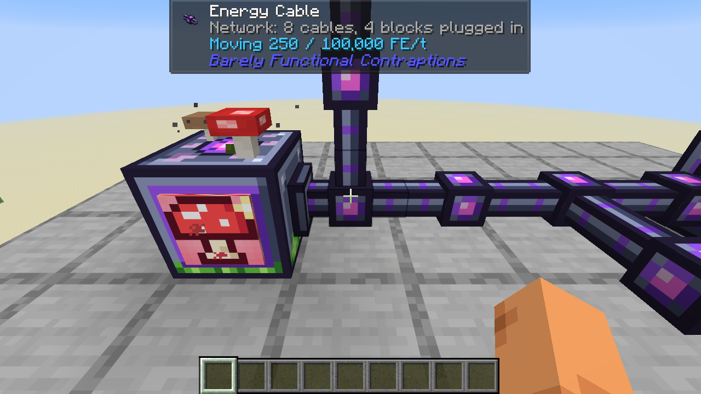
- The recipe makes **8** cables: copper wire with redstone, wrapped in wool. Any colour of wool works. Cables break quickly with any tool (a pickaxe is fastest) and always drop themselves.

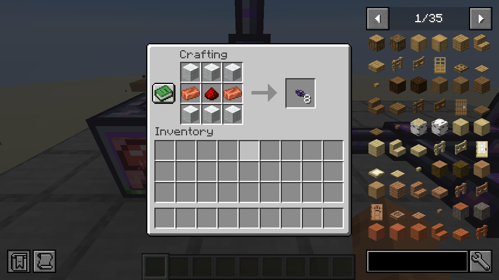

### Energy Meter
An inline meter for Forge Energy. Put it **between a generator (or cable) and what it powers**, and it shows how much energy goes through.

- **Placing:** it points the way you look when you place it. Energy goes **in at the back** (dark port) and **out at the front** (glowing port). The other faces have no energy connection.
- **Passes energy straight through:** it has no buffer. Whatever is pushed into the back goes on to the block in front, and whatever the block in front (or a cable network) pulls out comes from the block behind. Energy never goes backwards through it.
- **Screens:** its side screens show the flow, shortened to 250, 12.5k or 1.2M, with *FE/t* under it. The number glows blue while energy is moving.
- **Right-click** for the exact reading and the total that has passed since it was placed. **Jade** shows the same, plus the comparator signal.
- **Comparator:** the signal rises with the flow on a log scale, so it's useful from a trickle to a Zero Point pair: 1 FE/t gives 1, 10 gives 3, 100 gives 5, 1,000 gives 8, 10,000 gives 10, 100,000 gives 13, and 1,000,000 or more gives 15. Only energy that actually moves counts.
  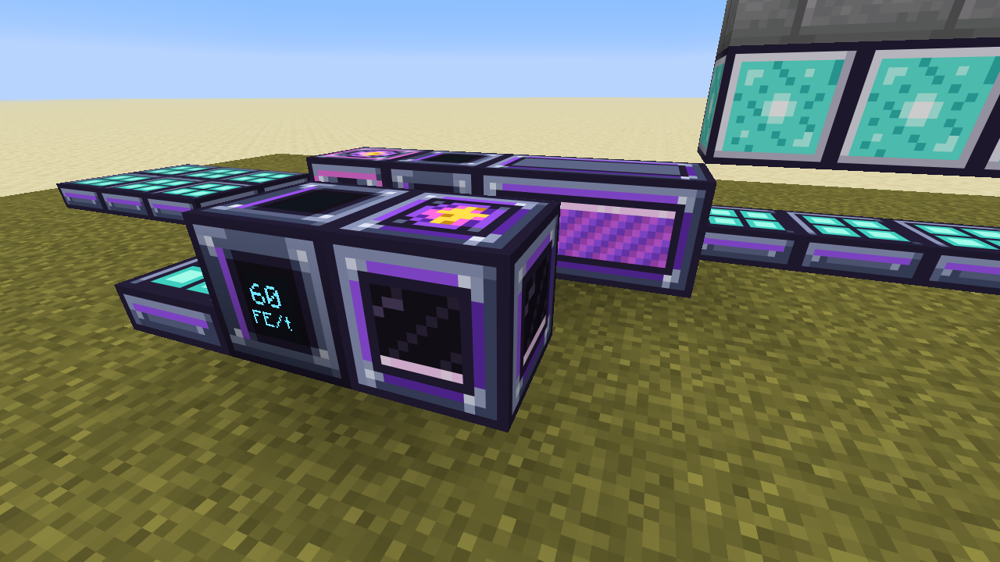
- **Recipe:** iron ingots around a comparator, a glass pane on top and an Energy Cable on each side. Mine it with a pickaxe; it drops itself.

### Fluid Pipe
The Energy Cable's twin for fluids, in **blue** instead of purple. Pipes carry water (and any other fluid) from the **Fluid Reservoir** and other tanks to the blocks that need it, such as the Mycelial Generator's water tank.


- **Placing and networks:** they work the same way as cables. Pipes join every pipe they touch into one network and plug into any block with a **fluid connection** on the side facing them. Pipes and cables never join each other, so the two can run side by side.
- **Flow:** fluid pushed into any pipe comes straight out at the other blocks plugged into the network, shared evenly between them and never back into the block it came from. Pipes hold no fluid themselves.
- **Push and pull:** the Fluid Reservoir pushes its water into the pipes on its own. Each tick the network also **pulls** from any plugged-in block that only gives fluid out (like another mod's pump). Tanks that take fluid in as well, like the Mycelial Generator, are never drained by the pipes, so two tanks on one network don't pass the same fluid back and forth.
- **Speed:** a network moves up to **4,000 mB/t** (4 buckets a tick) in total (`transferRate` in `[fluid_pipe]`).
- **Breaking** a pipe splits the network straight away.
- **Jade** on a pipe shows the network's size, how many blocks are plugged in and how much it is moving.

  
- The recipe makes **8** pipes: copper ingots across the top and bottom, glass, a bucket and glass across the middle. Pipes break quickly and always drop themselves.


### Item Pipe
The third of the set: the same pipe for **items**, in **yellow**. It moves wool, separator outputs and anything else between inventories.


- **Placing and networks:** these work like cables and fluid pipes. Item pipes join every item pipe they touch and plug into any block with an **item connection**: chests, barrels, hoppers, the Mechanical Separator, the Automatic Shears, the Fluid Reservoir and other mods' inventories. They never join Energy Cables or Fluid Pipes.
- **Flow:** items pushed into any pipe come straight out at the other blocks plugged into the network, shared evenly, and never back into the block they came from. Pipes hold nothing themselves.
- **Push and pull:**
  - Hoppers and the separator's bottom output push items into pipes on their own.
  - Each tick the network also **pulls** from slots holding items that block won't take back in. That covers the **Automatic Shears** (their inventory is output-only) and the separator's **output slots** (Raw Iron, String...).
  - Chests, barrels and the separator's wool input are **never emptied** by the pipes, so two chests on one network don't pass items back and forth.
- **Example:** shears → pipe → the side of a separator, then the separator's bottom → pipe → chest. Wool goes straight from the shears into the separator, and the resources come out into the chest. Separator sides follow its `itemInputSides`/`itemOutputSides` config: wool in at the top, back and sides, outputs out of the bottom.
- **Speed:** a network moves up to **16 items a tick** in total (`transferRate` in `[item_pipe]`).
- **Breaking** a pipe splits the network straight away.
- **Jade** on a pipe shows the network size, how many blocks are plugged in and how many items a tick it is moving.

  
- The recipe makes **8** pipes: copper ingots across the top and bottom, glass, a hopper and glass across the middle.


### Pipe sides: modes and filters
Each side where a Fluid or Item Pipe meets a block can be set up on its own.


- **Modes:** right-click the plug (or the face of the pipe's core towards the block) with an **empty hand** to cycle the side through four modes. The plug changes colour to match.

  | Mode | Plug | What the pipe does with that block |
  |---|---|---|
  | **Normal** | Pipe colour | Puts things in. Takes things out only from pure sources (Automatic Shears, the separator's outputs, the Fluid Reservoir), so chests and tanks are never drained. This is how pipes always worked. |
  | **Pull** | Orange | Takes everything it can **out**, chests, barrels and tanks included, and never puts anything in. |
  | **Push** | Green | Only puts things **in**. It never takes anything out, even from a pure source. |
  | **Off** | None | No connection on that side at all. Right-click the face of the core to turn it back on. |
- **Filters:** right-click a plug **holding an item** to add that item to the side's filter, or to remove it if it's already there. A side holds up to 9 entries. On a Fluid Pipe, click with a **bucket of a fluid** (or any filled fluid container) to filter that fluid. With a filter, only those items or fluids pass that side, both in and out; an empty filter lets everything through. **Sneak + right-click** with an empty hand clears the side's filter.
- Holding a pipe or cable while clicking still places it as normal.
- **Jade** lists every side that isn't plain Normal, with its filter. The settings are saved with the pipe.
- Energy Cables have no modes or filters.

### Creative Generator (testing)
An endless power source for creative mode, for testing builds without setting up mushroom farms. It's a slate block with a pulsing magenta energy core on every side, and it glows in the dark.


*Above: one Creative Generator running a Mechanical Separator (left), an Automatic Shears (right) and a stack of two Hume Energy Cubes (charging, on top), all at once.*

- **Where to get it:** the mod's *Barely Functional Contraptions* creative tab, or `/give @s barelyfunctionalcontraptions:creative_generator`. It has no crafting recipe, can't be broken in survival and drops nothing.
- **Unlimited Forge Energy:** it never runs out and needs no fuel or water.
- **Pushes power out:** every tick it pushes FE into every energy receiver touching it, on all six sides: machines, Hume Energy Cubes, other mods' cables. The rate is `creativeGeneratorOutput` (1,000,000 FE/t by default), but each receiver still takes only what its own input limit allows. Set the rate to `0` to stop it pushing.
- **Can be pulled from:** cables and machines can also pull unlimited FE from any side.
- **Typical uses:** put it against a Mechanical Separator to test wool processing, next to Automatic Shears to test a sheep pen, or under a stack of Hume Energy Cubes to fill them quickly.

### Built-in resources

| Fed item | Wool | Separator output (per wool) | Own uses (`-1`) | FE / time |
|---|---|---|---|---|
| Iron Ingot | Iron Wool | 2–4 Raw Iron | 9 | 20,000 / 5 s |
| Gold Ingot | Gold Wool | 2–4 Raw Gold | 9 | 20,000 / 5 s |
| Copper Ingot | Copper Wool | 2–4 Raw Copper | 9 | 16,000 / 5 s |
| Diamond | Diamond Wool | 2–4 Diamond | 1 | 40,000 / 8 s |
| Emerald | Emerald Wool | 2–4 Emerald | 1 | 40,000 / 8 s |
| Redstone Dust | Redstone Wool | 2–4 Redstone Dust | 9 | 12,000 / 4 s |
| Lapis Lazuli | Lapis Wool | 2–4 Lapis Lazuli | 9 | 12,000 / 4 s |
| Coal | Coal Wool | 2–4 Coal | 9 | 8,000 / 4 s |
| Netherite Scrap | Netherite Wool | 2–4 Netherite Scrap | 1 | 80,000 / 10 s |
| Cobblestone | Stone Wool | 2–4 Cobblestone | 1 | 4,000 / 2 s |
| Oak Log | Wood Wool | 2–4 Oak Log | 1 | 4,000 / 2 s |
| Quartz | Quartz Wool | 2–4 Nether Quartz | 1 | 16,000 / 5 s |
| Red Mushroom | Red Mushroom Wool | 2–4 Red Mushroom (+5% Mycelium) | 3 | 8,000 / 4 s |
| Brown Mushroom | Brown Mushroom Wool | 2–4 Brown Mushroom (+5% Mycelium) | 3 | 8,000 / 4 s |

Every resource also gives 2 String, unless its row says otherwise. Plain wool (`#minecraft:wool`) can be separated into 3 string through the bundled `barelyfunctionalcontraptions:separating` recipe.

### Themed sheep

Ten more built-in resources turn the sheep into a little version of the mob the resource comes from. Each one grows extra body parts or gets an extra behaviour while it has its infused fleece. Lambs and sheared sheep look normal.


| Fed item | Sheep | What's different | Separator output (per wool) | FE / time |
|---|---|---|---|---|
| Hay Bale | Hay | A hay-bale fleece with binding bands | 2–4 Wheat | 4,000 / 2 s |
| Nether Star | Wither | Two Wither Skeleton Skulls either side of its own head that look around on their own, and glowing eyes | 2–4 Nether Star + 1 Soul Sand | 400,000 / 20 s |
| Dragon's Breath | Dragon | Flapping dragon wings, glowing purple eyes | 2–4 Dragon's Breath (+5% Ender Pearl) | 80,000 / 10 s |
| Glow Ink Sac | Glow Ink | Its fleece glows in the dark and **lights up the block it stands in** (light level 12) | 2–4 Glow Ink Sac | 8,000 / 3 s |
| Bone Block | Skeleton | A Skeleton Skull for a face (the game's own skull texture) and bony legs | 2–4 Bone (+10% Arrow) | 6,000 / 3 s |
| Wither Rose | Wither Skeleton | A Wither Skeleton Skull for a face and charred, bony legs | 2–4 Bone + 2 Coal (+2.5% Wither Skeleton Skull) | 20,000 / 5 s |
| Spider Eye | Spider | Four extra spider legs that move as it walks, and glowing red eyes | 2–4 Spider Eye + 4 String | 6,000 / 3 s |
| Echo Shard | Sculk | Sculk tendrils on its head, sculk sensors on its back and fleece strands that glow | 2–4 Echo Shard + 2 Sculk | 80,000 / 10 s |
| Blaze Rod | Blaze | Permanently on fire, without burning or taking damage | 2–4 Blaze Rod (+10% Glowstone Dust) | 20,000 / 5 s |
| Ghast Tear | Ghast | **Twice the size**, ghast tentacles under its belly, and it **screams like a ghast** (the ghast's scream instead of a bleat, and its hurt and death sounds) | 2–4 Ghast Tear + 1 Gunpowder | 40,000 / 8 s |


*At night: the Glow Ink sheep lights up the grass around it, and the Sculk sheep's strands, the eyes and the fire still glow.*

The glow is a real light. A Glow Ink sheep leaves an invisible light block where it stands, and the light goes out within half a second of the sheep moving away, being sheared or losing its infusion. The light block can't be seen or touched and never drops anything.

### JEI: every wool type the separator handles
With JEI installed, click the Mechanical Separator in JEI (or press **U** over it) to open **Mechanical Separation**. It lists **every wool type that's loaded**: built-in, mushroom, command-generated and data-pack ones, sorted by name. Plain wool → string and other explicit recipes come after them. Each wool type is one compact row: wool → resource (cycling through 2–4) + string + bonus chance, with energy and time. Like the Resource Infusion page and the Mycelial Generator's fuel page, it uses the same dark slate style as the machine screens: slate panels, recessed slots, and the separator's purple arrow filling over the real processing time. Hover over things for the details. JEI updates by itself after `/reload` or `/barelyfunctionalcontraptions generate`. Press **U** on any resource wool to jump to its row (**R** shows how to make it: the infusion page).


### The Mechanical Separator GUI
- **Energy bar:** shows stored / max FE. Hover for the input rate and the current usage per tick.
- **Progress arrow and spinning gear:** hover for time remaining and the cost of one operation.
- **Status lamp and text:** Idle, Processing %, No Energy, Output Full, Invalid Input or Disabled by Redstone. Hover for an explanation.
- **Redstone button** (top right): cycles Ignored → Active with Signal → Active without Signal → Disabled.
- **Slots:** wool input, resource output, string output and bonus output.

### Automation
- **Items:** by default, hoppers and pipes insert wool through the top, back, left and right faces, and extract outputs from the bottom. Outputs are also auto-pushed into any inventory below the machine. Only items the machine can process are accepted.
- **Energy:** FE is accepted on every face except the front, through NeoForge's `EnergyHandler` capability (`Capabilities.Energy.BLOCK`). Any FE cable or generator works with it.
- **No voiding:** the machine never starts or finishes an operation unless all outputs are guaranteed to fit.
- **No power:** when energy runs out, progress pauses and resumes later.
- **Comparator:** reads how full the input slot is.

---

### Jade (optional)
With [Jade](https://www.curseforge.com/minecraft/mc-mods/jade) installed (26.3.x for NeoForge), looking at things shows:
- **Infused sheep:** the resource (in its colour) and how many shearings are left. A permanent infusion or a resting cooldown is shown instead when that applies.
- **Mechanical Separator:** its status (Processing, No Energy, Output Full...), the FE/t it is using, a non-default redstone mode, and a live progress bar. The energy bar and slot contents come from Jade's built-in support.

Each part can be switched off in Jade's settings under *Plugins → Barely Functional Contraptions*. Jade is optional: the mod runs fine without it.

| Sheep | Mechanical Separator |
|---|---|
|  |  |

<a id="resourceful-sheep-config"></a>

### Configuration

#### Global config (per world, synced to clients)
`config/barelyfunctionalcontraptions-sheep-synced.toml`, synced to every client. A copy placed in `<world>/syncedconfig/` overrides it for that world only. You can also edit it in-game from *Mods → Barely Functional Contraptions → Config*.

**`[sheep]`**

| Key | Default | Meaning |
|---|---|---|
| `feedingEnabled` | true | Master switch for feeding |
| `feedingAmountOverride` | -1 | Items consumed per feeding (-1 = use each definition's value) |
| `allowBabies` | false | Allow lambs to be infused by feeding (bred lambs inherit their infusion either way) |
| `breedingKeepsInfusion` | true | Lambs bred from infused sheep are born infused with a parent's resource and a full set of shearings; different parents pass on one at random |
| `breedingNeedsBothParents` | false | Only pass the infusion on when both parents are infused |
| `allowFeedingShearedSheep` | true | Infuse a sheep that has no wool yet |
| `allowReplacingInfusion` | false | Feed a different resource to replace an infusion |
| `sameResourceRefreshesUses` | true | Re-feeding the same resource tops the uses back up |
| `infusionConsumedByShearing` | true | `false` makes infusions **permanent** |
| `infusionUsesOverride` | 100 | Shearings every infusion lasts, for every wool type. `-1` = each resource's own `infusion_uses` |
| `infusionUsesMultiplier` | 1.0 | Scales every resource's `infusion_uses` |
| `woolDropCountOverride` | -1 | Wool dropped per shearing |
| `shearingBonusChance` / `shearingBonusAmount` | 0.0 / 1 | Chance of extra wool per shearing |
| `killDropsEnabled` | true | Killing an infused sheep with its wool drops resource wool and the resource |
| `killWoolBonus` | 1 | Extra resource wool from a kill, on top of one shearing's amount |
| `killDropsResource` | true | Whether a kill also drops one separator roll of the resource (e.g. 2–4 Raw Iron) |
| `preserveWoolColour` | true | Blend the dye colour into infused wool |
| `feedingParticles` | true | Particles and sound when feeding |
| `infusionCooldownTicks` | 0 | Rest time after an infusion runs out |
| `creativeConsumesItems` | false | Whether feeding uses up items in creative |
| `creativeIgnoresCooldown` | true | Creative players bypass the cooldown and the replacement lock |
| `sneakToInspect` | true | Sneak-right-click inspection |

**`[separator]`**

| Key | Default | Meaning |
|---|---|---|
| `energyCapacity` | 100000 | FE buffer |
| `maxEnergyInput` | 1000 | FE accepted per tick |
| `defaultEnergyCost` | 20000 | FE per operation when a resource doesn't set one |
| `energyPerTickOverride` | 0 | Fixed FE/t for every recipe (0 = derive from cost ÷ time) |
| `defaultProcessingTicks` | 100 | Time when a resource doesn't set one |
| `defaultStringOutput` | 2 | String when a resource doesn't set `secondary_count` |
| `primaryOutputMultiplier` | 1.0 | Scales the resource output; fractional parts become a chance |
| `bonusPrimaryChance` | 0.0 | Global chance of +1 resource output |
| `energyCostMultiplier` | 1.0 | Efficiency multiplier for energy |
| `processingSpeedMultiplier` | 1.0 | Speed multiplier (total energy is unchanged) |
| `resetProgressWhenUnpowered` | false | Reset progress instead of pausing it |
| `energyInputSides` | BACK, LEFT, RIGHT, TOP, BOTTOM | Faces that accept FE |
| `itemInputSides` | TOP, BACK, LEFT, RIGHT | Faces that accept wool |
| `itemOutputSides` | BOTTOM | Faces to extract from and auto-push into |
| `autoPushOutputs` / `autoPushInterval` | true / 10 | Automatic output |
| `redstoneControlEnabled` / `defaultRedstoneMode` | true / IGNORED | Redstone behaviour |

**`[automatic_shears]`**

| Key | Default | Meaning |
|---|---|---|
| `shearInterval` | 20 | Ticks between shearing sweeps (20 = once a second) |
| `energyPerShear` | 2000 | FE used per sheep sheared (0 = runs without power) |
| `energyCapacity` | 50000 | FE buffer |
| `maxEnergyInput` | 1000 | FE accepted per tick (every face except the front) |

**`[fluid_reservoir]`**

| Key | Default | Meaning |
|---|---|---|
| `waterPerSecond` | 1000 | mB of water made per second |
| `capacity` | 10000 | Tank size in mB (10 buckets) |
| `requireInfiniteSource` | true | Only work over a self-refilling water source (false = any water source) |
| `outputPerTick` | 1000 | mB pushed into neighbouring tanks (sides and top) per tick; 0 = no pushing |

**`[fluid_tank]`**

| Key | Default | Meaning |
|---|---|---|
| `capacityPerTank` | 16000 | mB each tank adds to its group's capacity |
| `transferPerTank` | 1000 | mB/t each tank adds to its group's transfer rate (in, out and pushing) |
| `maxGroupSize` | 64 | Most tanks in one group; extra tanks form another group |
| `autoOutput` | true | Push fluid into machines and pipes touching the group every tick (never into other tanks) |

**`[energy_cube]`**

| Key | Default | Meaning |
|---|---|---|
| `capacityPerCube` | 1000000 | FE each cube adds to its group's buffer |
| `transferPerCube` | 10000 | FE/t each cube adds to its group's transfer rate (in, out and pushing) |
| `maxGroupSize` | 64 | Most cubes in one group; extra cubes form another group |
| `autoOutput` | true | Push energy into touching machines and cables every tick |

Changes to `waterPerSecond` and `capacity` apply to reservoirs that are already placed, straight away (the config screen works in-game). Shrinking the tank drops any water above the new size. The GUI gauge always has 10 marks, so with a different size each mark is a tenth of the tank instead of a bucket.

**`[creative_generator]`**

| Key | Default | Meaning |
|---|---|---|
| `creativeGeneratorOutput` | 1000000 | FE pushed into each adjacent receiver per tick (0 = only allow pulling) |

**`[zero_point_energy_module]`**

| Key | Default | Meaning |
|---|---|---|
| `energyPerBlock` | 1000 | FE/t a linked pair makes for every block of open space between the modules. The two share one pool, so all of it can be taken from either module |
| `minGap` | 1 | Fewest blocks of open space needed between the modules before they link |
| `maxRange` | 64 | Furthest apart (in blocks) two modules can be and still link |
| `energyCapacity` | 50000 | FE each module adds to the pair's shared buffer (a linked pair holds twice this) |
| `beamDamage` | 4.0 | Damage the beam does to anything living touching it (2 = one heart), at most twice a second. 0 = harmless, no fire |
| `beamBurnSeconds` | 5 | Seconds the beam sets things on fire for. 0 = no fire |
| `beamCountsAsPlayerKill` | true | Mobs the beam kills drop experience and player-only loot, credited to a fake player called [Zero Point Beam] |
| `beamLooting` | 1 | Looting level for mobs the beam kills: each stack they drop gets 0 to this many extra items. 0 = normal drops |
| `maxOutput` | 100000 | Most FE/t each module pushes into, or lets be pulled by, its neighbours. A linked module can always give out at least its pair's whole output, even when that is more than this |

**`[energy_cable]`**

| Key | Default | Meaning |
|---|---|---|
| `transferRate` | 100000 | Most FE/t one cable network carries in total, however many cables and blocks are on it |
| `maxNetworkSize` | 4096 | Most cables in one network. A longer run splits into separate networks, which only pass energy on through blocks plugged into both |

**`[fluid_pipe]`**

| Key | Default | Meaning |
|---|---|---|
| `transferRate` | 4000 | Most mB per tick one pipe network carries in total, however many pipes and blocks are on it |
| `maxNetworkSize` | 4096 | Most pipes in one network. A longer run splits into separate networks, which only pass fluid on through blocks plugged into both |

**`[item_pipe]`**

| Key | Default | Meaning |
|---|---|---|
| `transferRate` | 16 | Most items per tick one pipe network carries in total, however many pipes and blocks are on it |
| `maxNetworkSize` | 4096 | Most pipes in one network. A longer run splits into separate networks, which only pass items on through blocks plugged into both |

**`[generator]`** (limits for `/barelyfunctionalcontraptions generate`; see [What the generator may use](#what-the-generator-may-use))

| Key | Default | Meaning |
|---|---|---|
| `allowedCreativeTabs` | `minecraft:building_blocks`, `minecraft:ingredients`, `minecraft:food_and_drinks` | A wool type's resource (its separator output) must be in one of these creative tabs. Empty list = any tab. |
| `requireStackable` | true | Blacklist every item that doesn't stack (max stack size 1), both as a feeding item and as an output |

#### Client config
`config/barelyfunctionalcontraptions-sheep-client.toml`:

| Key | What it controls |
|---|---|
| `ambientParticles` | Particles around infused sheep |
| `dyeTintStrength` | How strongly the dye colour shows through infused wool |
| `showResourceGrowths` | Small blocks of the resource growing out of infused fleece |
| `showSheepSparkleOverlay` | The glinting overlay on infused fleece |
| `detailedWoolTooltips` | Always show separator details in wool tooltips |
| `detailedMachineTooltips` | Extra detail in the separator GUI tooltips |

---

### Resource definitions (data packs)

Definitions live in `data/<namespace>/barelyfunctionalcontraptions/sheep_resources/<name>.json`.
- The resource id is `<namespace>:<name>`.
- They reload with `/reload` and are synced to clients automatically, so JEI and tooltips update too.
- Feeding, shearing, the separator and JEI all read the same definition.

```jsonc
{
  // Optional NeoForge load conditions: skip the file when a mod isn't installed.
  "neoforge:conditions": [ { "type": "neoforge:mod_loaded", "modid": "mekanism" } ],

  "feeding_item": "#c:storage_blocks/tin",   // item id, #tag, or a list
  "feeding_amount": 1,                       // default 1
  "display_name": "Tin",                     // optional text component; default: translation key resource.<ns>.<name>
  "wool_name": "Tin Wool",                   // optional; default "<display_name> Wool"
  "wool_color": "#B8C4CC",                   // "#RRGGBB", integer, or [r, g, b] (0-255)
  "accent_color": "#E6EEF2",                 // colour of the glinting strands
  "category": "ore",                         // ore | gem | dust | material | organic
  "wool_drop_count": 1,                      // wool per shearing
  "infusion_uses": 9,                        // shearings per feeding (used when infusionUsesOverride = -1)
  "separator": {
    "primary_output": "mekanism:raw_tin",    // item id or {"id": ..., "count": ..., "components": {...}}; default: the fed item
    "primary_count": { "min": 2, "max": 4 }, // random 2-4 per wool; a plain number means a fixed count
    "secondary_output": "minecraft:string",  // default string
    "secondary_count": 2,                    // default: config defaultStringOutput (0 = none)
    "bonus_output": { "item": "mekanism:nugget_tin", "chance": 0.1 },
    "energy_cost": 20000,                    // total FE; default: config
    "processing_ticks": 100                  // default: config
  },
  "growth_item": "mekanism:raw_tin",         // optional: block shown growing out of the fleece; default: the storage block of the fed item or output
  "appearance": {                            // optional: extra looks and behaviours (see below)
    "features": ["wings", "glowing_eyes"],
    "feature_color": "#7A5C99",
    "wool_texture": "mypack:textures/entity/sheep/tin_wool.png",
    "scale": 1.5,
    "skull_texture": "minecraft:textures/entity/skeleton/skeleton.png",
    "sounds": { "ambient": "minecraft:entity.ghast.scream", "hurt": "minecraft:entity.ghast.hurt", "death": "minecraft:entity.ghast.death" }
  }
}
```

**Appearance.** Any resource, including one from a data pack, can use the themed sheep's parts:

| Feature | What it does |
|---|---|
| `extra_heads` | Two Wither Skeleton Skulls either side of the sheep's head, like the Wither. They use the game's own skull texture (a resource pack that changes the skull changes these too) and aren't tinted. |
| `wings` | A pair of flapping dragon wings |
| `extra_legs` | Four long spider legs along the sides |
| `tentacles` | Ghast tentacles hanging under the belly |
| `bones` | A drawn skull face and bony legs (a `skull_texture` covers the face) |
| `sculk` | Sculk tendrils on the head, and accent strands that glow |
| `glowing_eyes` | Eyes in the `accent_color` that glow in the dark |
| `glowing` | The fleece glows, and the sheep lights the block it stands in (light level 12) |
| `on_fire` | Shows the on-fire flames, without burning |
| `screaming` | Bleats, hurts and dies with a screaming goat's sounds (unless `sounds` sets them) |

- `feature_color` tints the wings, legs, tentacles and bones. The default is white, which shows them as drawn. Sculk tendrils have their own colours, so leave it white for them.
- `scale` makes the sheep bigger or smaller while it's infused, from `0.25` to `4` times its normal size (default `1`). It goes through the vanilla `minecraft:scale` attribute as a modifier (`barelyfunctionalcontraptions:resource_scale`, multiplying the base value), so the hitbox, eye height and step height change with it, and it stacks with anything else that changes the scale, such as the `/attribute` command. Lambs stay in proportion. Shearing doesn't shrink the sheep; it goes back to normal once the infusion runs out.
- `sounds` replaces the sheep's `ambient` (bleat), `hurt` and `death` sounds with any sound event id, vanilla or modded. Leave one out to keep the sheep's own. Like the size, the voice lasts as long as the infusion, even while the sheep is sheared.
- `skull_texture` puts a mob's skull over the sheep's head, untinted. It takes any texture in the 64x32 mob-head layout the skull blocks use, such as `minecraft:textures/entity/skeleton/skeleton.png` or `.../wither_skeleton.png`.
- `wool_texture` replaces the greyscale fleece. It uses the vanilla sheep wool layout (64x32) and is still tinted with `wool_color`, so set `wool_color` to `"#FFFFFF"` to show it as drawn. The texture must come from a resource pack.

**Ores vs other materials.** For an ore, set `primary_output` to the raw material (as the built-ins do with Raw Iron). If you leave `primary_output` out, the separator gives back the fed item, which suits gems, logs and stone. A block input never implies 9 outputs automatically; you choose the numbers.

**Missing items.** A definition that references an item from a mod that isn't installed is skipped. The log gets one warning saying which file and which item; the rest of the reload is unaffected. Empty tags are skipped the same way.

**Sheep keep their infusion even when its wool type is missing.** If a sheep's wool type isn't loaded (its data pack was removed or disabled, or its mod uninstalled), the sheep keeps the infusion stored. Until the wool type comes back it looks and shears like a normal sheep, without using up shearings. You can also feed it a new resource, which replaces the stale infusion.

**Examples.** Ready-made definitions for **Tin, Lead, Silver, Nickel, Uranium, Osmium, Aluminium** and **Amethyst** are in `examples/resource_definitions/`. `examples/datapack/` is the same set packaged as a drop-in data pack, plus an example cobweb separating recipe. Copy the folder into `<world>/datapacks/`.

#### Auto-generating resources for every material
You don't have to write a definition for every metal by hand. In a world with cheats on (operator level 2), run:

| Command | What it does |
|---|---|
| `/barelyfunctionalcontraptions preview` | Lists what would be generated, without changing anything |
| `/barelyfunctionalcontraptions generate` | Creates a resource for every material that doesn't have one yet, saves them into the world data pack `barelyfunctionalcontraptions_generated`, and reloads |
| `/barelyfunctionalcontraptions generate all` | Same, but also regenerates materials that already have a definition |
| `/barelyfunctionalcontraptions generate material <material>` | Adds just one material from the storage-block tags. Press Tab to pick one (`slime`, `tin`, `osmium`...) |
| `/barelyfunctionalcontraptions generate item <item>` | Adds a wool type fed with **any** item you choose, e.g. `minecraft:amethyst_block`. If the item is a storage block, its whole `c:storage_blocks` tag is used. |
| `/barelyfunctionalcontraptions generate hand` | Same as `item`, using the item in your main hand |
| `/barelyfunctionalcontraptions generate remove <name>` | Deletes one generated wool type (press Tab to list them) |
| `/barelyfunctionalcontraptions generate dedupe` | Deletes generated wool types that duplicate another one, then reloads. A duplicate has the same feeding block or the same name as another type, for example a generated Iron next to the built-in Iron after `generate all`. Built-in and hand-written definitions are never removed. Of two generated duplicates, the first by id is kept. |
| `/barelyfunctionalcontraptions list` | Lists every loaded resource |

#### What the generator may use
By default the generator only makes wool types whose resource is something from the **Building Blocks**, **Ingredients** or **Food & Drinks** creative tabs, and it **blacklists every item that doesn't stack** (tools, weapons, armour, buckets, potions, stews and so on). This applies to `generate`, `generate all`, `preview`, `material`, `item` and `hand`, and to tab-completion:
- The **output** (the resource the separator gives back) must be in one of the allowed tabs and must stack. When a material's first choice isn't allowed, the generator tries the next candidate (raw material → ingot → gem → dust → same-named item → the block itself). If none is allowed, the material is skipped.
- The **feeding item** must stack. Members of a storage-block tag that don't stack are left out; the definition then lists the allowed items instead of using the whole tag.
- Modded items count when their mod adds them to one of the allowed tabs.
- `generate item`/`hand` explain why an item is refused, for example *"Diamond Sword doesn't stack…"* or *"Redstone Torch isn't in the Building Blocks, Ingredients, Food & Drinks creative tabs…"*.
- Definitions you already have, and hand-written or built-in ones, are never touched.
- Change the tabs or switch the stack rule off in the `[generator]` section of `config/barelyfunctionalcontraptions-sheep-synced.toml`.

How the generator chooses each value:
- **Materials:** it scans the `c:storage_blocks/<material>` item tags that vanilla, NeoForge and nearly every content mod fill. With Mekanism, Thermal and similar mods installed, that covers tin, lead, osmium, uranium, silver and so on. Raw ore blocks (`raw_*`) and anything already defined are skipped.
- **Feeding item:** the storage-block tag, so every mod's variant of the block works.
- **Output:** the first item in `c:raw_materials/`, `c:ingots/`, `c:gems/` or `c:dusts/<material>`. If none exist, it uses an item named after the material (for example `slime_ball` or `resin_clump`), and failing that, the block itself.
- **Uses:** 9 when a block is broken down into one of those units (a block holds 9), otherwise 1.
- **Colours:** taken from the block's map colour. The category comes from whichever tag supplied the output.

Picking single items or materials adds one file without touching the others. It refuses anything an existing built-in or hand-written resource already covers (same feeding item or same name), so you can't create duplicates this way. A wool type made from an arbitrary item (not a storage block) has `infusion_uses` 1, because the mod can't know how many units the item holds. That only matters with `infusionUsesOverride = -1`; by default every wool type lasts 100 shearings.

Generated files are ordinary JSON in `<world>/datapacks/barelyfunctionalcontraptions_generated/`. You can edit them freely. Re-running `generate` (or `generate all`) rewrites only the wool types it generates itself; other generated ones, such as those added with `generate item`/`hand`/`material`, stay until you delete them with `generate remove` or `generate dedupe`. Sheep infused with them keep their infusion. In plain vanilla this adds Dried Kelp and Slime; Hay Bales and Bone Blocks already belong to the Hay and Skeleton sheep (Resin is skipped because the Resin Clump is not in an allowed creative tab).

#### Explicit separator recipes
Use the recipe type `barelyfunctionalcontraptions:separating` to process any item, or to override how a particular wool is handled:
```json
{
  "type": "barelyfunctionalcontraptions:separating",
  "ingredient": "#minecraft:wool",
  "primary_output": { "id": "minecraft:string", "count": 3 },
  "secondary_output": "minecraft:white_dye",
  "bonus_output": { "item": "minecraft:string", "chance": 0.1 },
  "energy_cost": 2000,
  "processing_ticks": 40
}
```
An explicit recipe always takes priority over a resource definition. JEI shows only the recipe that actually applies.

#### Tags
| Tag | Default contents | Purpose |
|---|---|---|
| `#barelyfunctionalcontraptions:infusable` (entity type) | `minecraft:sheep` | Which mobs can be infused. Add modded sheep here. |
| `#barelyfunctionalcontraptions:replaceable_wool` (item) | `#minecraft:wool` | Which drops infused wool replaces |
| `#barelyfunctionalcontraptions:auto_shearable` (entity type) | `#barelyfunctionalcontraptions:infusable` | Which mobs the Automatic Shears shear |

Shearing drops are hooked through a global loot modifier on loot tables whose path starts with `shearing/`. That means hand shears, dispensers and modded shears are all covered, along with modded sheep that use their own `shearing/...` table. Infused-fleece rendering is applied to any entity whose renderer extends the vanilla `SheepRenderer`.

#### Custom wool textures
The 12 built-in wools have hand-made textures. Any other resource uses a greyscale wool texture tinted with its `wool_color` and `accent_color`, so it never shows a missing texture.

To give a data-pack resource its own icon, ship a resource pack that overrides `assets/barelyfunctionalcontraptions/items/resource_wool.json` and adds a `case` for your resource id. The file is a `minecraft:select` on the `barelyfunctionalcontraptions:sheep_resource` component.

---


---

## Test world

[`test-world/BFC-Test-World.zip`](test-world/BFC-Test-World.zip) is a creative world with every contraption set up
and running: sheep and separators, generators, cubes, Zero Point pairs, cables, pipes and Fluid Tanks. Unzip it into
your `saves` folder. [`test-world/README.md`](test-world/README.md) lists a teleport command for each scene.

## Configuration files

| File | Contents |
|---|---|
| `config/barelyfunctionalcontraptions-mycelial-synced.toml` | Mycelial Generator, networks, wrench, water, fuels and mycelium spread. Synced to clients; a copy in `<world>/syncedconfig/` overrides it per world. |
| `config/barelyfunctionalcontraptions-mycelial-client.toml` | Generator particles and sounds. |
| `config/barelyfunctionalcontraptions-sheep-synced.toml` | Sheep infusion, the Mechanical Separator, Automatic Shears, Fluid Reservoir, Hume Energy Cube, Zero Point Energy Module, Energy Cable, Fluid and Item Pipes, the Creative Generator and the `generate` command. Synced to clients; a copy in `<world>/syncedconfig/` overrides it per world. |
| `config/barelyfunctionalcontraptions-sheep-client.toml` | Sheep particles, tinting, overlays and tooltips. |

All four can be edited in-game from *Mods → Barely Functional Contraptions → Config*. The screen gives every section and option a plain English name, with its unit in brackets (for example *FE/t per Block of Gap* or *Network Rate (mB/t)*). Hover over an option for the full explanation. The tables in this README use the names as they appear in the `.toml` files.

| Sections | Options in a section |
|---|---|
|  |  |

## Commands

`/barelyfunctionalcontraptions preview | generate | list` (operator level 2). This is the Resourceful Sheep resource generator described above, which used to be `/resourcefulsheep`.

---

## Building from source

Requires **JDK 25**. Gradle 9 is downloaded by the wrapper.

```bash
./gradlew build                          # compiles, runs unit tests, outputs build/libs/barelyfunctionalcontraptions-1.5.0.jar
./gradlew runClient                      # dev client (with JEI and Jade)
./gradlew runServer                      # dev dedicated server
./gradlew runGameTestServer              # runs every GameTest (both modules + integration) headlessly, then exits
./gradlew test                           # unit tests
./gradlew runClient -PscreenshotHarness  # stages a test world, saves screenshots to run/screenshots/ and quits
./gradlew runClient -PscreenshotHarness -PharnessScene=themed_sheep  # only the themed sheep: close-ups and a night shot
```

To launch the dev runs **without JEI**, pass `-Puse_jei_runtime=false`.

The build downloads from `maven.neoforged.net` (NeoForge), Mojang's servers (Minecraft), `maven.blamejared.com` (JEI) and `api.modrinth.com` (Jade).

**IntelliJ IDEA:** *File → Open*, select the project folder, and set the Gradle JVM to a JDK 25 (IntelliJ 2025.2+). ModDevGradle generates the `Client`, `Server` and `GameTestServer` run configurations on sync.

### Regenerating art and data

| Command | What it does |
|---|---|
| `cd tools/mycelial-texture-generator && pip install -r requirements.txt && python generate.py -o ../../src/main/resources` | Mycelial Generator and wrench textures, models and GUI ([README](tools/mycelial-texture-generator/README.md)) |
| `python3 tools/sheep/generate_textures.py` | Sheep wool, separator and creative generator textures |
| `python3 tools/sheep/generate_sounds.py` | The Zero Point Energy Module's hum (`sounds/block/zero_point_hum.ogg`), synthesised as a seamless loop. Needs numpy and ffmpeg with libvorbis. |
| `python3 tools/sheep/generate_data.py` | Sheep models, blockstates, built-in resources, recipes, loot and tags. It merges into the shared `en_us.json` instead of replacing it. |

## Project layout

```
src/main/java/com/jax3/barelyfunctionalcontraptions/
├── BarelyFunctionalContraptions.java        the single @Mod entry point; initialises both modules
├── client/BarelyFunctionalContraptionsClient the single client entry point (config screen + both modules' client code)
├── registry/ContraptionsCreativeTab the two creative tabs (machines and tools, resource wool)
├── gametest/IntegrationGameTests   tests for the parts where the modules meet
├── mycelial/                       Mycelial Power module (generator, wrench, networks, mycelium, JEI/Jade)
└── sheep/                          Resourceful Sheep module (infusion, wool, separator, commands, JEI/Jade)

src/main/resources/
├── assets/barelyfunctionalcontraptions/     models, textures, sounds and the merged en_us.json for both modules
└── data/barelyfunctionalcontraptions/
    ├── barelyfunctionalcontraptions/sheep_resources/   built-in sheep resources (incl. red_mushroom, brown_mushroom)
    ├── recipe/, loot_table/, advancement/, loot_modifiers/
    └── structure/, test_environment/, test_instance/   GameTest data
```

The modules keep their own registries, configs and networking. They share the mod id and namespace through `BarelyFunctionalContraptions.MOD_ID`, and each module's `init(...)` is called from the single entry point. History: [docs/PORTING-MYCELIAL.md](docs/PORTING-MYCELIAL.md) describes Mycelial Power's port from 1.21.1 to 26.3.

## License

MIT, see [LICENSE](LICENSE).
