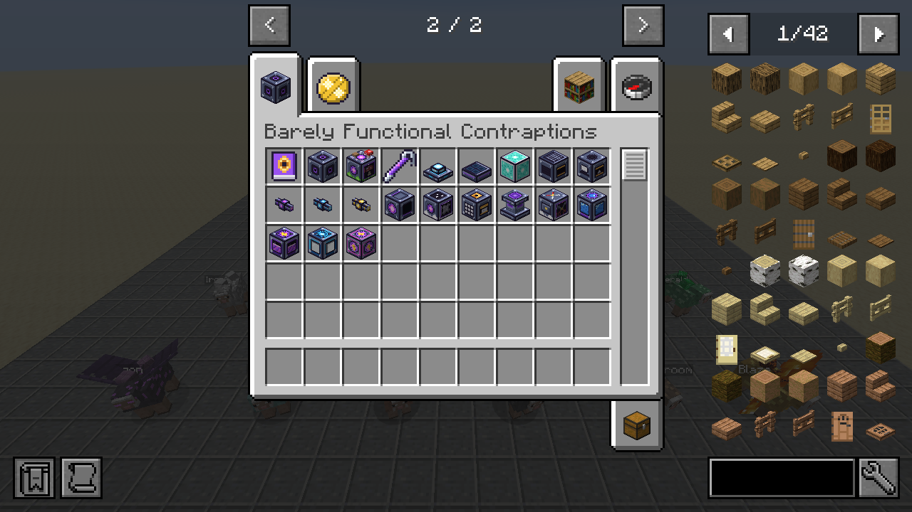
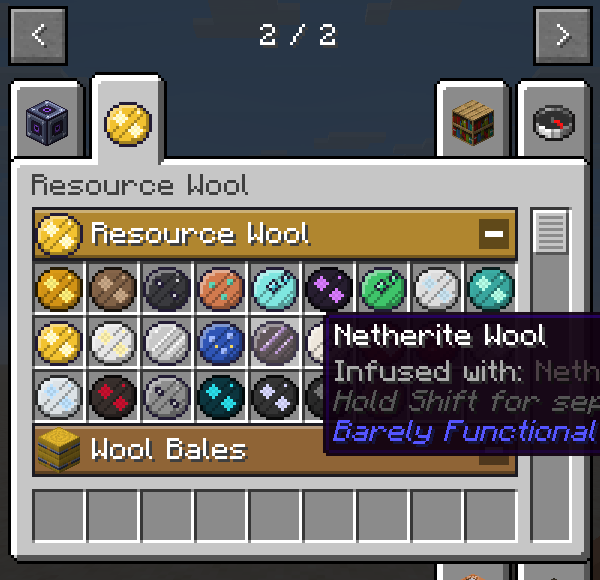
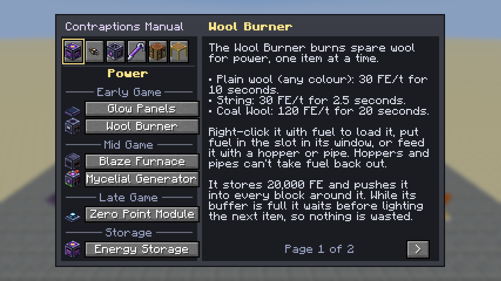
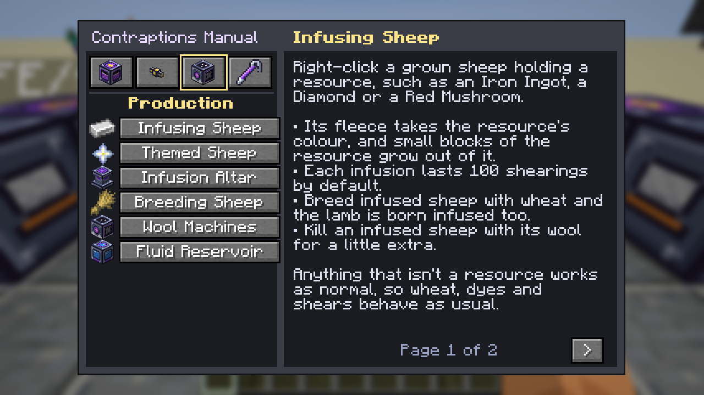
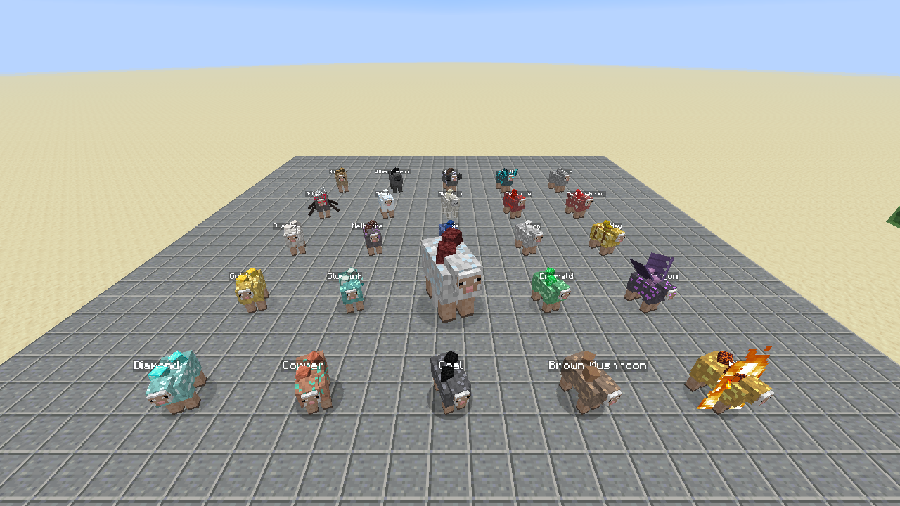

<!-- CurseForge description: paste this whole file into the project description with the editor set to Markdown. Images load from the GitHub repository, so they show the latest pushed screenshots. -->

# Barely Functional Contraptions

A NeoForge mod for **Minecraft 26.3** about sheep and slightly questionable machinery.

**Feed a sheep an ingot, a gem or a block and its wool takes on that resource.** Shear it for resource wool, and turn the wool back into the resource in a **Mechanical Separator**. Breed your best sheep to raise their Yield, Growth and Endurance. Higher-tier sheep, such as the Wither, Dragon and Warden sheep, are infused at a powered **Infusion Altar** with catalysts.

Everything runs on Forge Energy. You can make it from mushrooms in a network of **Mycelial Generators**, from sunlight on **Glow Panels**, from Blaze sheep warming a **Blaze Sheep Furnace**, or from burning spare wool. Store it in **Hume Energy Cubes** and move it, along with fluids and items, through cables and pipes. **Automatic Shears**, **Wool Packers** and hoppers can run a whole farm without you.

### Make it your own

- **Config:** four config files, editable in game from *Mods → Barely Functional Contraptions → Config*. Every power rate, buffer, time and chance can be changed, and a world can have its own copy.
- **Data packs:**
  - **Add sheep:** a new sheep needs only a JSON file. It sets the feeding item, the colours, the separator's outputs, its tier and altar catalysts, and extra looks such as wings, extra heads, glowing or a bigger size.
  - **More data:** Wool Burner fuels, furnace heat sources and boost items, and separator recipes are data too.
  - **For other mods:** the `resource_wool` ingredient lets KubeJS, Create and other mods' recipes use resource wool.
- **Modpacks:** `/barelyfunctionalcontraptions generate` makes a sheep for every ore and material in the modpack.
- **Resource packs:** they can retexture any wool and rewrite or translate the in-game manual.
- **Optional mods:** JEI and Jade show every recipe and machine status, but the mod runs without them.

## Machines and blocks

**Machines and tools**

**Resource wool and Wool Bales**

## The Contraptions Manual

Craft a book with a Functional Machine Block to get the in-game guide. Its chapters are sorted into four tabs: Power, Logistics, Production and Utility.

**Power**

**Production**

## The Resourceful Sheep

All 24 built-in sheep, each with its name: ores and gems, mushrooms, wood and stone, and the themed sheep, such as the winged Dragon, the giant Ghast, the burning Blaze and the Spider.

---

Requires NeoForge 26.3 and Java 25; JEI and Jade are optional. The full guide to every block, setting and data-pack format is in [docs/REFERENCE.md](https://github.com/JAX3/Barely-Functional-Contraptions/blob/main/docs/REFERENCE.md). Test results are in [TESTING.md](https://github.com/JAX3/Barely-Functional-Contraptions/blob/main/TESTING.md). MIT licensed. Source code: [GitHub](https://github.com/JAX3/Barely-Functional-Contraptions).
