# Barely Functional Contraptions: full reference

The complete guide to every machine, item, setting and data-pack format. The short overview is the [README](../README.md).


A NeoForge mod for **Minecraft 26.1, 26.2 and 26.3** (Java 25) that combines two systems, **Mycelial Power** and **Resourceful Sheep**, into one mod. They share one mod id (`barelyfunctionalcontraptions`), one jar, one config screen and two creative tabs (machines and tools, and resource wool), and they are built to work together:

* **Mycelial Power:** the **Mycelial Generator** burns mushrooms and water to make **Forge Energy (FE)**. Generators that touch, or are linked with the **Barely Functional Wrench**, form networks whose output grows **exponentially**. Running generators slowly spread **mycelium** and sprout **huge mushrooms**.
* **Resourceful Sheep:** feed sheep blocks, ingots and gems to **infuse** their wool, shear them for **resource wool**, and turn the wool back into resources in the FE-powered **Mechanical Separator**. The **Fluid Reservoir** draws water from an infinite source to keep generators supplied.

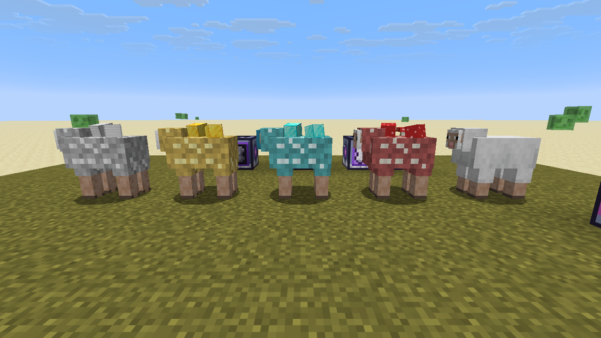

| Mycelial Generator | Mechanical Separator | Mushroom sheep |
|---|---|---|
| 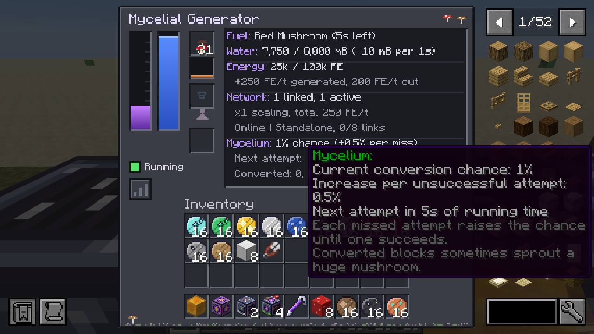 | 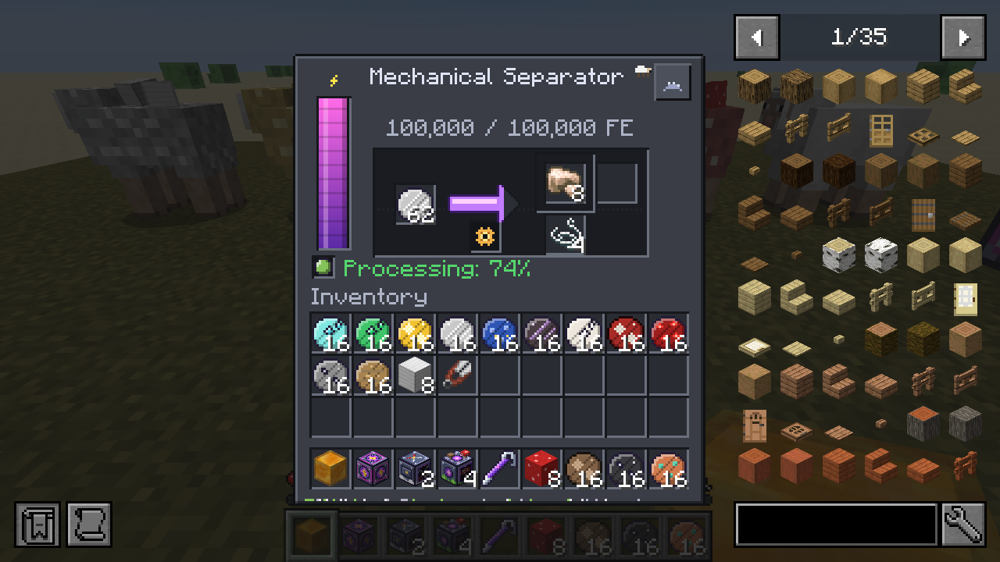 | 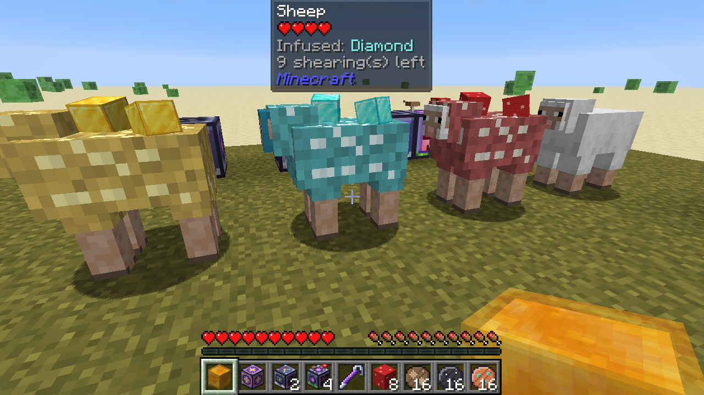 |

*Real screenshots, captured in-game with `./gradlew runClient -PscreenshotHarness`.*

| | |
|---|---|
| | Minecraft 26.3 | Minecraft 26.2 | Minecraft 26.1 (26.1.2) |
|---|---|---|---|
| Jar | `barelyfunctionalcontraptions-1.5.5-mc26.3.jar` | `barelyfunctionalcontraptions-1.5.5-mc26.2.jar` | `barelyfunctionalcontraptions-1.5.5-mc26.1.jar` |
| NeoForge | 26.3.x (built against 26.3.0.101) | 26.2.x (built against 26.2.0.95) | 26.1.2.x (built against 26.1.2.127) |
| Java | 25 | 25 | 25 |
| JEI (optional) | 31.x (built against 31.17.0.109) | 30.x (built against 30.48.0.244) | 29.x (built against 29.54.0.116) |
| Jade (optional) | 26.3.x (built against 26.3.5) | 26.2.x (built against 26.2.10) | 26.1.x (built against 26.1.12) |

Every jar has every feature. The 26.1 jar needs Minecraft 26.1.2; 26.1 and 26.1.1 aren't supported. One difference: on 26.1 and 26.2 the synced config (`barelyfunctionalcontraptions-sheep-synced.toml` and `-mycelial-synced.toml`) is a per-world server config, kept in `<world>/serverconfig/` rather than `config/`, because their NeoForge has no global synced config.

---

## How the two halves work together

```
 mushrooms ──────► feed a sheep ──► shear ──► Mushroom Wool (×100 shearings)
      ▲                                                                │
      │ mycelium spread                                                ▼
 Mycelial Generator ───────── FE (no cables needed) ──────────► Mechanical Separator
      ▲                                                                │
      └──────────────── Red / Brown Mushrooms (fuel) ◄─────────────────┘
```

1. **Generators power separators directly.** Both use NeoForge's standard energy capability, so a Mycelial Generator placed against any energy face of a Mechanical Separator (back, left, right, top or bottom) pushes FE into it. One generator makes 200–250 FE/t, which is exactly what a separator uses for most wool. FE cables from other mods work too.
2. **Mushroom sheep.** Two new built-in sheep resources, **Red Mushroom** and **Brown Mushroom**, are infused with a **Red/Brown Mushroom** (100 shearings per feeding by default). The separator turns each Mushroom Wool into **2–4 mushrooms** + 2 String, with a 5% chance of a **Mycelium** block. Those mushrooms are the Mycelial Generator's fuel.
3. **The loop closes.** Running generators spread mycelium and grow huge mushrooms, which give you mushrooms for the sheep. The sheep give you mushrooms for the generators, and the generators power the separators that process all your other resource wool.
4. **One mod.** Two creative tabs side by side (*Barely Functional Contraptions* for the machines and tools, *Resource Wool* for every wool type, including ones added by data packs and the generate command), one entry in the mod list, one config button listing all four config files, and one JEI and Jade plugin set.

The integration is covered by GameTests, which run in [`IntegrationGameTests`](../src/main/java/com/jax3/barelyfunctionalcontraptions/gametest/IntegrationGameTests.java). See [TESTING.md](../TESTING.md).

## Installation (players and servers)

1. Install NeoForge for your Minecraft version: 26.3.x for Minecraft 26.3, 26.2.x for Minecraft 26.2, or 26.1.2.x for Minecraft 26.1.2.
2. Put the jar for that version (`barelyfunctionalcontraptions-1.5.5-mc26.3.jar`, `-mc26.2.jar` or `-mc26.1.jar`) in the `mods/` folder of the client **and** the server.
3. Optional: install JEI and/or Jade for the same Minecraft version. The mod runs normally without them.

**Machine fronts:** all three machines share one look. Each has a purple-rimmed glass window on its front: a red mushroom in the generator, a wool block in the separator and a pair of shears in the Automatic Shears. The window is dark while the machine is idle and glows with a pulsing halo and sparkles while it runs. The separator and shears also give off a little light while running.

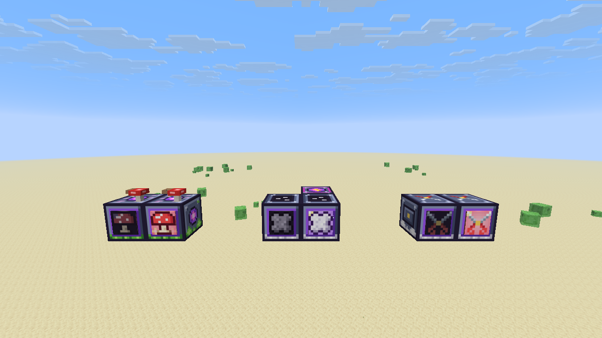

The main creative tab is split into the Contraptions Manual's sections (Power, Logistics, Production and Utility), each starting on its own row under a coloured banner with the tab's icon and title. The Resource Wool tab is split the same way into *Resource Wool*, *Wool Bales* and *Spawn Eggs*. Clicking a banner folds that section away or opens it again; folded sections stay folded until the game closes. The banner rows and the blanks after each section are an invisible placeholder item (`barelyfunctionalcontraptions:tab_section`) that the tab won't let you take, and that JEI and the search tab leave out.

| Creative tab: machines and tools | Creative tab: Resource Wool |
|---|---|
| 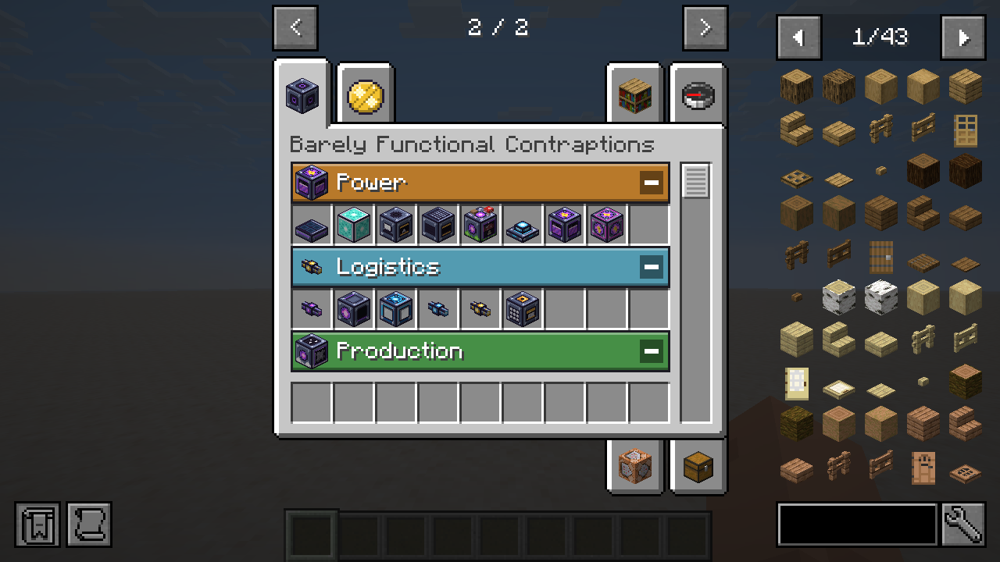 | 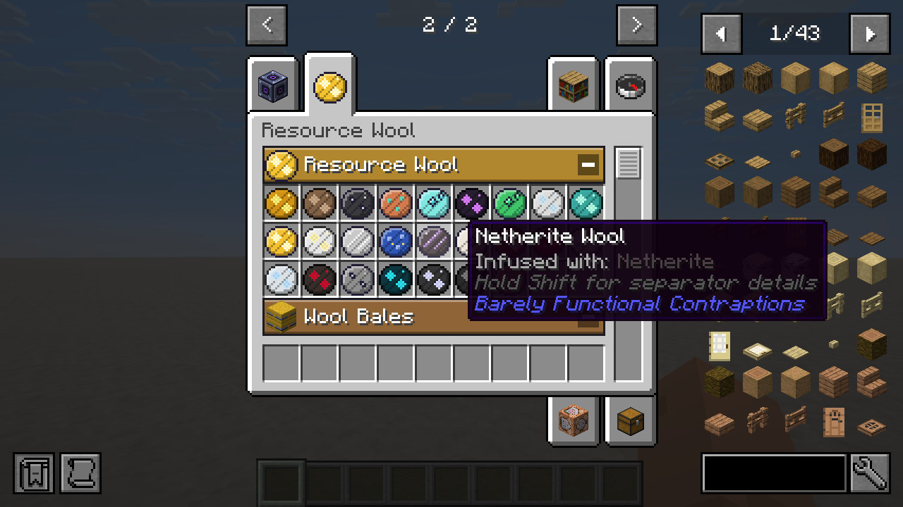 |

### Contraptions Manual (in-game guide)
Craft a **Contraptions Manual** (a book and a Functional Machine Block) and right-click it to read about everything in the mod in game. Its chapters are sorted into six tabs along the top of the left panel:

- **Power:** the generators, listed in tiers: *Early Game* (Glow Panels, Wool Burner, Sheep Treadmill), *Mid Game* (Blaze Sheep Furnace, Mycelial Generator) and *Late Game* (Zero Point Module, Thermal Reaction Chamber), then energy storage. A guide chapter's optional `"group"` field sets the heading it is listed under.
- **Logistics:** cables and the Energy Meter, tanks and pipes, pipe modes and filters, and the Wool Packer.
- **Production:** infusing sheep, the themed sheep, the Infusion Altar, breeding stats, the Powered Furnace, the Snow Sheep Chiller, the Mechanical Separator and Automatic Shears, and the Fluid Reservoir.
- **Utility:** getting started, the wrench and its links, Woollen Armour and the Muffled effect, and data packs and commands.
- **Recipes:** built from the game itself, so it matches any data-pack or modpack changes. *Machines* and *Parts, Tools and Armour* show every crafting recipe of the mod as a 3x3 grid; *Infusion* shows what each sheep is fed and the wool it grows; *Infusion Altar* shows the catalysts round the feeding item, with the tier and power; *Mechanical Separator* shows what every wool separates into, with the power and time; *Wool Bales* shows packing, unpacking and what every bale separates into. Ingredients that take any of several items cycle through them, and hovering over an item shows its tooltip.
- **WIP:** work-in-progress features, written up here as they arrive. For now it holds the planned late-game generators that need upkeep: *Hume Field Generator*, *Lightning Array* and *Fleece Fusion*, and the *Quantum Sheep*, which blinks in and out of existence, changes its wool type and drops random resource wool. None of them is in the game yet. The Hume Field Generator has a first model, a 2x2 machine two and a half blocks tall: in development builds (`runClient`) it can be placed with `/give @s barelyfunctionalcontraptions:hume_field_generator` to look at. It fills the 2x2x3 space east, south and above where it's placed (and won't place if any of it is taken), breaking any part removes the whole machine, and it does nothing yet. Released jars don't include it.

  | Hume Field Generator (WIP model) | Close up |
  |---|---|
  | 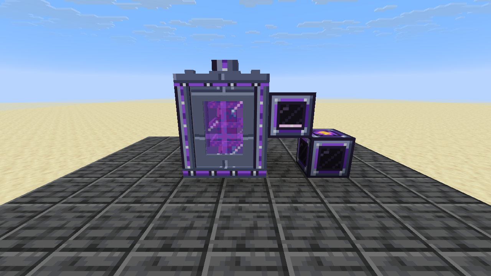 | 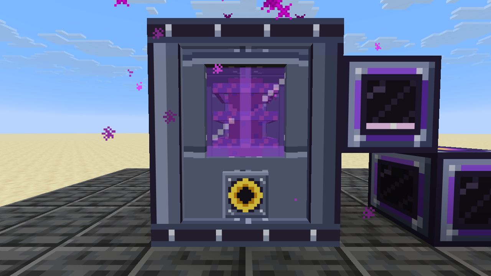 |

  A resource pack's guide file puts a chapter here with `"tab": "wip"`, and can give it a `"fallback_icon"` to show when its `"icon"` item isn't in the game.

Hover over a tab to see its name. A resource pack's guide file can still use the tab's old name, `"productive"`; it now means Production.

| Power tab | Production tab |
|---|---|
| 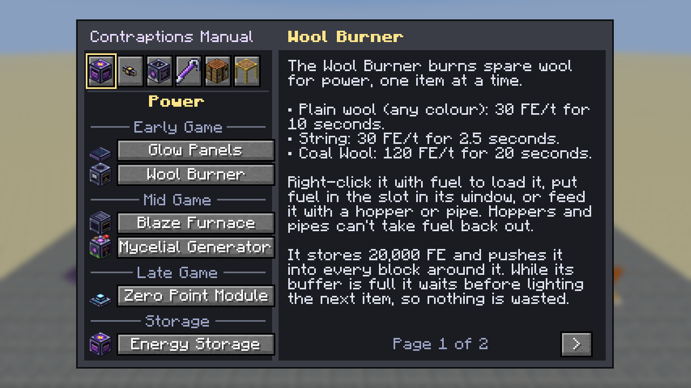 | 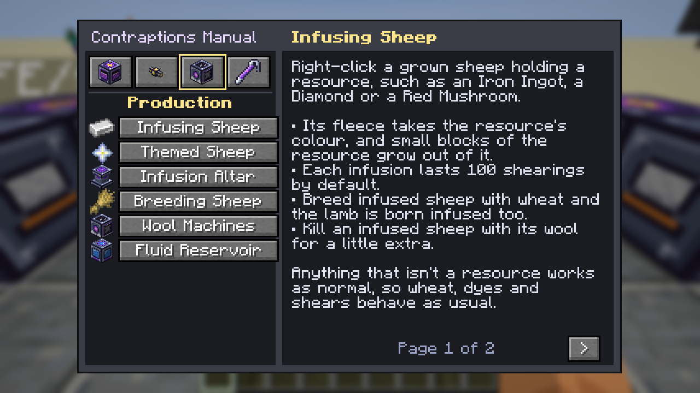 |

| Recipes: Machines | Recipes: Mechanical Separator |
|---|---|
| 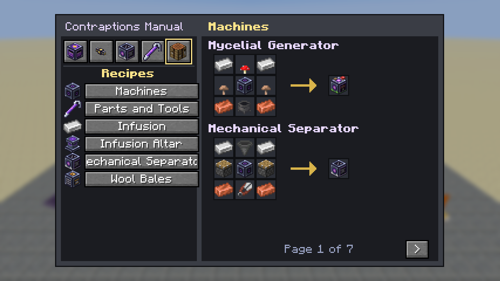 | 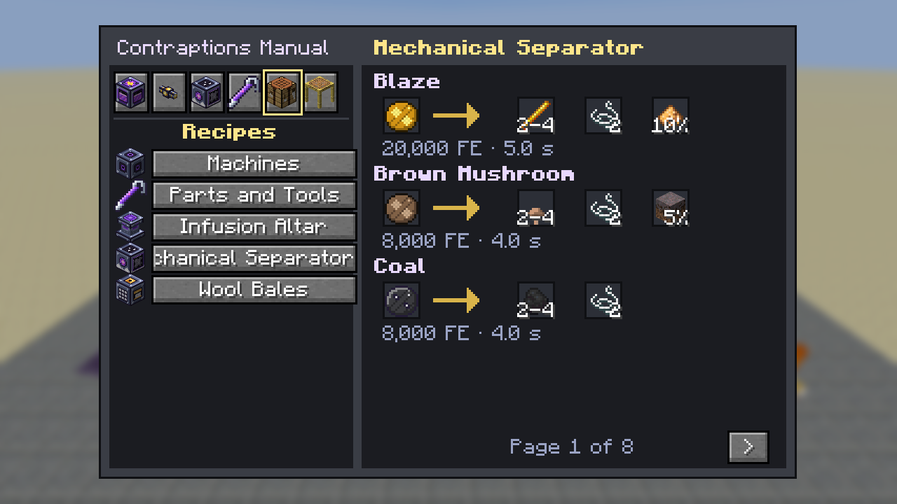 |

- Pick a tab, then a chapter on the left; long chapters turn over with the arrow buttons.
- The text lives in `assets/barelyfunctionalcontraptions/guide/en_us.json`. A resource pack can replace it or add a translation (`guide/<language>.json`, e.g. `de_de.json`), which is used when the game is in that language. Each chapter has a `title`, an `icon` item, a `tab` (`power`, `logistics`, `production` or `utility`) and a list of `text` paragraphs; a paragraph starting with `## ` is a heading and one starting with `- ` is a list item.

### Functional Machine Block

Every machine is built around a **Functional Machine Block**: the blue-steel casing of the machines on its own, with corner bolts and an empty, unlit port in the middle. Craft it from 4 iron ingots, 4 copper ingots and 1 redstone, then put one in the recipe of the Mycelial Generator, Mechanical Separator, Automatic Shears, Fluid Reservoir or Hume Energy Cube. It can also be placed as a decorative block (stone pickaxe, drops itself).

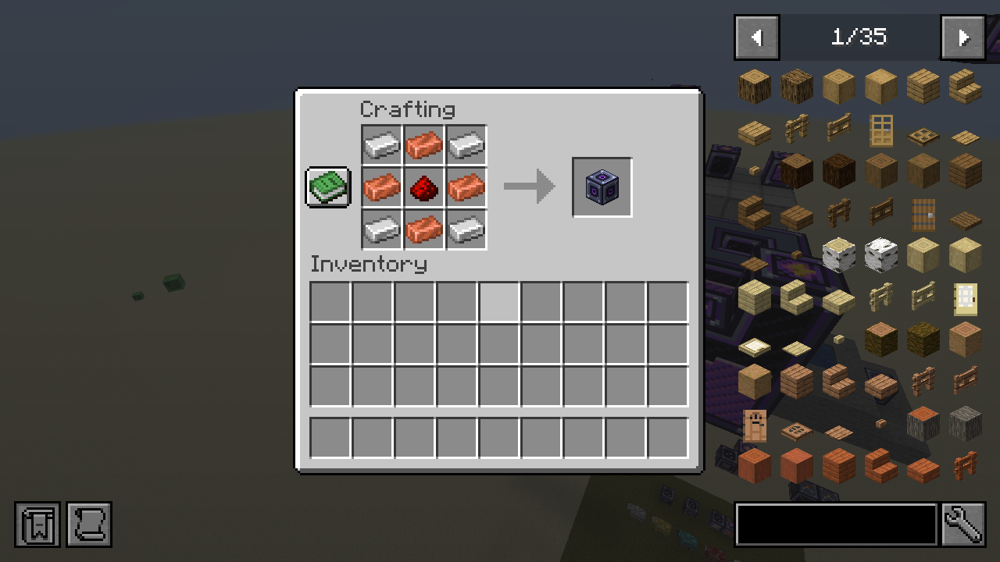

**Placing machines:** every block in the mod sounds like an Iron Block when placed, broken or walked on. the Mycelial Generator, Mechanical Separator and Automatic Shears place with their front facing you. **Hold Shift while placing** to make the front face away from you instead (handy for pointing the shears at a pen from outside it, or the separator's back at a cable).

---

### Advancements

The mod has its own advancement tab, **Barely Functional Contraptions**, with one advancement for making each machine, a few special ones, one for each themed sheep and a wool-collecting challenge:

| Advancement | How to get it |
|---|---|
| **Barely Functional Contraptions** | Make a Functional Machine Block (opens the tab) |
| It's Alive... Ish | Craft a Mycelial Generator |
| Some Assembly Required | Craft a Barely Functional Wrench |
| ⭐ **Fungal Network** (goal) | Link two Mycelial Generators together with the Barely Functional Wrench |
| Separation Anxiety | Craft a Mechanical Separator |
| Hands-Free Haircut | Craft Automatic Shears |
| ⭐ **Shear Genius** (goal) | Be within 16 blocks of Automatic Shears when they shear a sheep |
| Bottomless Bucket | Craft a Fluid Reservoir |
| Hume Sweet Hume | Craft a Hume Energy Cube |
| Think Tank | Craft a Fluid Tank |
| Something From Nothing | Craft a Zero Point Energy Module |
| ⭐ **Don't Cross the Streams** (challenge, hidden) | Get vaporised by a Zero Point beam. It stays hidden until you earn it and gives 50 experience. |
| Plugged In | Craft some Energy Cables |
| Pipe Dreams | Craft some Fluid Pipes |
| Special Delivery | Craft some Item Pipes |
| Watt's Going On | Craft an Energy Meter |
| Let There Be Glow | Craft a Glow Panel |
| Fleece Navidad | Craft a Wool Burner |
| Bale Out | Press a Wool Bale in a Wool Packer |
| Altar-ed States | Craft an Infusion Altar |
| ⭐ **Sheepish Combustion** (goal) | Be within 16 blocks of a Blaze Sheep Furnace when it starts making power from a Blaze sheep |
| ⭐ **Running Ewe Ragged** (goal) | Be within 16 blocks of a Sheep Treadmill when a sheep starts walking it |
| ⭐ **Thermal Shock** (challenge) | Be within 16 blocks of a Thermal Reaction Chamber when it starts reacting |
| ⭐ **Shocking!** (goal) | Get knocked back by an overcharged Static Generator |
| ⭐ **Good Vibrations** (challenge) | Be within 16 blocks of an Echo Chamber when it starts listening with its noise in the sweet spot (comes after the Warden sheep) |
| Wool You Look at That | Infuse a sheep with any resource |
| Hay There, Night Light, Bare Bones, Charred to the Bone, Eight Legs, Four Hooves, Too Hot to Shear, Scream and Shout | Infuse a sheep with a Hay Bale, Glow Ink Sac, Bone Block, Wither Rose, Spider Eye, Blaze Rod or Ghast Tear |
| ⭐ **Three Heads Are Better Than One**, **Here Be Dragons**, **Shh... It's Sculking** (goals) | Infuse a sheep with a Nether Star, Dragon's Breath or Echo Shard |
| ⭐ **Fleece of Every Colour** (challenge) | Collect one of each of the 25 built-in resource wools. Its progress shows which ones you still need, and it gives 100 experience. |

A data pack's own resource can have an advancement too: put it at `data/barelyfunctionalcontraptions/advancement/contraptions/sheep/<name>.json` with a `minecraft:impossible` criterion named `done`, and infusing a sheep with `barelyfunctionalcontraptions:<name>` grants it.

The crafting advancements are earned by getting the item into your inventory however you make it (crafting table, autocrafter or a friend handing it over).

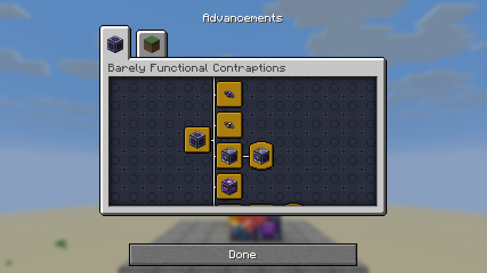

## Mycelial Power

### Crafting

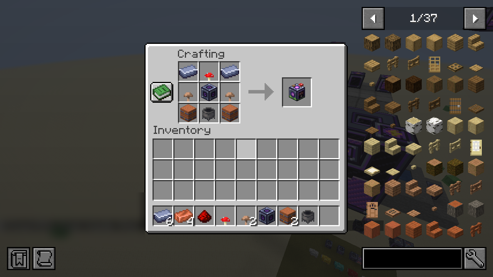

The generator is mined with any pickaxe and drops itself. Its inventory is dropped when it is broken.

### Running a generator

1. Place it. The front window, with a red mushroom behind the glass, faces you. The mushroom lights up and pulses while the generator runs, and stays lit while it is only paused by a full energy buffer.
2. **Water:** right-click with a water bucket, put a bucket in the bucket slot (the empty bucket comes out below), or pipe water in.
3. **Fuel:** put red or brown mushrooms (or any configured fuel) in the top slot. Hoppers and pipes can insert from any side.
4. Energy is pushed into adjacent cables and machines (any block exposing NeoForge `IEnergyStorage`). Pipes can also pull it out.

| Fuel (default) | Burn time | Energy | FE/t alone | FE per item |
|---|---|---|---|---|
| Brown Mushroom | 400 ticks (20 s) | ×1.0 | 200 | 80,000 |
| Red Mushroom | 600 ticks (30 s) | ×1.25 | 250 | 150,000 |

A generator stops when it runs out of fuel or water. When its buffer is full it pauses and keeps its fuel progress (configurable).

### Networks

Generators connect automatically in all six directions. By default only **running** generators count towards `N`, so a network grows as more members are fed. Networks update instantly when generators are placed, broken, loaded or unloaded. Generators in unloaded chunks simply stop counting, and **no chunk is ever loaded by the mod**. Networks are capped at 64 members by default.

### Barely Functional Wrench (wireless links)

A stylized crowbar, in the same art style as the blocks: purple-painted shaft, steel claw and chisel tip.

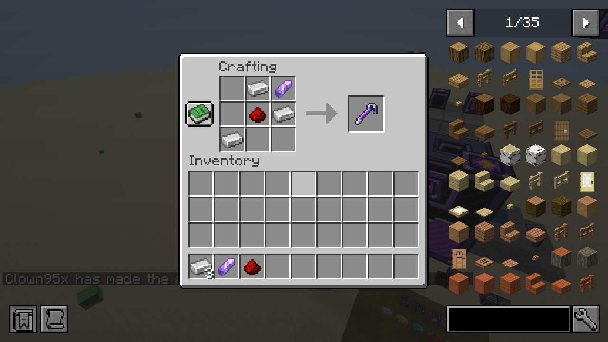

* **Right-click** a generator to select it. It gets a purple outline while you hold the wrench, and the wrench glints.
* **Right-click another generator** to link them. Red and white particles run between the two, the action bar confirms the link, and the wrench flashes with the enchantment glint for 2 seconds.
* **Shift + right-click** a generator to remove all of its manual links. Shift + right-click the air to clear the selection.
* Linked generators form **one network**, exactly like touching ones, and every running member counts towards the exponential boost. Touching and linked generators can be mixed freely. Each generator keeps its own mushrooms, water and energy (unless the server enables resource sharing).
* By default, links reach **64 blocks**, each generator can have **8** links, links stay in one dimension, and wrenches never wear out. All of this is configurable in `[network.wrench]`.
* Links are saved with the world. Breaking a generator removes its links. A link to a generator in an unloaded chunk is kept, and only counts while both chunks are loaded; the mod never loads chunks to keep a link working.
* The generator GUI's status line shows how it is connected (*Physical*, *Manual*, *Physical + manual* or *Standalone*) and its link count.
* **Dismantling:** hit (left-click) any of the mod's blocks with the wrench and it breaks at once. The block, with anything that spills out of it (a machine's fuel, wool, input or output), goes straight into your inventory; what doesn't fit drops as usual. It works on every block of the mod, needs no pickaxe, doesn't wear the wrench out, and leaves other mods' blocks alone. Blocks that can't be broken in survival (the Creative Generator) still can't be. Turn it off with `dismantle_blocks = false` in `[network.wrench]`.
* **Tags:** the wrench is in `#c:tools` and `#c:tools/wrench`, so mods that accept any wrench (for rotating or picking up their machines) treat it as one, and in `#c:storable_item`. Those mods' wrench actions are their own; the linking, pipe sides and dismantling only work on this mod's blocks.

#### Wireless power to machines
The wrench can also power a **Mechanical Separator** or **Automatic Shears** from a generator that isn't touching it.

* **Right-click the generator, then the machine** (or the machine first, then the generator). The same red and white particles run between them.
* The generator sends the machine FE as if it were touching it. This comes out of the generator's normal output (`outputTransferRate` per tick), after any machines it actually touches. When it powers several machines, it shares the energy evenly between them.
* One generator can power up to **8** machines (`max_power_links_per_generator`), within the usual **64 block** limit (`max_link_distance`), in the same dimension. A machine can be powered by several generators.
* Machines don't join the generator's network, so they don't count towards its boost.
* **Shift + right-click a machine** to remove its wireless links. Shift + right-clicking a generator removes all its links, including wireless ones.
* Right-clicking a machine with the wrench selects it instead of opening its GUI.
* Breaking the machine or the generator removes the link. Links are saved with the world, and they only carry power while both blocks are loaded.
* Which machines can be powered is the block tag `#barelyfunctionalcontraptions:wireless_power_receivers`. A data pack can add other mods' FE machines to it.
* **Generator screen:** a small **wireless button** (signal bars) under the *Running* lamp. The bars are purple while linked machines are getting power, yellow when every link is idle, and grey with no links. Next to it, a count shows how many machines are powered out of how many are linked, e.g. *2/2*. **Hover over the button** for the details: the limit, the FE/t being sent, and each machine with its position. Machines in unloaded chunks are marked *(not loaded)*, and links a lowered range limit no longer allows are marked *(inactive)*.

| Linking a generator to two machines | The separator running on wireless power only |
|---|---|
| 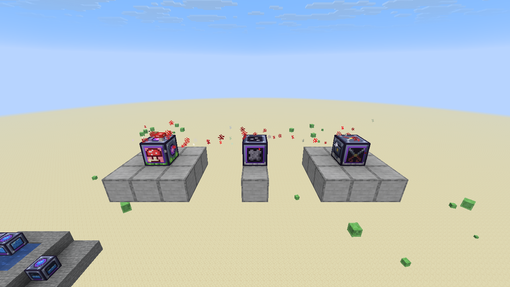 | 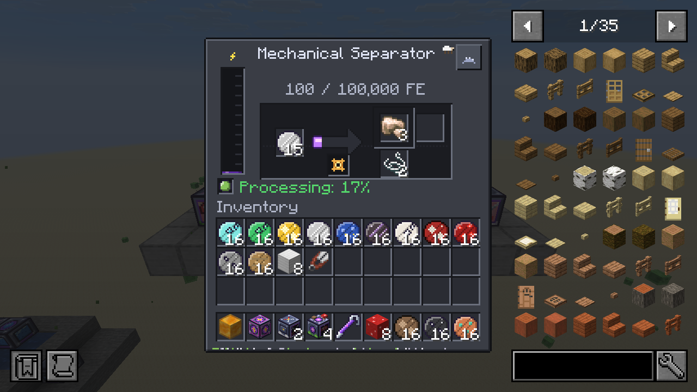 |

| The wireless button under the lamp | Hovering it shows the machines |
|---|---|
| 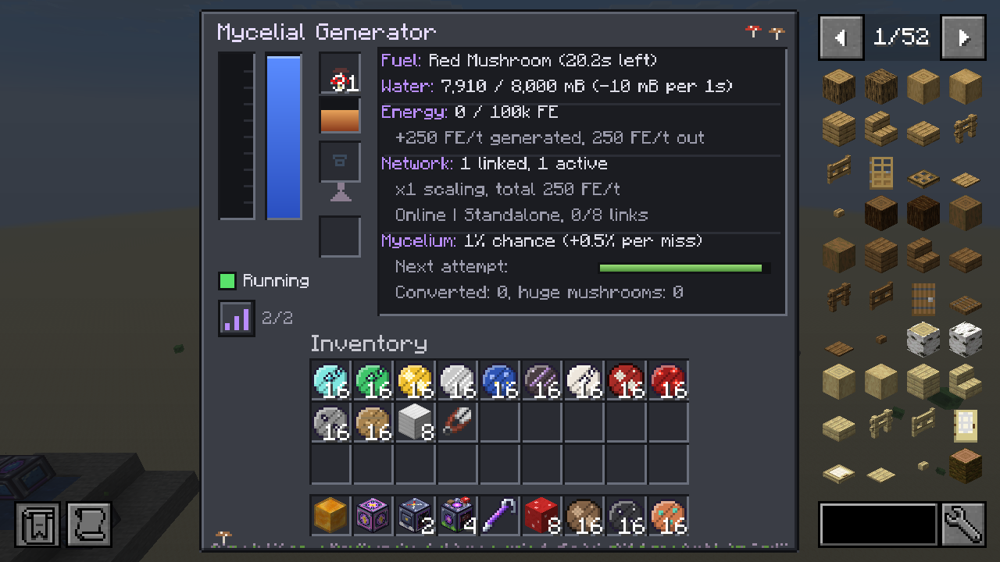 | 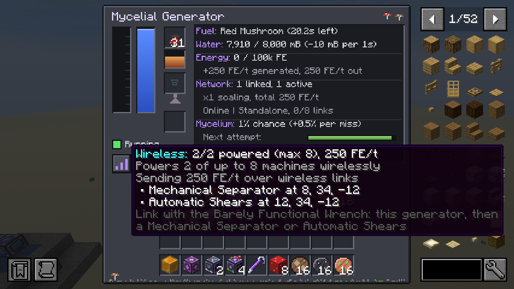 |

### Mycelium

Converted blocks at least 3 blocks from the generator have a 5% chance to sprout a **huge red or brown mushroom**, if there's room. It only grows into empty space and never loads chunks.

Every 100 running ticks a generator tries to convert a dirt block with air above it, within 4 blocks, into mycelium. The first attempt has a 1% chance. Each failed attempt adds 0.5 percentage points, so attempt 100 has 50.5% and attempt 199 is guaranteed. After a success the chance resets. Attempts with no valid dirt nearby do not change the chance. Conversions fire a block place event so claim and protection mods can block them, and they respect spawn protection and the world border.

### GUI

* Bars: **energy** (left) and **water tank** (right). The orange box is the remaining burn time of the current mushroom.
* The info panel shows fuel and time left, water and consumption rate, stored, generated and extracted FE, network size, active count, multiplier, total FE/t and status, and the mycelium chance, increase, next-attempt progress, conversions and huge mushrooms grown this session.
* Hover over any bar or line for exact numbers and explanations. The lamp shows the machine state.
* All values are computed on the server and sent to the viewing player.

---

### Jade (optional)
With [Jade](https://www.curseforge.com/minecraft/mc-mods/jade) installed (26.3.x for NeoForge), looking at a Mycelial Generator shows:
- **State** (Running, No fuel, No water, Energy full) and the **FE/t** it is generating.
- The **mushroom burning** and how long it has left, with a fuel progress bar.
- **Network** size, active generators and scaling, and the network's total FE/t when several generators are linked.
- Stored **energy**, the **water tank** and the **fuel slots**. These come from Jade's built-in support for NeoForge's energy, fluid and item capabilities.

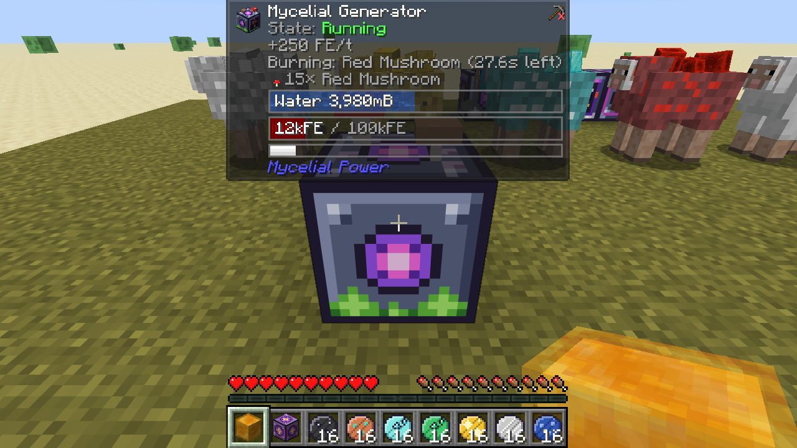

Each part can be switched off in Jade's settings under *Plugins → Barely Functional Contraptions*. Jade is optional: the mod runs fine without it.

Full configuration reference: [docs/CONFIGURATION-MYCELIAL.md](CONFIGURATION-MYCELIAL.md). Defaults: [docs/barelyfunctionalcontraptions-mycelial-synced.toml](barelyfunctionalcontraptions-mycelial-synced.toml).

Adding a modded fuel takes one line in `config/barelyfunctionalcontraptions-mycelial-synced.toml`:

[fuel]
	fuels = ["minecraft:brown_mushroom;burn=400", "minecraft:red_mushroom;burn=600;energy=1.25", "#c:mushrooms;burn=400"]
```


---

## Resourceful Sheep

### 1. Infuse a sheep
Every sheep is infused at a powered **Infusion Altar** (below): the resource in the centre, **2 of its blocks and a rarity item** round it, and an **adult** sheep standing beside it. For example, Iron takes an Iron Ingot, 2 Blocks of Iron and a Golden Carrot.

- Right-clicking a sheep with a resource no longer infuses it; the action bar points you to the altar. A server can bring hand feeding back with `[infusion_altar] handFeedingMaxTier` (1 = tier 1 sheep by hand, as before).
- You'll see coloured particles and hear a chime when the sheep takes the resource.
- The sheep's fleece takes on the resource colour with glinting strands, and **small blocks of the resource grow out of it**: Blocks of Iron on an iron sheep, Blocks of Diamond on a diamond sheep, Red Mushroom Blocks on a red mushroom sheep, Cobblestone on a stone sheep. The cluster shrinks as the infusion is sheared away. The block is the resource's storage block (`<name>_block`, found from the feeding item or the separator output), or the item itself when it is already a block (Oak Log). A data pack can choose another with `growth_item`.
- Its dye colour still shows through slightly, so a blue diamond sheep looks different from a white one.
- **Each infusion lasts 100 shearings by default**, whatever the resource (`infusionUsesOverride` in the config). Set that to `-1` to use each resource's own count instead: iron, gold, copper, redstone, lapis and coal last **9** shearings, and diamond, emerald, netherite scrap, cobblestone, oak log, quartz and the mushrooms last **1** or **3**.
- Items that aren't resources do nothing special, so wheat breeding, dyes and so on work as normal.
- Sneak + right-click a sheep with an empty hand to see its infusion and how many shearings it has left.
- **Spawn eggs:** the creative *Resource Wool* tab ends with a spawn egg for every sheep, coloured like its wool. The sheep it spawns is already infused, with its full shearings; used on a sheep it gives an infused lamb, and on a spawner it sets a plain sheep spawner.
- **Breeding keeps the infusion.** Breed infused sheep with wheat as normal and the lamb is born infused with its parents' resource, with a **full set of shearings**. Its fleece shows the resource colour straight away, and the resource blocks grow in once it's an adult. Its wool, like any lamb's, can only be sheared once it has grown up.
  - Two parents with **different** resources (Diamond + Emerald) pass on **one of the two at random**.
  - **One** infused parent is enough by default, so an Iron sheep and a plain white one have an Iron lamb (set `breedingNeedsBothParents` to require both).
  - The parents keep their own infusions, so a pair of infused sheep can breed a whole flock. Set `breedingKeepsInfusion` to false to turn this off.

  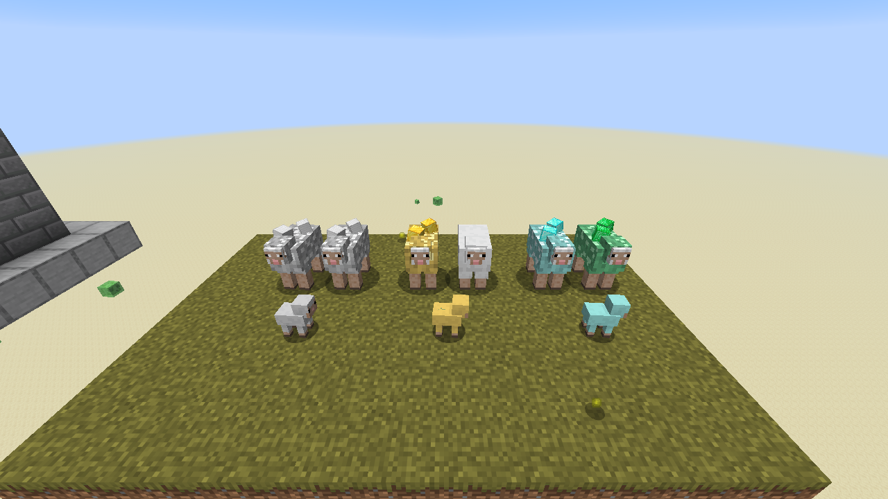

### Bred stats: Yield, Growth and Endurance
Every sheep has three stats from **1 to 10**. Wild sheep are all 1s, and you raise them by breeding.

| Stat | What it does (defaults) |
|---|---|
| **Yield** | More wool per shearing, infused or plain: +15% of the normal amount per point, so Yield 10 shears about 2.35 times as much. A fraction is a chance of one more. |
| **Growth** | A sheared sheep grows its wool back **on its own**, without grass: a 1% chance a second per point above 1, so about 11 seconds at Growth 10. Growth 1 still needs grass, as in vanilla. |
| **Endurance** | An infusion lasts more shearings: +10% per point, so Endurance 10 makes 100 shearings last 190. It counts when the sheep is fed, infused at an altar or born infused. |

- **Breeding:** a lamb gets the **average** of its parents' stats (a half rounds either way at random). Each stat then has a **25% chance of going up one** and a 5% chance of going down one, never past 1 or 10. So two wild sheep make 1s or 2s, and breeding your best sheep together keeps pushing the line up. A lamb that comes out better than both parents gives off happy-villager sparkles.
- **Seeing them:** sneak + right-click a sheep with an empty hand, or look at it with **Jade**. Wild sheep don't show a line.
- Stats stay through shearing, infusing, dyeing and saving. All the numbers, and a switch to turn stats off, are in `[sheep_stats]` in the synced config.

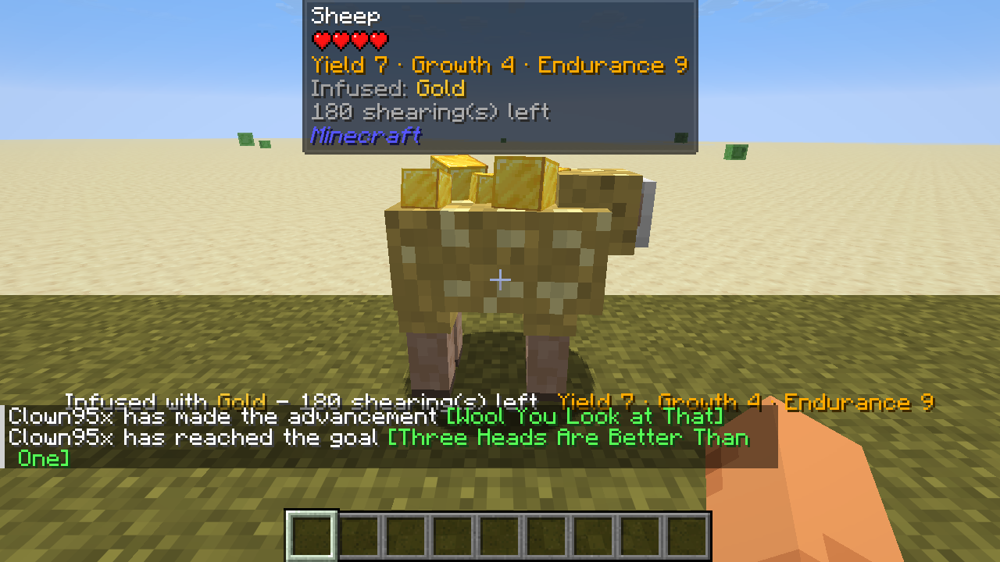

### Infusion tiers and the Infusion Altar
**Every sheep is infused at the altar.** Most resources are **tier 1**; the **Wither, Dragon and Warden sheep are tier 2** (legendary) and take more catalysts and power. Right-clicking a sheep with a resource only tells you it needs an altar, and the item isn't used.

The **Infusion Altar** is a powered pedestal. Put the feeding item in its **centre slot** and the **catalysts** in the four slots around it, give it power, and stand a grown sheep **within 2 blocks** of it. A stream of the resource's colour runs from the altar to the sheep, which is held nearly still with Slowness (only the sheep, and only until the infusion ends). When the bar fills the sheep is infused. The items and power are only used when it finishes.

**Showing the area:** click the spyglass button right of the status line in the altar's window, or sneak-right-click the altar with an empty hand, to outline in purple where a sheep must stand: 5x5 columns centred on the altar, from one block below it to one above. Do it again to hide it. The setting is saved with the altar, like the Automatic Shears' and Blaze Sheep Furnace's.

| Sheep | Feeding item | Catalysts | Power |
|---|---|---|---|
| Wither | Nether Star | 4 Soul Sand, 2 Bone Blocks, 1 Wither Rose | 200,000 FE |
| Dragon | Dragon's Breath | 4 End Stone, 4 Popped Chorus Fruit, 2 Eyes of Ender | 200,000 FE |
| Warden | Echo Shard | 4 Sculk, 4 Amethyst Shards, 1 Sculk Catalyst | 200,000 FE |
| Common: Stone, Wood, Coal, Copper, Hay, Snow, Red and Brown Mushroom | the resource | 2 of its blocks (Stone, logs, Block of Coal, Block of Copper, Hay Bales, Snow Blocks, mushroom blocks), 1 Wheat | 20,000 FE |
| Uncommon: Iron, Gold, Redstone, Lapis, Quartz, Glow Ink, Spider, Skeleton | the resource | 2 of its blocks (Blocks of Iron, Gold, Redstone, Lapis, Quartz; Glowstone; Cobwebs; Bone Blocks), 1 Golden Carrot | 20,000 FE |
| Rare: Diamond, Emerald, Blaze, Ghast | the resource | 2 of its blocks (Blocks of Diamond, Emerald; Magma Blocks; Soul Sand), 1 Golden Apple | 20,000 FE |
| Epic: Netherite, Wither Skeleton | the resource | 2 Ancient Debris or 2 Nether Bricks, 1 Eye of Ender | 20,000 FE |
| Generated (`/barelyfunctionalcontraptions generate`) | 2 of the block | an ingot, gem or dust of the material, 1 Golden Carrot | 20,000 FE |

- **Window:** the energy buffer, the cross of slots, a progress bar, the tier and FE/t (about 2,667 FE/t for tier 2 over 3.75 seconds). The catalysts still needed show **faded in the empty side slots**, and hovering a side slot lists them, with the missing ones in red. A status lamp shows *Waiting*, *Infusing*, *No energy*, *Missing catalysts*, *No sheep* or *Not enough items*.
- **Which sheep:** the nearest grown sheep in reach that can take the resource: not already infused with something else, not a lamb (unless `allowBabies` is on). Its Endurance counts.
- **Automation:** an altar fed by hoppers (the resource, its blocks and its rarity item) keeps a pen infused without you. **Redstone pulse:** the moment the centre slot and every catalyst are complete, the altar powers every side for **one redstone tick** (2 game ticks), once each time they become complete, to trigger a dispenser, piston or the next step of a contraption. Hoppers and pipes put feeding items and catalysts in from any side and can't take them out. A comparator reads its progress. Jade shows its status.
- **Advancements:** the nearest player within 16 blocks gets the infusion advancements, as if they had fed the sheep.
- **JEI:** an *Infusion Altar* page shows each altar infusion laid out like the altar's window: the feeding item in the centre, the catalysts round it, the wool it gives, and the tier and power. Looking up the uses of a catalyst (Soul Sand, Sculk...) or of the feeding item finds it. Tier 2 sheep are no longer on the *Resource Infusion* (by hand) page.

  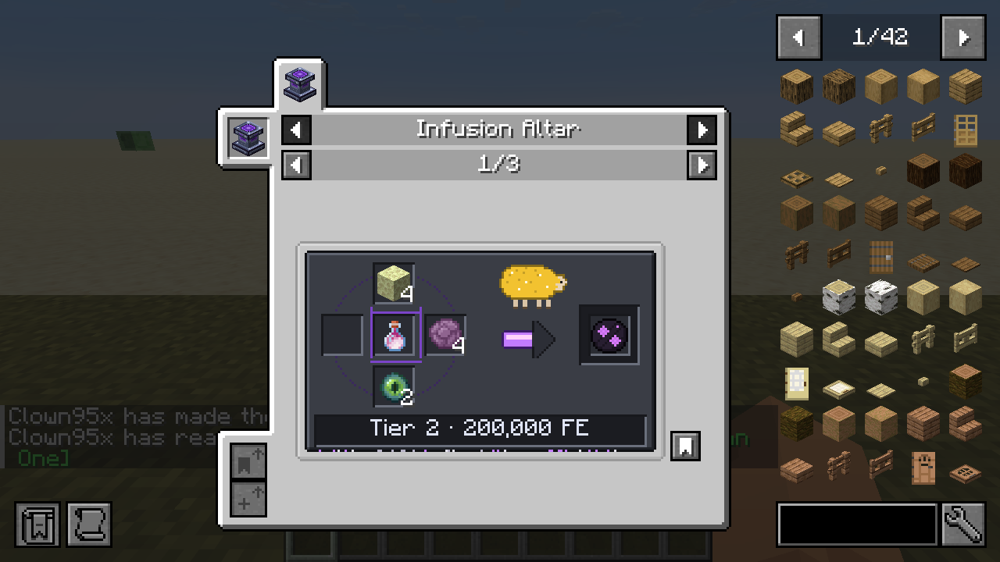
- **Recipe:** amethyst blocks either side of an enchanting table, gold ingots either side of a Functional Machine Block, and diamonds and a gold ingot along the bottom. Mine it with a pickaxe.
- **Config:** `[infusion_altar]` sets the power, time, buffer and which sheep can still be fed by hand (`handFeedingMaxTier`: 0, none, by default; 1 for tier 1 sheep as before; 3 for all).

| The window: catalysts still needed | Infusing |
|---|---|
| 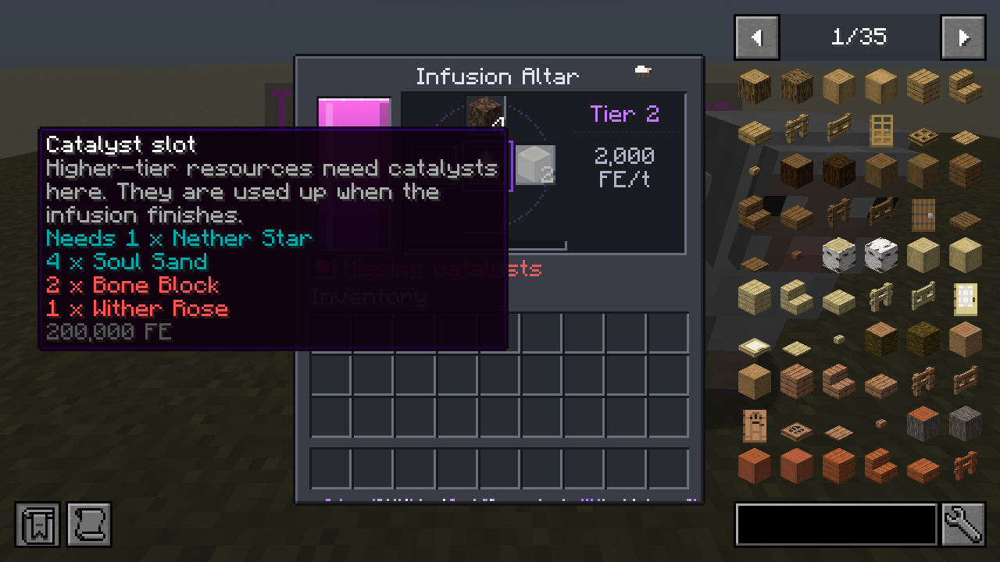 | 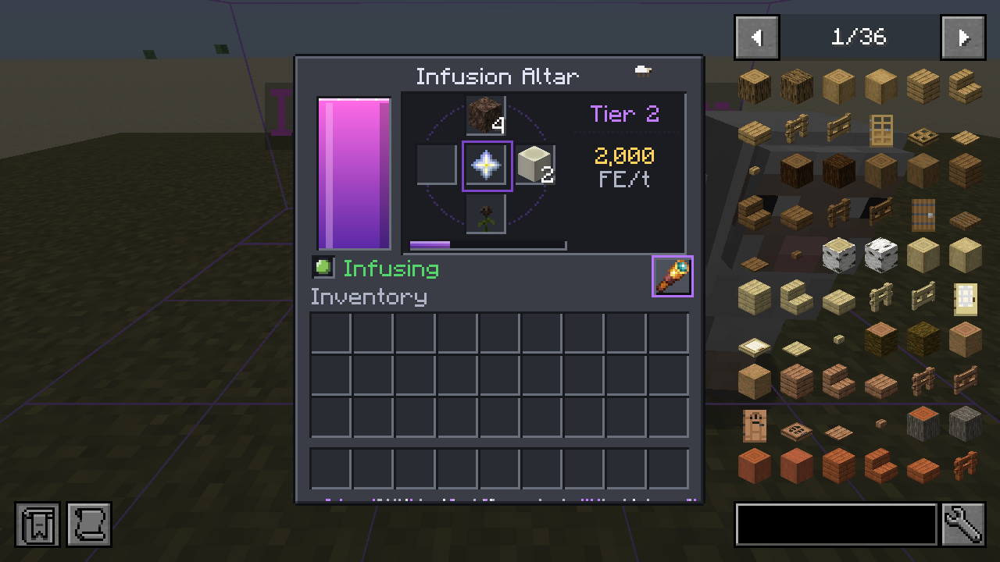 |

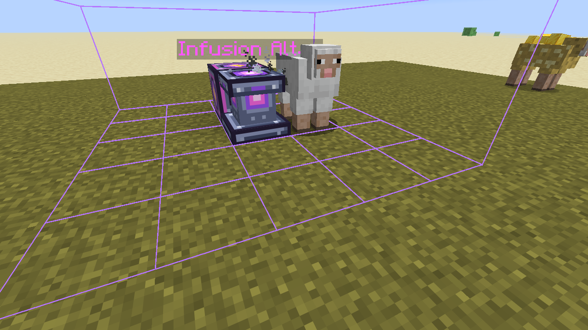

### 2. Shear it
Shears and dispensers both work. An infused sheep drops **resource wool** (e.g. *Iron Wool*) **instead of** its normal wool. When the infusion runs out the sheep goes back to normal.

**Or kill it.** An infused sheep that still has its wool drops a little more when it dies than one shearing gives: **one extra resource wool** (2 Iron Wool instead of 1) **plus the resource itself**, one separator's worth of it (2–4 Raw Iron for an iron sheep, 2–4 Diamonds for a diamond sheep). Its mutton still drops. Shearing is still the better deal over time, since a living sheep can be sheared again and again; killing gets you a bigger payout once. A sheep that has just been sheared has no wool, so killing it gives only normal loot. Any death counts, including mob farms. Turn it off or tune it with `killDropsEnabled`, `killWoolBonus` and `killDropsResource`.

### 3. Separate the wool
Put the wool into a **Mechanical Separator** and supply Forge Energy (FE).

| Example | Value |
|---|---|
| Input | 1 Iron Wool |
| Energy | 20,000 FE (about 267 FE/t) |
| Time | 75 ticks (3.75 s) |
| Output | **2–4** Raw Iron (random each time) + 2 String (+10% chance of 3 Iron Nuggets) |

**Balance:** every wool separates into **2–4** of its resource (3 on average). With the default of 100 shearings per feeding, one Iron Ingot yields about 300 Raw Iron and one Diamond about 300 Diamonds, so infused sheep **multiply** resources a lot. (With `infusionUsesOverride = -1`, one Iron Ingot gives about 27 Raw Iron and one Diamond about 3 Diamonds.) The cost is the shearing time and the machine's energy. To tone it down, lower `primaryOutputMultiplier` (e.g. `0.34` brings it back to about 1 per wool), lower `infusionUsesOverride` (or set it to `-1`) or `infusionUsesMultiplier`, or set `primary_count` per resource.

### Crafting the separator
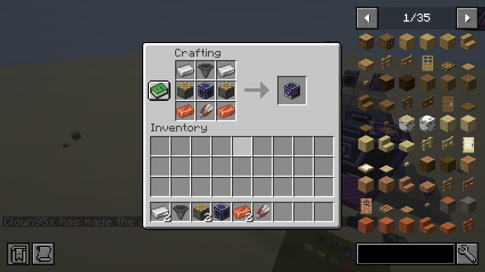
- Requires a stone pickaxe or better.
- Hardness 3.5, blast resistance 6.
- When broken, it keeps its stored energy and redstone mode.

### Automatic Shears
An FE-powered machine that shears sheep for you and keeps the wool.

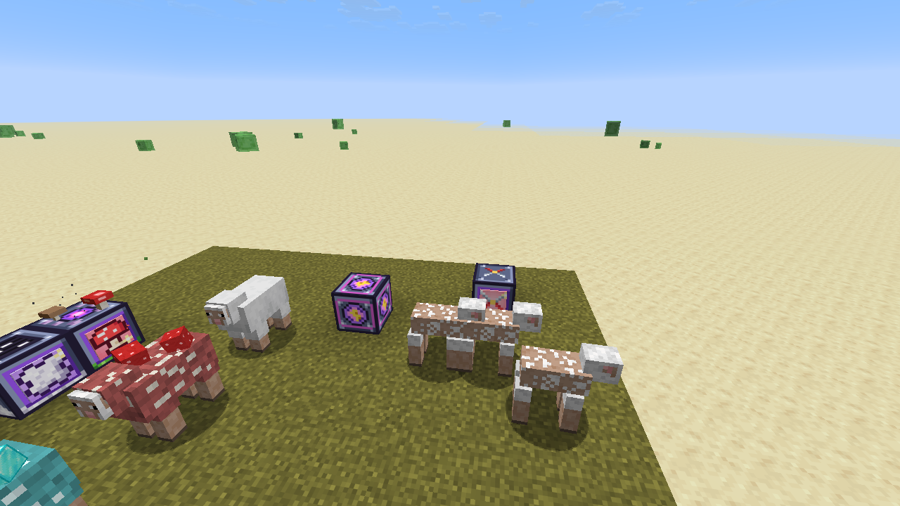

- **Where it shears:** the **3×3 area in front of its face** (the face with the crossed blades, which points at you when you place it). That's the three block columns 1–3 blocks out, one column either side, from one block below the machine to one block above it. A sheep counts when its feet are in that area.
- **Power:** it runs on Forge Energy and uses **2,000 FE per sheep sheared** (`energyPerShear`). It holds 50,000 FE and accepts up to 1,000 FE/t on every face except the front, from any FE cable or generator. A Mycelial Generator placed against its back powers it directly. Without enough FE it waits, showing *No Energy*.
- **How often:** every three quarters of a second by default (`shearInterval` in `[automatic_shears]`), shearing every ready sheep in the area each time. Once a sheep eats grass and regrows its wool, it gets sheared again.
- **Infused sheep:** these work exactly like hand shears. They drop their resource wool and use up one infusion shearing.
- **GUI:** right-click to open it. It's in the same style as the Mechanical Separator: an energy gauge, a status lamp and line (*Waiting for Sheep*, *Shearing*, *No Energy*, *Storage Full*, *Disabled by Redstone*), the redstone button, a shears icon that snips while it works, a bar counting down to the next sweep, and its 9 storage slots. Hover over things for details.
- **Inventory:** 9 slots. Take the wool out by hand (shift-click works), or put a **hopper underneath** (or any pipe) to pull it out automatically. Nothing can be put *into* it. A comparator reads how full it is.
- **When it's full:** it stops shearing until there is room again, so wool is never thrown away. If one sheep's drops only partly fit, the rest drop on the ground at the sheep.
- **Redstone:** the same four modes as the separator, cycled with the button in the top-right corner: *Ignored* (default), *Active with Signal*, *Active without Signal*, *Disabled*.
- **Show the area:** **sneak-right-click** it with an empty hand, or click the spyglass button next to the redstone button in its window, to draw the 3×3 area as a light-blue box with a grid on the ground. Do it again to hide it. The setting is saved with the block.
- **Which mobs:** only those in the entity tag `#barelyfunctionalcontraptions:auto_shearable`, which is sheep by default. It never turns a mooshroom into a cow or takes a snow golem's pumpkin.
- Its shears never wear out. Mine it with a stone pickaxe or better. When broken it keeps its stored energy and redstone mode, like the separator, and its wool drops on the ground.

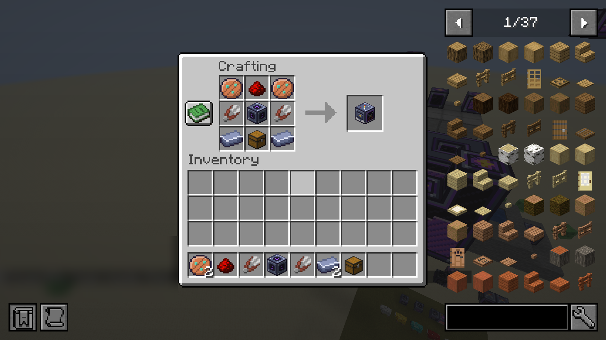

| GUI | Area shown (spyglass button framed in blue) |
|---|---|
| 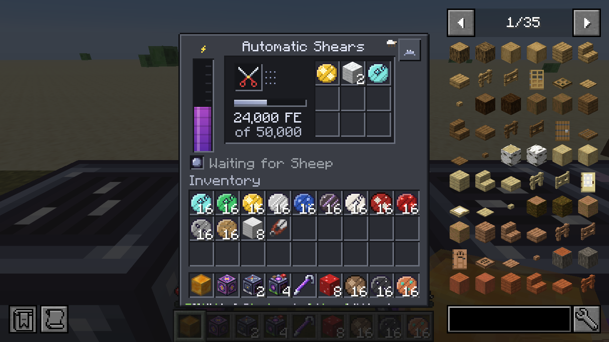 | 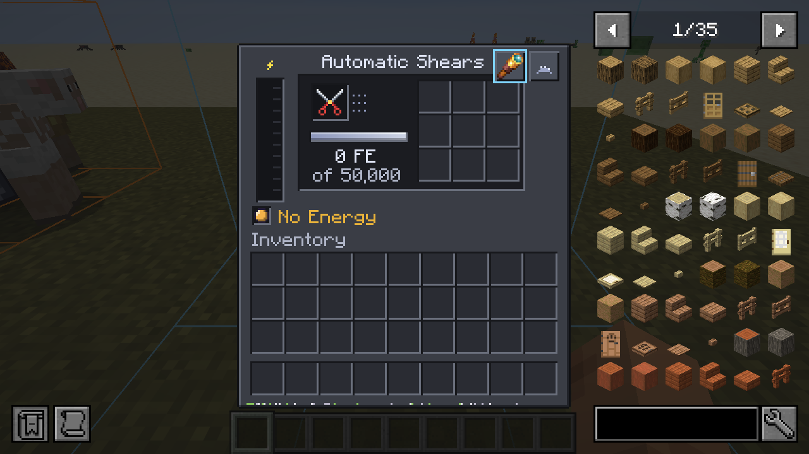 |

### Fluid Reservoir
A water source for your machines. Put it **directly on top of an infinite water source** and it fills its **10-bucket tank** with water.

| In the world | GUI |
|---|---|
| 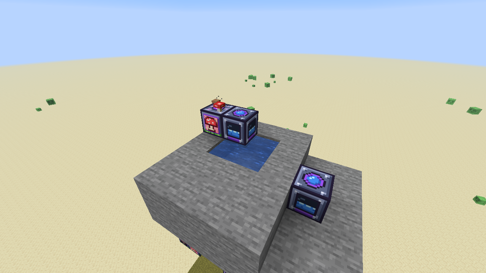 | 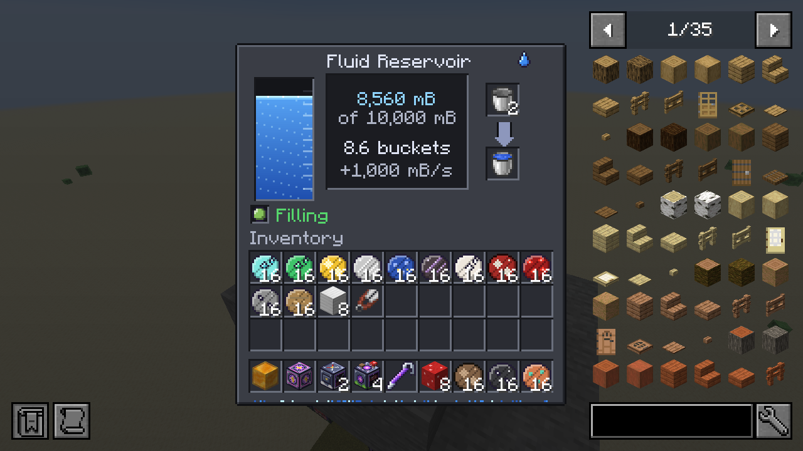 |

- **Infinite source:** the water block under it must refill itself, by vanilla's rule: it needs **at least two neighbouring water sources** and something solid (or more water) under it. A 2×2 pool, or the middle of a 3-long line, works. A lone source, or two sources side by side, does not. The source is never used up. Set `requireInfiniteSource = false` to allow any water source.
- **Speed:** 1 bucket (1,000 mB) a second by default (`waterPerSecond`), so it fills in 10 seconds. It then stops until water is taken out.
- **Getting water out:**
  - Right-click it with an empty bucket (or any other fluid container) to fill it.
  - Put empty buckets in the top slot of its GUI; it fills them into the bottom slot. Hoppers and pipes can also feed in empty buckets and take water buckets out.
  - Pipes can pull water from any side.
  - It **pushes water into tanks beside it or on top** (up to 1,000 mB/t, `outputPerTick`). A **Mycelial Generator placed next to it never runs dry**.
- Nothing can be poured *into* it. It's a water source, not a storage tank.
- **Windows:** the glass on its sides shows the water level. A comparator reads how full it is.
- **GUI:** right-click with an empty hand. It shows a water gauge with a mark per bucket, the stored amount, the bucket slots, and a status lamp: *Filling*, *Tank Full*, *Source Not Infinite* or *No Water Source*. Hover over things for details.
- Mine it with a stone pickaxe or better. The water in it is lost when it's broken.

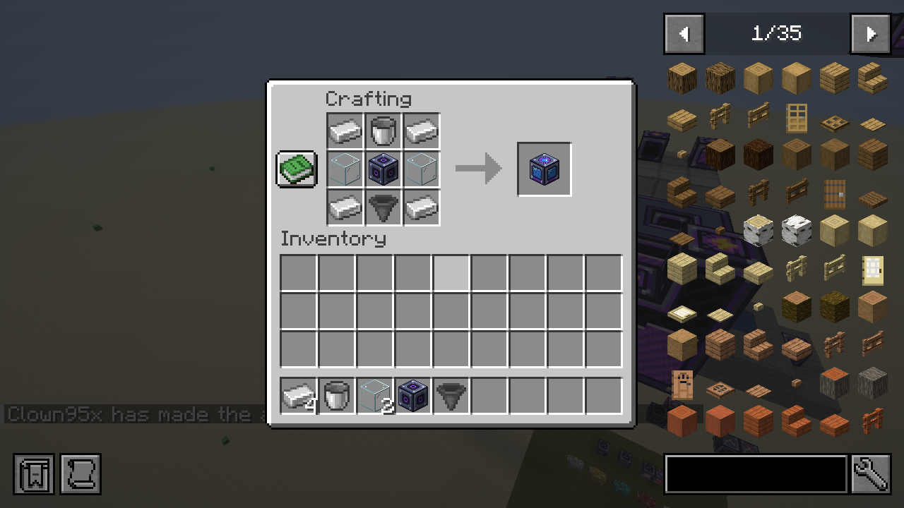

Any glass block works.

### Hume Energy Cube
A Forge Energy battery. FE goes **in and out on every side**, and **cubes that touch join into one bigger battery**: every cube adds to the group's buffer and its transfer rate.

| Groups connect into one casing | From below |
|---|---|
| 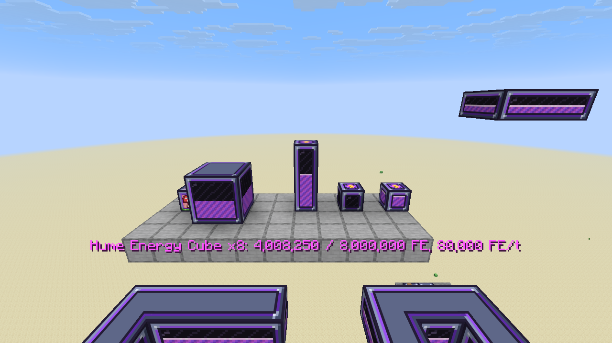 |  |

Any shape works, not just full boxes. L-shapes, rings and walls with bends get proper inside corners where the frame turns. Where the structure folds inward (a wall standing on a slab, a staircase), each face keeps its frame along the fold, so a window never runs into the plate beside it.

| Inside corners | Folds (wall on a slab, staircase) |
|---|---|
| 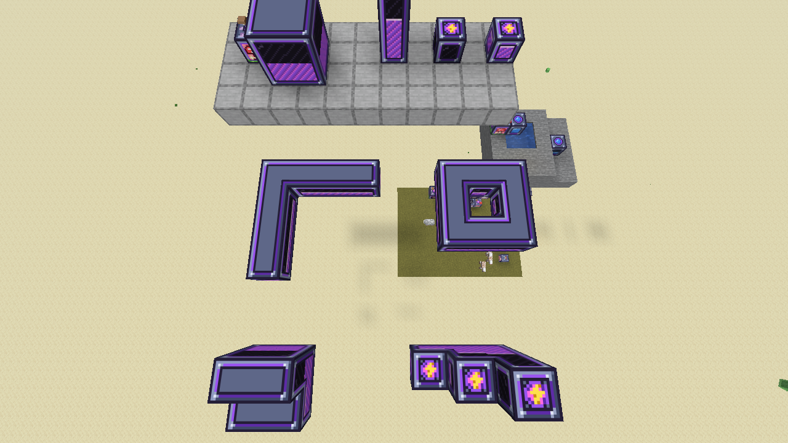 | 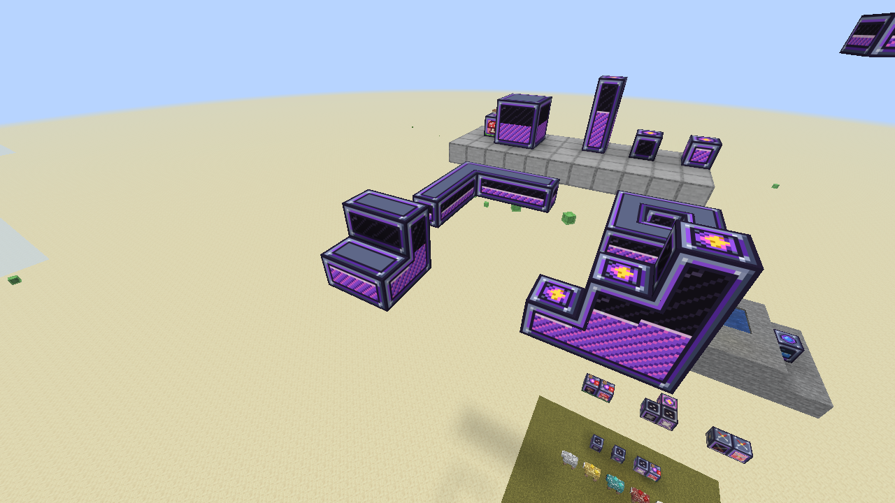 |

- **One cube:** 1,000,000 FE buffer, 10,000 FE/t transfer rate (`capacityPerCube`, `transferPerCube`).
- **A group of N touching cubes** (faces touching, in any shape) has **N x** the buffer and **N x** the transfer rate. A 2x2x2 block of 8 cubes holds 8,000,000 FE and moves 80,000 FE/t. Every cube in the group shares the same energy, so you can feed one end and take power out of the other.
- **Output:** the group **pushes energy into any machine or cable touching it** (`autoOutput`), up to its transfer rate each tick. Machines and cables can also pull from it, and any generator or cable can charge it. It never pushes into other cubes.
- **Breaking a cube** splits the group if it was holding it together. Each cube keeps its own share of the energy, and a broken cube keeps its share in the item (shown in its tooltip), so no energy is lost. This works in creative too: a cube that holds energy drops itself with it, like a shulker box (an empty one drops nothing, as usual in creative). Place it again, alone or beside other cubes, and the energy is back in the battery.

  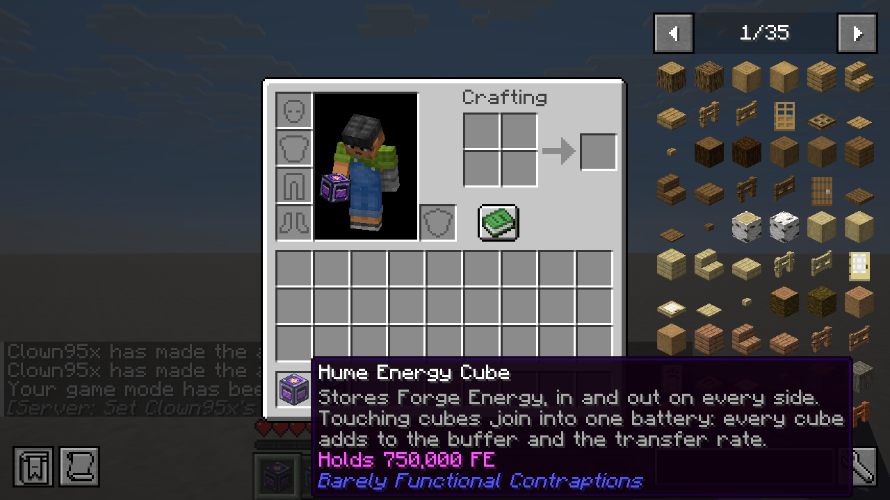
- **Looks like one big block:** touching cubes connect. Their frames only run around the outside of the group, so a 2x2x2 group looks like a single large cube with one big window, and a tower looks like one tall tank. The windows fill with swirling purple energy **from the bottom layer up**, like a tank of liquid: a 2-high stack at 75% shows a full bottom layer and a half-full top layer. The top and bottom join into one plain metal plate (only a cube with nothing beside it, like a lone cube or the top of a one-wide tower, shows the purple bolt port), and the cubes glow brighter as they charge. A comparator reads how full the group is.
- **GUI:** right-click a cube to open it. It's in the same slate style as the other machines:
  - an energy gauge with a mark for every eighth;
  - the stored energy and buffer (*4,020,500 FE of 8,000,000 FE*);
  - the group's cube count and transfer rate (*x8 · 80,000 FE/t*);
  - the energy actually flowing **in** and **out**, averaged over the last second;
  - a status lamp: *Charging*, *Discharging*, *Full*, *Empty* or *Idle*.
  It shows the whole group, whichever cube you open. Hover over things for details.

  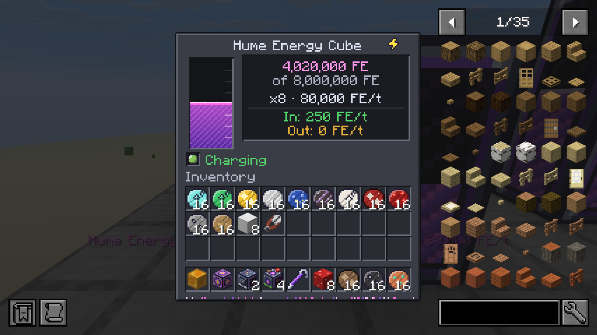
- **Wireless:** a Mycelial Generator can charge a cube from a distance with the Barely Functional Wrench, like the other machines.
- Groups are limited to 64 cubes (`maxGroupSize`); extra cubes form another group. Mine it with a stone pickaxe or better.

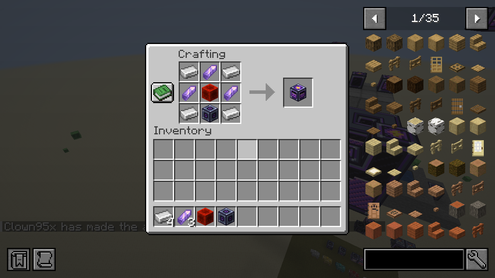

### Fluid Tank
The Hume Energy Cube's twin for fluids. It stores **one fluid** (water, lava or any modded fluid) behind **glass windows**, so you can see the level, and touching tanks join into **one big tank** with the same connected casing as the cube.

| Water, lava and an L of tanks | Up close |
|---|---|
| 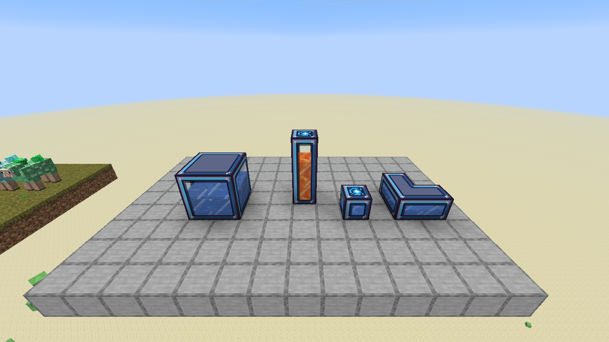 | 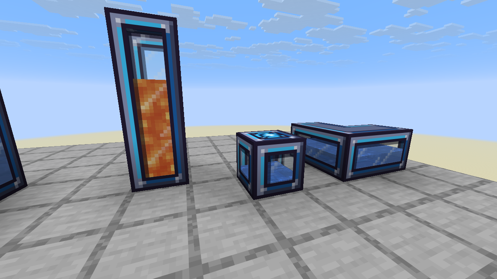 |

- **One tank:** holds **16,000 mB** (16 buckets) and moves up to **1,000 mB/t** (a bucket a tick) in or out.
- **Multiblock:** tanks touching on any face form **one tank**. Every tank adds 16,000 mB to the capacity and 1,000 mB/t to the transfer rate, up to 64 tanks. It fills **from the bottom up** like a real tank: the bottom layer fills first, the tanks of a layer share their fluid evenly, and the windows show **one level running across the whole group**. Tanks holding different fluids never join, even when they touch.
- **Connected casing:** the frame drops where tanks touch, so a 2x2x2 looks like one big tank with one window on each side and one plain top plate. Inside corners turn properly, just like the Hume Energy Cube. A lone tank shows a blue valve on top.
- **Filling and emptying:** right-click with a **bucket** (or any fluid container) to pour it in or take it out. Fluid goes in and out on **every side**, so Fluid Pipes, the Fluid Reservoir and other mods' pipes all work. The tank also **pushes its fluid into machines touching it** every tick, such as a Mycelial Generator's water tank (`autoOutput`), but never into another tank.
- **With Fluid Pipes:** pipes give fluid to **machines first** and fill tanks with what's left. They never move fluid from one tank to another, so two tanks on one network don't pass it back and forth. The tank pushes into pipes itself.
- **Breaking:** a broken tank keeps **its own share** of the fluid; the item's tooltip shows *Holds 7,000 mB of Lava*. Place it again, alone or beside other tanks, and the fluid is back. In creative, a tank that holds fluid drops itself with it too, like a shulker box.
- **GUI:** right-click with an empty hand. The gauge shows the fluid's own texture and colour, along with the fluid's name, *mB of capacity*, the group size and rate, and the flow in and out over the last second. The status lamp reads *Filling*, *Draining*, *Full*, *Empty* or *Idle*.

  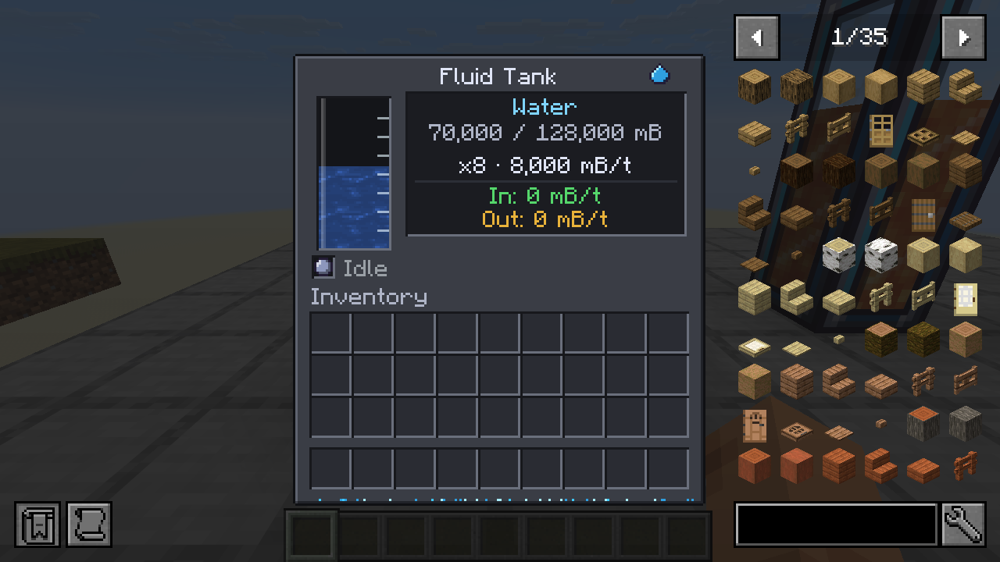
- A **comparator** reads how full the whole group is. Lava glows through the glass. Mine it with a stone pickaxe or better.

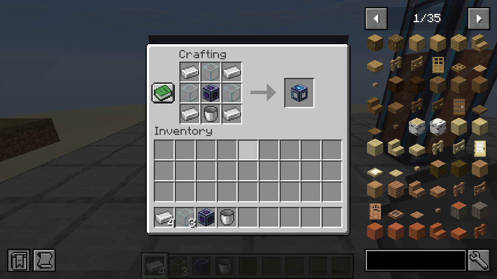

### Zero Point Energy Module
A generator that comes in pairs. Put one module on the floor and another on the ceiling **directly above it**, or one on each of **two walls facing each other**, with open space between them. The two link with a **blue beam** and make Forge Energy out of the gap: **the farther apart they are, the more power they make**.

| A linked pair, 5 blocks apart | Jade on the floor module |
|---|---|
| 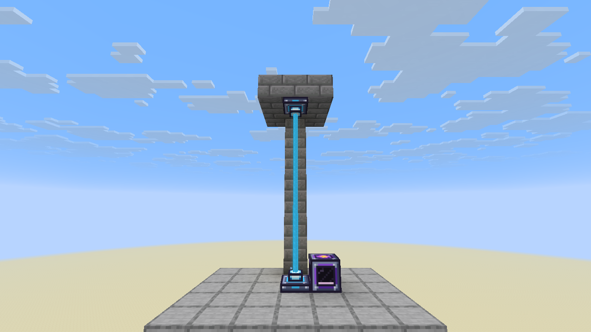 | 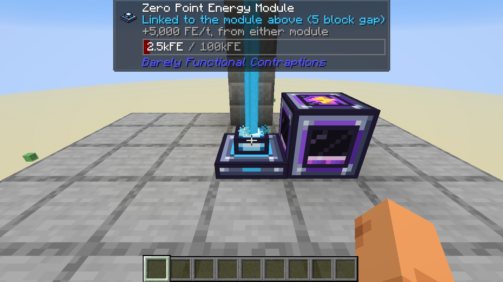 |

- **Placing:** it goes on like an end rod, pointing **away from the block you place it against**. On top of a block the emitter points **up**, on the underside of a block (a ceiling) it points **down**, and on the side of a block (a wall) it points **straight out from the wall**.
- **Sideways pairs:** two modules on facing walls work exactly like a floor and ceiling pair: same power per block of gap, same beam (stained glass colours it, and it burns anything that walks through it), same GUI. A beam running along the floor is a handy mob trap.

  | Wall-to-wall pairs | The GUI of a wall module |
  |---|---|
  | 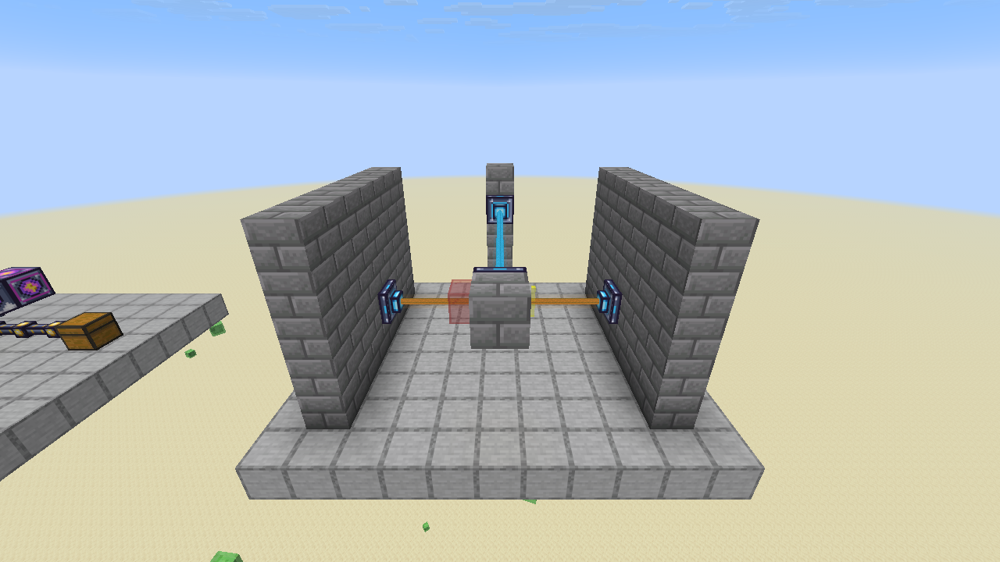 | 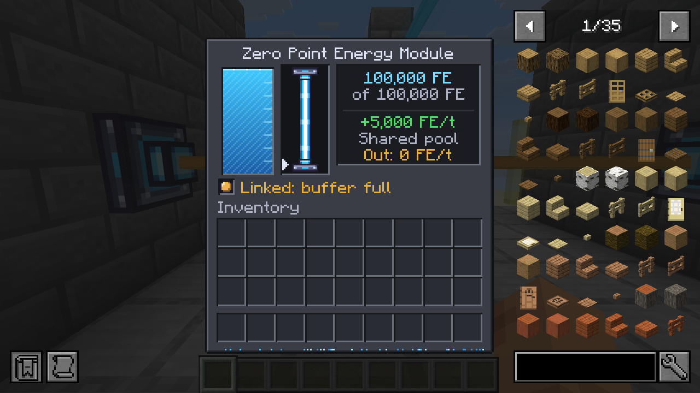 |
- **Linking:** a module links with the **nearest module straight ahead of its emitter** (above it, below it, or across the room) that points back at it. The two must:
  - face each other (two modules pointing the same way never link);
  - have at least one block of open space between them (`minGap`), and be no more than 64 blocks apart (`maxRange`);
  - have nothing solid in the way. The beam passes through air, glass, panes, leaves and anything else see-through, so you can build a glass tube around it. Any solid block breaks the link.
  Modules check for their partner a few times a second, so breaking a block in the way, or one of the modules, switches the beam off almost straight away.
- **Power:** a linked pair makes **1,000 FE/t for every block of gap** (`energyPerBlock`). A 5-block gap makes 5,000 FE/t, and a 63-block gap, the largest, makes 63,000 FE/t.
- **Take it from either end:** the two modules share **one pool of energy**, so **the pair's full output can be taken from either module**. You only need to connect one of them: a machine on the floor module gets all 5,000 FE/t, not half. Each module adds a 50,000 FE buffer to the pool (100,000 FE for the pair).
- **Output:** each module **pushes energy from the pool into every machine or cable touching it**, up to 100,000 FE/t (`maxOutput`), and **never less than the pair's whole output**: if the pair makes more than `maxOutput`, the limit rises to match, so one module can always give out everything the pair makes. Cables can also pull from it. If both ends have machines, they share what the pair makes. Modules don't accept energy and never push into each other.
- **Looks:** while linked, the emitters glow bright blue, pulse and give off light, and blue sparks drift around them. Unlinked modules are dull grey-blue.
- **Sound:** linked modules give off a deep, low **energy hum** (built on 55 Hz) with a faint electric shimmer. It fades in when the beam connects and winds down when it breaks, and bigger gaps hum a little higher. Its subtitle is *Zero Point Energy Module hums*, and it follows the *Blocks* volume slider.
- **Emitters turn:** while a pair is linked, each module's glowing emitter slowly turns the opposite way to the beam (one turn every 8 seconds). An unlinked module's emitter stands still.
- **The beam burns:** anything living that touches the beam (mobs, animals and players) takes **4 damage** (2 hearts, `beamDamage`) and is **set on fire for 5 seconds** (`beamBurnSeconds`). It keeps hurting them twice a second while they stay in it, and its death message is *"was vaporised by a Zero Point beam"*. Players in creative or spectator mode are safe, and fire-immune mobs like blazes take the damage but don't burn. Set `beamDamage` to 0 for a harmless beam. Dropped items are left alone.
- **Built-in Looting:** mobs the beam kills drop as if killed with a **Looting I** sword (`beamLooting`, up to 10): every stack in their normal drops gets up to one extra item, so a pig drops 1-4 porkchops instead of 1-3. Since they burn to death, meat comes out cooked. Only the mob's own drops get the bonus, not armour or weapons it was holding.
- **Counts as a player kill:** mobs the beam kills **drop experience** and **player-only loot** (blaze rods, a zombie's rare iron ingot, a wither skeleton's skull), just as if you had killed them yourself (`beamCountsAsPlayerKill`). The kill is credited to a fake player called *[Zero Point Beam]*, so it works even when nobody is nearby. A beam-and-hopper mob farm needs no player.

  
- **Coloured beams:** stained glass colours the beam. Put a stained glass block or pane anywhere in the gap and the **whole beam**, from one module to the other, takes its colour. Several colours mix the way a beacon beam's do (each different colour blends with the colour so far), so red and then yellow make an orange beam. Glass of the same colour in a row changes nothing. The colour is only for looks: the power is the same.

  
- **GUI:** right-click a module to open it. It's in the same slate style as the other machines:
  - an energy gauge for the pair's shared pool;
  - a **beam diagram**: the column with this module marked by a pointer, and at the far end what it found. When linked, both modules are lit with the animated beam between them. Otherwise it shows why: a blocking block (with a red cross) part of the way along, a partner that points the wrong way, a partner too close, or a dashed outline where a partner should go;
  - the pair's pooled energy (*of 100,000 FE*), what the pair makes (*+5,000 FE/t*, *Shared pool*) and the energy leaving the pool through either module, averaged over the last second;
  - a status lamp: *Linked: 5 block gap* (green), *Linked: buffer full* (orange, nothing is taking the energy), or in red *Beam blocked 3 above*, *Partner faces wrong way*, *Partner too close*, or grey *No module above*.
  Hover over the diagram or the lamp for what to do about it.

  | Linked | Beam blocked |
  |---|---|
  |  |  |
- **Jade** shows whether a module is linked, the gap to its partner and how much it and the pair make. If it isn't linked, it tells you it needs a module facing it in the same column.
- The recipe makes **two** modules, one pair. Mine them with a stone pickaxe or better.


### New blocks at a glance


*From the left: a Glow Panel in the sun, a Glow Lamp on a panel, a shaded panel with the Contraptions Manual framed on it, an Energy Meter reading a panel's 60 FE/t, and Item and Fluid Pipes with Pull (orange) and Push (green) sides. Staged with `./gradlew runClient -PscreenshotHarness -PharnessScene=new_blocks`.*

### Glow Panel and Glow Lamp
The **Glow Panel** is a thin, solar-style generator that makes Forge Energy from the **light falling on its top**. The **Glow Lamp** is a full-brightness lamp of glow ink that keeps the panels going at night and underground.

| By day | At sunset |
|---|---|
|  |  |

At midnight the panels under the lamps still run:


- **Sunlight:** with open sky above it, a panel makes up to **60 FE/t** (`sunRate`). It reads the sun the way a daylight detector does: less at dawn and dusk, in rain and in shade, and **nothing at night**.
- **Glow light:** it also makes up to **40 FE/t** (`lightRate`) from **block light** on its top, scaled by the light level. A **Glow Lamp** sitting on it or above it gives the full 40 FE/t, and so does glowstone or any other light-15 block. A glowing **Glow Ink sheep** (light 12) standing right beside a panel lights it to about 29 FE/t. The panel uses whichever of sun or glow gives more.
- **Shade:** a solid block on top that doesn't glow (stone, a machine) shades it completely.
- **Output:** it stores 10,000 FE and pushes up to 1,000 FE/t into blocks **beside and below** it (cables, machines, Hume Energy Cubes, other mods' FE blocks). Cables and machines can also pull from it. Panels don't charge each other, and nothing can be pushed into a panel.
- **Its cells show how much it is making.** They are dark when it makes nothing, dim when it makes up to a third of its best (60 FE/t by default): at dawn, dusk, in rain or in a lamp's spill light. They are half lit up to two-thirds (a Glow Lamp's 40 FE/t, so at night under a lamp) and fully lit above that (the midday sun). The panel gives off a little light to match (0 to 3). **Right-click** or **Jade** shows how much it makes and from which light. Every number is in `[glow_panel]` in the synced config.
- **Recipes:**
  - Glow Panel: a row of glass, a daylight detector between two quartz, and iron ingots around redstone.
  - 2 Glow Lamps: glass in the corners, Glow Ink Sacs on the sides and glowstone dust in the middle.
- Mine the panel with a pickaxe. The lamp breaks by hand.

### Static Generator
A mid-game generator, **two blocks tall**, that turns **friction** into power, like a Van de Graaff generator. Sheep rubbing against **Copper Combs** in its pen build up static, and its polished copper dome collects the charge and arcs it into power. Its blue-steel base has a charge gauge on the front, and a rubber belt runs up a column into the dome, which crackles with sparks while it charges.

```
  L        L = Lightning Rod
C R C      C = Copper Block, R = Redstone
W M W      W = any wool, M = Functional Machine Block

I I I      Copper Comb: I = Copper Ingot
  B        B = Brush
```

- **Pen and combs:** its pen is 5x5, centred on it (`radius`), at its level and the one above. Put up to 4 Copper Combs in it (`maxCombs`; it uses the nearest). A sheep standing within 1.5 blocks of a comb (`combReach`) gets rubbed. Sneak-right-click it, or the window's button, to outline the pen.
- **Herd:** every half second it counts the grown sheep with their fleece on next to a comb. Each gives 100 FE/t (`powerPerSheep`); Copper sheep give 150 and Redstone sheep 125 (`sheepPower`). Up to six count (`maxSheep`), each in full: 600 FE/t from plain sheep, 900 from Copper sheep. (`falloff`, 0 by default, can make each one after the best add a little less.) Sheared sheep and lambs don't count, so give the pen grass to regrow their wool. It calls back sheep that wander just out of its pen.
- **Combs:** a comb passes on 100% of a sheep's charge fresh, then 75, 50 and 25% as it oxidises (exposed, weathered, oxidised). Each comb a sheep is rubbing against wears, and after 20 minutes of it (`wearTicks`) it oxidises a stage. An axe takes it back a stage; Honeycomb waxes it, which stops it ageing for good but insulates it a little (85%, `waxedEfficiency`). The axe takes wax off first, as on vanilla copper. Combs only age while they're worked, and a broken comb keeps its stage and wax.
- **Dome and power:** the charge builds in its dome, which arcs into its buffer every 3 seconds (`arcTicks`), with a crackle of sparks down to a comb. It stores 500,000 FE and pushes up to 2,000 FE/t out of every face of its base but the top.
- **Shocks:** with nothing taking its power, its buffer fills and the dome keeps charging (up to 100,000 FE, `domeCapacity`). Past half full (`shockAt`) it's *Overcharged*: it shocks every player and mob in its pen (not sheep, not creative players), knocking them back away from the dome (`shockStrength`). Each piece of **Woollen Armour** takes a quarter off a shock, and a full set stops it. Each shock bleeds a little charge off.
- **Window:** the energy gauge, the herd and output, the dome's charge bar with the shock line marked in red, a chip for each comb (coloured by its stage, with a sheen when waxed), and the status. Every part has a tooltip.
- **Comparator:** reads how charged its dome is, 0-15, for a circuit that keeps people out or switches on a load.
- **JEI:** a *Static Generator* page (the sheep, the combs, the generator, an axe and Honeycomb, the power for one to six plain or Copper sheep, what each comb stage passes on, and the shock warning), information pages for the generator and the Copper Comb, and its recipes. **Jade:** its status, output, herd, dome charge, its combs (how many, the most worn, how many waxed) and its stored energy, on either half.
- **Advancement:** ⭐ *Shocking!* (goal), for being knocked back by an overcharged one.
- Mine it with a pickaxe; breaking either half removes both. **Config:** `[static_generator]` (see below).

| In its pen: four combs at different stages, five sheep | Its window |
|---|---|
|  |  |
|  |  |
|  |  |
|  |  |
|  | |

### Thermal Reaction Chamber
A late-game generator that makes power from the **difference between hot and cold**. Blaze sheep stand in a pen against its hot side, Snow sheep in a pen against its cold side, and water runs through the middle. It is the machines' blue-steel casing split down the middle: red-hot vent slats and fins on the hot side, frosted ones on the cold side, a gauge panel at the front (two thermometers and a balance dial), water and power ports at the back, and a window on top where flame and snow chase each other while it reacts. Crafted from a Magma Block, a Nether Star, Blue Ice, a Blaze Sheep Furnace, a Hume Energy Cube, a Snow Sheep Chiller, two Copper Blocks and a Fluid Tank, hot things on the left and cold on the right:

```
L N I      L = Magma Block, N = Nether Star, I = Blue Ice
B H S      B = Blaze Sheep Furnace, H = Hume Energy Cube, S = Snow Sheep Chiller
C T C      C = Copper Block, T = Fluid Tank
```

| Three chambers: balanced (middle, pens shown), running cold (right), running hot (left) | Its window |
|---|---|
|  |  |
| Up close: embers drift in from the Blaze sheep, snowflakes from the Snow sheep | Running hot: the needle swings left and the danger bar fills |
|  |  |
| Left cold too long, it freezes itself into Packed Ice | Left hot too long, it melts down |
|  |  |

- **Sides:** it faces you when placed. Looking at its front, the **hot side is on the left** and the **cold side on the right**. Each pen is 5x5 (`radius`), starting one block out from that face, at its level and the one above. Its spyglass button, or a sneak-right-click with an empty hand, outlines the hot pen in orange and the cold pen in light blue, each with its attraction area as a faint dashed box.
- **Keeping its herds close:** it calls sheep back from up to 4 blocks outside its pens, but only in a way that keeps the herds even. A side with fewer sheep calls one of its own back, so a stray comes home. When both sides are even and below 6 pairs, it calls a new pair only if a Blaze sheep and a Snow sheep are both waiting nearby. It never calls a sheep that would leave one side ahead, and never one whose fleece is spent. See [Sheep attraction](#sheep-attraction).
- **Sheep:** every half second it counts the grown sheep with their fleece on: Blaze sheep (`hotSources`) in the hot pen and Snow sheep (`coldSources`) in the cold pen. Sheared sheep and lambs don't count.
- **Power:** a Blaze sheep matched by a Snow sheep is a **pair**. The first pair makes 2,500 FE/t and each one after it adds less (`falloff` 0.13): about 4,700 FE/t for two, 6,500 for three, 8,100 for four and 10,100 for six, the most it counts (`maxPairs`). It stores 2,000,000 FE and pushes up to 40,000 FE/t into every block around it; cables and machines can also pull from any face.
- **Boosts:** a Blaze Rod in the hot slot and Blue Ice in the cold slot each burn 30 seconds while it reacts. While **both** burn the output is doubled (`boostMultiplier`). One burning alone tips the balance one step towards its side instead. Hoppers and pipes can fill both slots from any face, and can't take them out.
- **Balance:** every unpaired sheep, or a lone boost, tips the balance one step and costs a quarter of the output (`imbalancePenalty`). The window's needle swings towards the side with too much.
  - **Running hot** for 30 seconds (`unstableTicks`) causes a **meltdown**: the hot pen's sheep are singed bare and set alight, and it explodes like TNT (`meltdownPower`). With `meltdownExplodes` off it just shuts down as *Overheated* until it cools.
  - **Running cold** for 30 seconds **freezes it solid**: it encases itself in Packed Ice (above and on every open side) and stays *Frozen solid* until every block of that ice is mined away.
  - Running balanced, waiting, or out of water counts the danger back down. A comparator reads the danger: 0 when steady up to 15 just before it goes, so a redstone circuit can cut off a pen's gate.
  - If either pen is empty, it just waits as *Needs both herds*: a pen of Blaze sheep alone can't melt it down.
- **Water:** 250 mB a tick while it reacts (`waterPerTick`), what five Fluid Reservoirs make, from buckets, pipes or a reservoir on any face. It holds 16,000 mB. If it runs dry while reacting it **flash-boils**: it stops and blasts scalding steam out of its front for 5 seconds, hurting anything in the two blocks in front of it.
- **Fatigue:** each sheep can react for an hour (`fatigueTicks`) before its fleece is spent. A spent sheep stops counting (the thermometer's tooltip shows how many are spent). Infusing it again with its own resource, at the Infusion Altar or by hand, renews the fleece, even if its infusion hasn't run out.
- **Buffer full:** it makes no power and uses no water, boosts or fleece until its power is used. Its herds still heat and chill it, though: the needle, the danger bar and the comparator keep following them, and uneven herds still lead to a meltdown or a freeze.
- **Window:** the energy gauge, the hot thermometer, the centre panel (pairs, FE/t, the balance needle and the danger bar), the cold thermometer, the water gauge, the two boost slots with their burn bars, and the status: *Needs both herds*, *Reacting*, *Running hot*, *Running cold*, *No water*, *Buffer full*, *Overheated* or *Frozen solid*.
- **Jade:** looking at it shows its status, the FE/t from how many pairs, each herd, how far off balance it is, how close it is to a meltdown or a freeze (as a percentage), the seconds left on each boost, and any sheep with spent fleece. Jade's own lines add the water, the stored energy and the boost slots. Looking at a Blaze or Snow sheep shows how much of its thermal fleece is left (*Thermal fleece: 73% left*), or that it is spent and needs infusing again.
- **JEI:** a **Thermal Reaction** page shows the hot side (Blaze sheep and a Blaze Rod), the chamber with the 250 mB of water it drinks, the cold side (Blue Ice and Snow sheep), and a table of the FE/t for one to six pairs, with and without both boosts. The numbers come from the server's config. Hover over *Hot* and *Cold* for what happens when it runs hot or cold. Press **U** on a Blaze Rod, Blue Ice or the chamber to find it; the chamber also has an information page.

| JEI: Thermal Reaction | Jade on the chamber and on a Blaze sheep |
|---|---|
|  |   |
- **Advancement:** ⭐ **Thermal Shock** (challenge), for being within 16 blocks when one starts reacting.
- Mine it with a pickaxe. **Config:** `[thermal_reaction_chamber]` (see below).

### Echo Chamber
A late-game generator, **3x3x3**, that turns **noise** into power. Warden sheep stand in a pen in front of its dish and listen for vibrations; keep the noise around it steady and in its sweet spot. Its casing is the machines' blue steel lined with sculk: a big resonator dish on the front whose rings pulse outward from a glowing heart, egg-crate foam walls between baffle ribs, a power port between louvred vents at the back, and a sculk roof with a catalyst dome in a crown of sculk fronds, the biggest two like the Warden sheep's ears.

```
I E I      I = Iron Block, E = Echo Shard
E W E      W = Warden Wool Bale
B M B      B = Blackstone, M = Functional Machine Block
```

- **Placing it:** the block you place is the middle of its front, and it faces you. The rest fills the 3x3x3 space behind and above (it won't place if any of it is taken). Breaking any block of it removes the whole machine, and it drops one Echo Chamber (with a pickaxe).
- **Herd:** grown Warden sheep with their fleece on, in the 5x5 *listening pen* that starts one block out from its dish. The first makes 8,000 FE/t and each one after it less, up to four: 8,000 / 14,000 / 18,000 / 20,000 FE/t. It calls back a Warden sheep that wanders just out of the pen.
- **Hearing:** it hears vibrations the way a sculk sensor does, within 8 blocks of the middle of its dish: note blocks, pistons, doors, footsteps, items landing and so on. Wool between the noise and the dish blocks it, a player wearing Woollen Boots makes none, and its own Warden sheep moving about don't count.
- **Noise level:** the vibrations it heard in the last 10 seconds, as vibrations per 5 seconds (0-15). A note block struck once a second is about 5.
- **Sweet spot:** levels 5-10 give full power. Quieter, the output falls away towards nothing in silence (level 3 gives three fifths); louder, it falls a fifth for each level over 10, to nothing at 15.
- **Steadiness:** it splits the 10 seconds into fifths. A noise that's the same in each gets full power; an erratic one as little as half.
- **Power:** it stores 2,000,000 FE and pushes up to 40,000 FE/t out of its **power port**, the middle of its back, on the bottom layer. Only that face connects.
- **Sleep:** too quiet for 30 seconds and its Warden sheep fall asleep (the sculk clicks stop, and so do the pops off its ears). It makes nothing until the noise is back up to the sweet spot, then they take 5 seconds to settle before it starts again. Back in the sweet spot, drowsiness wears off twice as fast as it builds.
- **Shriek:** too loud for 10 seconds and the room shrieks like a sculk shrieker: shriek rings rise off its roof, players in survival within 16 blocks of its dish get Darkness for 10 seconds, and it stops for a minute. Out of the loud end, the shriek meter drains again.
- **Window:** right-click any block of it. Left, its energy gauge. In the panel: the herd and output, the **noise meter** (16 segments from silence to 15: amber is too quiet, green the sweet spot, red too loud, lit up to the noise level now), the steadiness bar, and two small bars under it: drowsiness (towards its sheep falling asleep) and the shriek meter (towards a shriek; after one, the cooldown draining). Bottom: a status lamp and line. Every part has a tooltip, and the button top right shows or hides its listening pen (so does sneak-right-click).
- **Comparator:** against any block of it, reads the noise level, 0-15, for circuits that turn the noise up or down.
- **Recipe:** see above: three Echo Shards, two Iron Blocks, a Warden Wool Bale, two Blackstone and a Functional Machine Block. It needs a pickaxe; breaking any block of it drops the one machine.
- **JEI:** an *Echo Chamber* page (the Warden sheep, a note block for the noise, the sweet spot, and the power for one to four sheep with a steady noise and an erratic one) and an information page. **Jade:** its status, output, herd, noise level and steadiness, how drowsy or close to shrieking it is, and its stored energy, whichever of its blocks you look at.
- **Advancement:** ⭐ **Good Vibrations** (challenge), for being within 16 blocks when one starts listening with its noise in the sweet spot.
- Still to come: sculk catalysts that wear out, Echo Shard boosts and fleece fatigue.
- **Config:** `[echo_chamber]` (see below).

| The machine | From the back |
|---|---|
|  |  |

| Listening | Shrieked |
|---|---|
|  |  |
|  |  |
|  |  |
|  | |

<a id="sheep-attraction"></a>

### Sheep attraction
The Blaze Sheep Furnace, Powered Furnace, Snow Sheep Chiller, Static Generator, Thermal Reaction Chamber and Echo Chamber keep the sheep they use close by. Every half second, a sheep of the right kind that has wandered out of the working area, but is still within 4 blocks of it (`range` in `[sheep_attraction]`, one block up or down too), walks back to a spot inside it, the way sheep follow wheat.

- Each machine calls only as many as it still has room for, so it never takes sheep it wouldn't use. The chamber also keeps its herds even (see above).
- A sheep standing in one of these machines' areas belongs to that machine for a couple of seconds, so two machines side by side don't pull the same sheep back and forth.
- Sheep on a lead, riding something, and lambs are left alone, so you can still lead a sheep away.
- With the area shown (spyglass button or sneak-right-click), the attraction area is the faint dashed box round the working area.
- `[sheep_attraction] enabled = false` turns it off; `range = 0` does too.

### Blaze Sheep Furnace
A generator that makes Forge Energy from the **heat of Blaze sheep** standing around it. Their fleece is always on fire, so the sheep themselves are the fuel.

| The furnace (orange box) and the Automatic Shears (blue box) with their areas shown | Up close: flames drift from the sheep into the furnace |
|---|---|
|  |  |

- **Where the sheep go:** the **5×5 columns centred on the furnace** (two blocks out each way), at its own level and the block above. Sheep standing next to it, a block further out, or on top of it all count. A sheep counts when its feet are in that area. To make the area bigger or smaller, change `radius` in `[blaze_furnace]` in the synced config: `1` is 3×3, `2` is 5×5 (the default), up to `8`. The area outline always matches it.
- **Keeping its sheep close:** a Blaze sheep that wanders up to 4 blocks outside the area is called back in, as sheep follow wheat, while the furnace has room for more heat (fewer than 4). The outline shows this attraction area as a faint dashed box round the working area. See [Sheep attraction](#sheep-attraction).
- **How much power:** one Blaze sheep gives **80 FE/t**. Each extra one adds a little less (the `falloff`, 12.5%), and the hottest four count (`maxHeatSources`):

  | Blaze sheep | Power |
  |---|---|
  | 1 | 80 FE/t |
  | 2 | 150 FE/t |
  | 3 | 210 FE/t |
  | 4 or more | 260 FE/t |

- **Only blazing sheep:** a sheep counts only while it shows its blazing fleece. A **sheared** sheep or a **lamb** gives nothing until its wool grows back. So you choose between **shearing for Blaze Rods** and **leaving the fleece on for power**. Automatic Shears on a redstone timer let you have some of both.
- **Rain and water:** a sheep in rain or water gives **half**.
- **Blaze Rod boost:** right-click the furnace with Blaze Rods to load them, put them in the boost slot in its window, or feed them in with a hopper or pipe (it holds one stack and only takes boost items; hoppers and pipes can't take them back out). Each rod **doubles the output for 30 seconds**. Rods only burn while there is heat to boost, so a cold furnace keeps them.
- **Output:** it stores 20,000 FE and pushes up to 1,000 FE/t into **every block around it** (cables, machines, Hume Energy Cubes, other mods' FE blocks). Cables and machines can also pull from it. It doesn't join a wrench-linked generator network, which only the Mycelial Generator can lead.
- **Window:** **right-click** with an empty hand to open it. It's laid out like the Zero Point Energy Module's:
  - **Left:** the energy buffer.
  - **Middle:** the **heat column**. Fire rises with the heat from the sheep, out of the most four Blaze sheep can give. There's a line for each extra heat source, with a pip that lights for each one in use, and the fire pulses brighter while a boost burns.
  - **Right:** stored energy, FE/t made, heat sources in use (*Sources: 3/4*) and the boost's time left.
  - **Bottom:** a status lamp (*Burning*, *Burning, boosted*, *Cold*, *Buffer full*) and the **boost slot** for Blaze Rods. Shift-click rods into it, or take them back out.
  - **Top right:** the **show-area button**.

  Hover over any part for details.

  | Four Blaze sheep, boosted | One sheared: three sources, 420 FE/t |
  |---|---|
  |  |  |
- **Info:** its front glows, flickers and crackles while it runs, and small flames drift from each sheep heating it into it. Jade shows what it makes (for example *520 FE/t from 4 heat sources, boosted x2 for 27s, 4 x Blaze Rod waiting*). A **comparator** reads one level per 20 FE/t.
- **Show the area:** click the spyglass button in its window, or **sneak-right-click** it with an empty hand, to draw its area as an orange box. Do it again to hide it.
- **Recipe:** nether bricks and iron bars across the top, Blaze Rods either side of a Functional Machine Block, and redstone either side of a Blast Furnace. Mine it with a pickaxe; any loaded Blaze Rods drop.
- Every number is in `[blaze_furnace]` in the synced config.


#### Heat sources and boosts in data packs
**What heats the furnace** is data. Each file in `data/<namespace>/barelyfunctionalcontraptions/furnace_heat/<name>.json` is one heat source and names **exactly one** of:

- `"sheep"`: a sheep resource id. The built-in `blaze_sheep.json` is `{"sheep": "barelyfunctionalcontraptions:blaze", "power": 80}`.
- `"feature"`: an `appearance` feature, so **any** infused sheep that shows it counts. The built-in `fiery_sheep.json` is `{"feature": "on_fire", "power": 60}`, so a data pack's own fiery sheep work straight away.
- `"entity"`: an entity type, a list of them or a tag, e.g. `{"entity": "minecraft:blaze", "power": 40}` to let caged blazes heat it.

Each file also has:

- `"power"`: FE/t, before the falloff. Use `0` to switch a source off.
- `"wet_multiplier"`: what the source gives in rain or water. It's optional and defaults to `0.5`.

When several files match, the most specific one wins: `sheep`, then `entity`, then `feature`. To change a built-in source, use the same file path in your own data pack. Files may use NeoForge load conditions, and they reload with `/reload`.

**Boost items** are the data map `barelyfunctionalcontraptions:blaze_furnace_boost`:

```json
// data/<namespace>/data_maps/item/blaze_furnace_boost.json
{ "values": { "minecraft:blaze_rod": { "multiplier": 2.0, "duration": 600 },
              "minecraft:blaze_powder": { "multiplier": 1.5, "duration": 200 } } }
```

`duration` is in ticks. Only the Blaze Rod is a boost item by default.

### Powered Furnace
**Smelts anything a Furnace can, on Forge Energy instead of fuel, in a little over half the time**, and faster still with Blaze sheep around it.

| In the world | Its window |
|---|---|
|  |  |

- **Speed:** each item takes **0.55 of its Furnace time** (`cookTimeMultiplier`): Raw Iron 5.5 s instead of 10.
- **Blaze sheep:** heat sources (the Blaze Sheep Furnace's: Blaze sheep with their fleece on, by default) with their feet in the furnace's area (`[blaze_furnace] radius`, 5x5 by default, on its level and the block above) speed it up by **25%** for the first (`blazeBonus`), each one after it adding a little less (the Blaze Furnace's falloff), up to four (`maxBlazeSheep`): x1.25, about x1.47, x1.66 and x1.81. The flame under its input slot lights while they do. They don't add to its power use, so they save power too.
- **Power:** **20 FE/t while smelting** (`energyPerTick`), from any face; it stores 20,000 FE and accepts 1,000 FE/t. It pauses without power.
- **Items:** hoppers and pipes put smeltable items in on any side and take only the results out. A comparator reads the input. Only items a Furnace can smelt go in.
- **Experience:** kept until a player takes the results from its window, like a Furnace's (and dropped if it's broken).
- **Area:** its spyglass button, or a sneak-right-click with an empty hand, outlines the Blaze sheep's area in orange.
- **Keeping its sheep close:** a Blaze sheep that wanders up to 4 blocks outside the area is called back in while it has room for more (fewer than 4). The attraction area shows as a faint dashed box. See [Sheep attraction](#sheep-attraction).
- **JEI:** it's listed as a station for every smelting recipe.
- **Recipe:** iron ingots in the corners and a redstone dust top middle, Furnaces either side of a Functional Machine Block, and a copper ingot bottom middle.

### Snow Sheep Chiller
The Blaze Sheep Furnace's icy opposite: it **freezes water into Ice with the cold of Snow sheep** standing around it, and needs no power.

| In the world | Its window |
|---|---|
|  |  |

- **Cold:** every half second it counts the grown **Snow sheep with their fleece on** whose feet are in the **5x5 columns around it**, on its level or the block above (the Blaze Furnace's area). A sheared sheep or a lamb gives nothing until its wool grows back. Snowflakes drift from each one into it.
- **Speed:** one Snow sheep freezes an Ice every **7.5 seconds** (`ticksPerIce`); each one after the first adds 12.5% less (`falloff`), up to four (`maxColdSources`): about 4, 2.9 and 2.3 seconds for two, three and four.
- **Water:** each Ice takes **1 bucket** (`waterPerIce`) from its **8-bucket tank** (`tankCapacity`). Right-click it with a Water Bucket, pipe water in from any side, or place a **Fluid Reservoir** beside it. Water can't be taken back out.
- **Ice:** it goes in the chiller's one slot (a stack of 64). Hoppers and pipes take it out of any side; a comparator reads how full the slot is. While the slot is full it stops and keeps its water.
- **Window:** right-click with an empty hand. The water gauge, the **cold column** (frost rising with the cold, a mark and pip for each Snow sheep), the speed, the freezing arrow into the Ice slot, how long each Ice takes, and the status (*Too warm*, *Freezing*, *No water*, *Ice slot full*).
- **Area:** its spyglass button, or a sneak-right-click with an empty hand, outlines the area in light blue.
- **Keeping its sheep close:** a Snow sheep that wanders up to 4 blocks outside the area is called back in while it has room for more (fewer than 4). The attraction area shows as a faint dashed box. See [Sheep attraction](#sheep-attraction).
- **Recipe:** iron ingots in the four corners, a Snow Block above a Functional Machine Block, Packed Ice either side of it, and a Cauldron below. Mine it with a pickaxe.
- **Config:** `[chiller]` sets the radius, the most Snow sheep counted, the falloff, the time and water per Ice, the tank, and which sheep resources give cold (`coldSources`, the Snow sheep by default).

### Grass Seeder
Keeps a sheep pen **green**, so sheared sheep regrow their wool sooner. Sheep eat grass down to dirt, and a sheared sheep only grows its wool back when it eats, so a bare pen is a slow one. A squat machine on four legs with a window full of seeds, a seed hopper on top and a brass sprinkler that drips while it works.

```
S C S      S = Wheat Seeds, C = Composter
B M B      B = Bone Block, M = Functional Machine Block
I H I      I = Iron Ingot, H = Hopper
```

| A pen its sheep have eaten bare | Green again, with short grass growing |
|---|---|
|  |  |
|  | |

- **Area:** the **5x5 ground around it** (`radius`), at its feet, and the sheep standing on it. Sneak-right-click it with an empty hand to outline it in green.
- **Tending:** every **2 seconds** (`tickInterval`) it tends one block. **Bare dirt** goes back to grass first; once it's all grass, it grows **short grass** on up to **40%** of it (`shortGrass`), for the sheep to eat instead of the grass block. With nothing to tend it rests, and uses no fuel.
- **Grazing:** while it has fuel, **sheared, grown sheep** in its area graze **four times as often** (`grazeMultiplier`) as they would on their own (a vanilla sheep: 1 in 1,000 a tick), so their wool comes back much sooner. Sheep with their fleece on, and lambs, are left alone. A sheep with a high **Growth** stat regrows anyway; the Seeder is the cheap fix for the rest.
- **Fuel:** **Bone Meal** (one tends 8 blocks, `boneMealBlocks`), by right-click, hopper or pipe; or **FE and water**: **800 FE** (`energyPerTick` 20 x 2 s) and **10 mB** (`waterPerBlock`) a block, from cables, pipes or a Water Bucket. It holds 20,000 FE and 4 buckets. It uses power and water first and saves its Bone Meal.
- **Readout:** right-click it with an empty hand: its status (*Tending*, *All green*, *No fuel*, *No grass or dirt around it*), how much of its ground is grass, its Bone Meal, FE and water.
- **Comparator:** reads how green its area is, 0-15.
- **Goes well with:** **Automatic Shears** on the same pen (the shears take the wool, the Seeder grows it back), and a **Static Generator**, whose sheep only count with their fleece on. Mine it with a pickaxe. **Config:** `[grass_seeder]` (see below).

### Sheep Treadmill
A generator a sheep runs: a belt one block wide and two long in the machines' blue-steel casing, with a bundle of wheat hanging from a gantry at the front and the generator housing at the back. Crafted from two Iron Ingots, three wool (the belt), two Copper Ingots and a Functional Machine Block:

```
I . I      I = Iron Ingot
W W W      W = any wool
C M C      C = Copper Ingot, M = Functional Machine Block
```

| A sheep walking, a sheared one, and an empty treadmill | Its window |
|---|---|
|  |  |

- **Placing:** it faces the way you look, and fills the block in front of where you place it (it won't place if that's taken). Your end is the generator housing; the far end has the wheat. Breaking either half breaks both and drops the treadmill and its food.
- **A sheep:** any grown sheep standing on the belt walks it. While the treadmill has food, no sheep and room for power, it calls the nearest rested, grown sheep within 8 blocks over, about once a second, as wheat in a player's hand does; once beside the belt the sheep hops on (never through a fence or wall). Sheep on a lead, resting, or already on another treadmill are left alone, and two treadmills don't call the same sheep. You can also lead one on. The treadmill holds it in the middle of the belt facing the wheat, the belt runs and its legs go. Lambs are too small. One sheep per treadmill.
- **Power:** 20 FE/t while it walks, +20% for each level of Speed (Slowness takes as much off), and +25% while the sheep is sheared and running light. It stores 20,000 FE and pushes up to 200 FE/t into every block around its back half; cables and machines can also pull from either half.
- **Food:** Wheat or Hay Bales in its slot: right-click it with them, or feed it with a hopper or pipe from any side (they can't take food back out). A Wheat lasts 30 seconds of walking, a Hay Bale nine times that. With nothing to eat the sheep stops and wanders off. A comparator reads how full the slot is.
- **Stamina:** after 2 minutes of walking the sheep is worn out: it steps off the back and rests for 30 seconds, and won't walk any treadmill until then. Its tiredness stays with the sheep, so a fresh sheep can take over at once. Each Endurance point above 1 (from breeding) adds 25% to how long it walks.
- **Buffer full:** the sheep stands still on the belt and eats nothing until power is used.
- **Window:** the energy gauge, the wheat (golden while a sheep walks) over the food slot, the walking sheep's stamina bar, the FE stored and made, and the sheep's stamina or rest. The status line reads *Walking*, *No sheep*, *Hungry: needs Wheat*, *Resting* or *Buffer full*.
- **Config:** `[sheep_treadmill]` (see below).

### Wool Burner
A simple generator that **burns spare wool** for Forge Energy: plain wool, string, and Coal Wool from coal-infused sheep.


| Fuel | Power | Burns for | Energy per item |
|---|---|---|---|
| Plain wool (any colour) | 30 FE/t | 10 s | 6,000 FE |
| String | 30 FE/t | 2.5 s | 1,500 FE |
| Coal Wool | 120 FE/t | 20 s | 48,000 FE |

- **Loading it:**
  - right-click it with fuel;
  - put fuel in the slot in its window (shift-click works);
  - feed it with a hopper or pipe from any side.

  The slot takes fuel only, and hoppers and pipes can't take it back out.
- **Burning:** one item burns at a time, and the next is lit as soon as the last burns out. While its buffer is full it **waits** before lighting the next item, so no fuel is wasted.
- **Output:** it stores 20,000 FE and pushes up to 1,000 FE/t into **every block around it** (`[wool_burner]` in the synced config). Cables and machines can also pull from it.
- **Window:** right-click with an empty hand. It shows the energy buffer, a flame that burns down as the item burns, the FE/t and the time left, with a status lamp (*Burning*, *Out of fuel*, *Paused: buffer full*). Hover over the flame for the list of fuels. Jade shows the same, and a comparator reads how full the fuel slot is.
- **Looks:** its front glows and crackles while it burns, and smoke rises from the chimney on top.
- **Recipe:** iron ingots either side of a wool block, furnaces either side of a Functional Machine Block, and copper ingots either side of redstone. Mine it with a pickaxe; its fuel drops.

| Window | Hover over the flame: the fuels |
|---|---|
|  |  |

#### Fuels in data packs
Each file in `data/<namespace>/barelyfunctionalcontraptions/wool_burner_fuel/<name>.json` is one fuel:

```json
{ "ingredient": "#minecraft:wool", "burn_time": 200, "power": 30 }
```

- `ingredient`: any recipe ingredient. It can be an item, a tag, or the mod's `resource_wool` ingredient for one kind of resource wool. The built-in `coal_wool.json` uses `{"neoforge:ingredient_type": "barelyfunctionalcontraptions:resource_wool", "resource": "barelyfunctionalcontraptions:coal"}`.
- `burn_time`: ticks one item burns for.
- `power`: FE/t while it burns.

When several fuels match an item, the one that gives the most energy in all is used. To change a built-in fuel, use the same file path in your own data pack. Files may use NeoForge load conditions, and they reload with `/reload`.

### Wool Packer and Wool Bales
The **Wool Packer** presses 9 of the same resource wool into one **Wool Bale**. A whole bale goes through the Mechanical Separator in one go: it costs **more power** than its 9 wool, but gives **more resources**.


- **Pressing:** each bale takes 1,000 FE over 1.5 seconds (about 34 FE/t). The packer only starts once 9 wool are in and the bale will fit, and the press pauses without power.
- **Loading it:**
  - right-click it with resource wool;
  - put wool in the left slot of its window (shift-click works);
  - feed it with a hopper or pipe from any side.

  The wool slot takes resource wool only. Hoppers and pipes can take bales out of any side, but never the wool.
- **Window:** right-click with an empty hand. It shows the energy buffer, the wool slot with **nine pips** that light up as the wool for the next bale comes in, a brass arrow that fills while it presses, the bale slot, the FE/t and the time per bale. A status lamp shows *Pressing a bale*, *Waiting for wool*, *No energy*, *Output full* or *Unknown wool*. Jade shows the same, and a comparator reads how full the wool slot is.
- **Looks:** the brass ram in its front thumps down while it presses, puffing out bits of wool.
- **Recipe:** iron ingots in the corners, a piston on top, wool either side of a Functional Machine Block, and redstone at the bottom. Mine it with a pickaxe; its contents drop.

#### Separating a bale
Put a bale in the Mechanical Separator like any wool. With the default config, compared with the bale's 9 wool separated one at a time:

| | 9 Iron Wool | 1 Iron Wool Bale |
|---|---|---|
| Raw iron | 18-36 | **24-48** |
| String | 18 | **24** |
| Iron nuggets | 3 each, 10% chance per wool | 36, 10% chance |
| Energy | 180,000 FE | **300,000 FE** |
| Time | 33.75 s | 33.35 s |

So a bale gives a third more of everything for two-thirds more power. Every count is capped at one stack, so a bale never jams the separator (ender pearls, for example, stop at 16). Bales stack to 64, so they also carry nine times as much wool in a chest or pipe.

All of this is in `[wool_packer]` in the synced config: `baleYield` (12 = 12 wool's worth of outputs), `baleEnergy` (15 = 15 wool's energy) and `baleTime` (9 = 9 wool's time). A separating recipe whose ingredient matches a Wool Bale with its `sheep_resource` component gives that bale its own outputs instead.

**Power for costly bales:** a bale uses its wool's FE a tick times `baleEnergy ÷ baleTime` (15 ÷ 9 by default), so with the separator's x1.35 speed a Wither Wool Bale needs about **2,250 FE/t**. The separator's input rate rises to twice what the bale in it uses (over its usual 1,000 FE/t), so any bale runs at full speed when the power is there. That much takes a big supply: a Hume Energy Cube bank, a Zero Point Module or several generators on one cable.

#### Unpacking bales
Put a bale on its own anywhere in a crafting grid (the inventory's 2x2 grid works) to get its **9 wool** back, of the same resource. JEI lists this for every wool type. The recipe is `data/barelyfunctionalcontraptions/recipe/unpack_wool_bale.json`; a data pack can remove it by overriding that file.


#### Placing bales
A bale can be placed like a hay bale, standing up or lying down, in the colour of its wool with two steel straps round it. It softens falls the same way, breaks fastest with a hoe, and drops the same bale back. Pick-block gives the bale too. The creative Resource Wool tab has a bale of every wool after the wools, then a spawn egg for every sheep.

| Placed bales | The packer's window, pressing |
|---|---|
|  |  |

| A bale in the separator | Its manual chapter |
|---|---|
|  |  |

### Energy Cable
Cables carry Forge Energy from the **power generators** (Mycelial Generator, Zero Point Energy Module, Creative Generator) and the **Hume Energy Cube** to the machines that use it, so a machine no longer has to touch its power source.


- **Placing:** cables join up with every cable they touch, and **plug into any block with a Forge Energy connection** on the side facing them: generators, cubes, the separator, the shears and other mods' energy blocks. A plugged-in side shows a square plug plate. Blocks with no energy connection (or a side that has none, like the front of the Automatic Shears) are ignored, so cables can run straight past them.
- **Networks:** every cable that touches another forms **one network**. Energy put into any cable comes straight out at the blocks plugged in anywhere else on that network, however long it is, shared evenly between them. Cables don't store energy themselves.
- **Where energy goes:**
  - Energy from a **generator** goes to the **machines first**, and anything they can't take charges the **Hume Energy Cubes** on the network. Put a cube on the network as a battery, and it fills up while the generator makes more than the machines use.
  - Energy from a **Hume Energy Cube** only goes to **machines**, never into another cube, so two cubes on one network don't pass the same energy back and forth.
  - Energy never goes back into the block it came from.
- **Push and pull:** generators and cubes push into cables on their own, and each tick the network also **pulls** from any plugged-in block that has energy to give. A cube with `autoOutput = false`, or another mod's generator that doesn't push, still powers the network.
- **Speed:** a network moves up to **100,000 FE/t** in total (`transferRate`). That is enough for the biggest Zero Point pair.
- **Breaking** a cable splits the network in two right away, and each half only connects what is plugged into it.
- **Jade** on a cable shows the network's size, how many blocks are plugged into it and how much it is moving (averaged over the last second).

  
- The recipe makes **8** cables: copper wire with redstone, wrapped in wool. Any colour of wool works. Cables break quickly with any tool (a pickaxe is fastest) and always drop themselves.


### Energy Meter
An inline meter for Forge Energy. Put it **between a generator (or cable) and what it powers**, and it shows how much energy goes through.

- **Placing:** energy goes **in at the back** (dark port) and **out at the front** (glowing port); the other faces have no energy connection. It faces the right way by itself:
  - placed against a generator, battery or cable, energy comes in from that block;
  - placed between two of them (say on the floor between a generator and a Hume Energy Cube), energy comes in from the one with energy to give and goes out to the other;
  - with nothing around it, it points the way you look.
- **The wrench** flips a meter end to end; sneak + wrench turns it to the next direction.
- **Passes energy straight through:** it has no buffer. Whatever is pushed into the back goes on to the block in front, and whatever the block in front (or a cable network) pulls out comes from the block behind. Energy never goes backwards through it.
- **Screen:** one side has the screen, and it **faces you** when you place the meter (if the side towards you is a port, it goes on the nearer side next to it). It shows the flow, shortened to 250, 12.5k or 1.2M, with *FE/t* under it, glowing blue while energy is moving. The other faces are plain casing apart from the two ports. Flipping the meter with the wrench keeps the screen where it is.
- **Not connected?** If there's nothing with an energy connection at its back or front, the screens say **NO INPUT**, **NO OUTPUT** or **NO IN/OUT** in red instead of 0, and right-clicking or Jade says which side to fix. A meter only measures energy that passes through it in a straight line, back to front. If a generator also touches the machine directly, or the meter sits round a corner, energy can go around it; turn it with the wrench, or move it so it's the only way through.
- **Right-click** for the exact reading and the total that has passed since it was placed. **Jade** shows the same, plus the comparator signal.
- **Comparator:** the signal rises with the flow on a log scale, so it's useful from a trickle to a Zero Point pair: 1 FE/t gives 1, 10 gives 3, 100 gives 5, 1,000 gives 8, 10,000 gives 10, 100,000 gives 13, and 1,000,000 or more gives 15. Only energy that actually moves counts.
  
- **Recipe:** iron ingots around a comparator, a glass pane on top and an Energy Cable on each side. Mine it with a pickaxe; it drops itself.

### Fluid Pipe
The Energy Cable's twin for fluids, in **blue** instead of purple. Pipes carry water (and any other fluid) from the **Fluid Reservoir** and other tanks to the blocks that need it, such as the Mycelial Generator's water tank.


- **Placing and networks:** they work the same way as cables. Pipes join every pipe they touch into one network and plug into any block with a **fluid connection** on the side facing them. Pipes and cables never join each other, so the two can run side by side.
- **Flow:** fluid pushed into any pipe comes straight out at the other blocks plugged into the network, shared evenly between them and never back into the block it came from. Pipes hold no fluid themselves.
- **Push and pull:** the Fluid Reservoir pushes its water into the pipes on its own. Each tick the network also **pulls** from any plugged-in block that only gives fluid out (like another mod's pump). Tanks that take fluid in as well, like the Mycelial Generator, are never drained by the pipes, so two tanks on one network don't pass the same fluid back and forth.
- **Speed:** a network moves up to **4,000 mB/t** (4 buckets a tick) in total (`transferRate` in `[fluid_pipe]`).
- **Breaking** a pipe splits the network straight away.
- **Jade** on a pipe shows the network's size, how many blocks are plugged in and how much it is moving.

  
- The recipe makes **8** pipes: copper ingots across the top and bottom, glass, a bucket and glass across the middle. Pipes break quickly and always drop themselves.


### Item Pipe
The third of the set: the same pipe for **items**, in **yellow**. It moves wool, separator outputs and anything else between inventories.


- **Placing and networks:** these work like cables and fluid pipes. Item pipes join every item pipe they touch and plug into any block with an **item connection**: chests, barrels, hoppers, the Mechanical Separator, the Automatic Shears, the Fluid Reservoir and other mods' inventories. They never join Energy Cables or Fluid Pipes.
- **Flow:** items pushed into any pipe come straight out at the other blocks plugged into the network, shared evenly, and never back into the block they came from. Pipes hold nothing themselves.
- **Push and pull:**
  - Hoppers and the separator's bottom output push items into pipes on their own.
  - Each tick the network also **pulls** from slots holding items that block won't take back in. That covers the **Automatic Shears** (their inventory is output-only) and the separator's **output slots** (Raw Iron, String...).
  - Chests, barrels and the separator's wool input are **never emptied** by the pipes, so two chests on one network don't pass items back and forth.
- **Example:** shears → pipe → the side of a separator, then the separator's bottom → pipe → chest. Wool goes straight from the shears into the separator, and the resources come out into the chest. Separator sides follow its `itemInputSides`/`itemOutputSides` config: wool in at the top, back and sides, outputs out of the bottom.
- **Speed:** a network moves up to **16 items a tick** in total (`transferRate` in `[item_pipe]`).
- **Breaking** a pipe splits the network straight away.
- **Jade** on a pipe shows the network size, how many blocks are plugged in and how many items a tick it is moving.

  
- The recipe makes **8** pipes: copper ingots across the top and bottom, glass, a hopper and glass across the middle.


### Pipe sides: modes and filters
Each side where a Fluid or Item Pipe meets a block can be set up on its own, with the **Barely Functional Wrench**.


- **Modes:** right-click the plug (or the face of the pipe's core towards the block) **with the wrench** to cycle the side through four modes. The plug changes colour to match.

  | Mode | Plug | What the pipe does with that block |
  |---|---|---|
  | **Normal** | Pipe colour | Puts things in. Takes things out only from pure sources (Automatic Shears, the separator's outputs, the Fluid Reservoir), so chests and tanks are never drained. This is how pipes always worked. |
  | **Pull** | Orange | Takes everything it can **out**, chests, barrels and tanks included, and never puts anything in. |
  | **Push** | Green | Only puts things **in**. It never takes anything out, even from a pure source. |
  | **Off** | None | No connection on that side at all. Wrench the face of the core to turn it back on. |
- **Filter grid:** **sneak + right-click** the plug with the wrench to open that side's filter: a **3x3 grid** of up to 9 items (or, on a Fluid Pipe, fluids, shown as their buckets).
  - Click a grid slot while carrying an item to put it in that slot. On a Fluid Pipe, carry a bucket of the fluid (or any filled fluid container).
  - Click a slot with nothing carried to take that entry out.
  - Shift-click an item in your inventory to add it to the next free slot.
  - Nothing is ever taken from you. The grid only remembers what to let through.
  - Clicking the middle of the pipe works too: the wrench picks the nearest side that is plugged into a block.
  - The **mode button** on the left cycles Normal/Pull/Push/Off (hover over it for what the mode does), and **Clear** empties the filter.

  
- **Quick filter:** with the wrench in one hand and an item (or a filled bucket) in the other, right-click the plug to add it to the filter, or remove it if it's already there.
- With a filter, only those items or fluids pass that side, both in and out; an empty filter lets everything through.
- Without the wrench, clicking a pipe does nothing special, so items and blocks in your hand are used or placed as normal.
- **Jade** lists every side that isn't plain Normal, with its filter. The settings are saved with the pipe.
- Energy Cables have no modes or filters.

### Woollen Armour and Muffled
A full armour set knitted from wool: the **Woollen Beanie** (helmet), **Woollen Jumper** (chestplate), **Woollen Leggings** and **Woollen Boots**.

| | | |
|---|---|---|
|  |  |  |

- **Crafting:** any wool (`#minecraft:wool`) in the leather armour shapes: 5 for the beanie, 8 for the jumper, 7 for the leggings and 4 for the boots. The recipe type is `barelyfunctionalcontraptions:woollen_armor`, an ordinary shaped recipe whose result takes the wool's colour: one colour gives that colour, and mixed colours blend the way dyes do on leather (red and blue make purple). Wool from other mods counts as white.
- **Colour:** stored as the vanilla `minecraft:dyed_color` component, so the pieces can be dyed in a crafting grid like leather and washed back to white in a water cauldron.
- **Protection:** a little better than leather: 1 / 4 / 3 / 1 armour for the beanie, jumper, leggings and boots (9 for the set; leather gives 7), a 7x durability multiplier (leather's is 5x, so the boots last 91 uses instead of 65), and enchantability 17 (leather's is 15), repaired with any wool on an anvil. The pieces are in the vanilla armour tags, so they take armour enchantments and trims, and in `minecraft:freeze_immune_wearables`, so they keep you from freezing in powder snow.
- **Muffled:** worn **Woollen Boots** give the *Muffled* effect, topped up every half second and lasting 2 seconds, so it wears off soon after they come off. A muffled entity makes no sound: sounds it plays (footsteps, landing, swimming, eating, hurt and death sounds) are cancelled on the server and on its own client. Its vibrations don't reach sculk sensors, shriekers or Wardens either. Mobs wearing the boots are muffled too. Sounds from blocks it breaks or places still play.
- **Config:** `[woollen_armor] bootsMuffle` turns the boots' effect off; `muffleVibrations` lets muffled entities set off sculk again.

### Creative Generator (testing)
An endless power source for creative mode, for testing builds without setting up mushroom farms. It's a slate block with a pulsing magenta energy core on every side, and it glows in the dark.


*Above: one Creative Generator running a Mechanical Separator (left), an Automatic Shears (right) and a stack of two Hume Energy Cubes (charging, on top), all at once.*

- **Where to get it:** the mod's *Barely Functional Contraptions* creative tab, or `/give @s barelyfunctionalcontraptions:creative_generator`. It has no crafting recipe, can't be broken in survival and drops nothing.
- **Unlimited Forge Energy:** it never runs out and needs no fuel or water.
- **Pushes power out:** every tick it pushes FE into every energy receiver touching it, on all six sides: machines, Hume Energy Cubes, other mods' cables. The rate is `creativeGeneratorOutput` (1,000,000 FE/t by default), but each receiver still takes only what its own input limit allows. Set the rate to `0` to stop it pushing.
- **Can be pulled from:** cables and machines can also pull unlimited FE from any side.
- **Typical uses:** put it against a Mechanical Separator to test wool processing, next to Automatic Shears to test a sheep pen, or under a stack of Hume Energy Cubes to fill them quickly.

### Built-in resources

| Fed item | Wool | Separator output (per wool) | Own uses (`-1`) | FE / time |
|---|---|---|---|---|
| Iron Ingot | Iron Wool | 2–4 Raw Iron | 9 | 20,000 / 3.75 s |
| Gold Ingot | Gold Wool | 2–4 Raw Gold | 9 | 20,000 / 3.75 s |
| Copper Ingot | Copper Wool | 2–4 Raw Copper | 9 | 16,000 / 3.75 s |
| Diamond | Diamond Wool | 2–4 Diamond | 1 | 40,000 / 5.95 s |
| Emerald | Emerald Wool | 2–4 Emerald | 1 | 40,000 / 5.95 s |
| Redstone Dust | Redstone Wool | 2–4 Redstone Dust | 9 | 12,000 / 3 s |
| Lapis Lazuli | Lapis Wool | 2–4 Lapis Lazuli | 9 | 12,000 / 3 s |
| Coal | Coal Wool | 2–4 Coal | 9 | 8,000 / 3 s |
| Netherite Scrap | Netherite Wool | 2–4 Netherite Scrap | 1 | 80,000 / 7.45 s |
| Cobblestone | Stone Wool | 2–4 Cobblestone | 1 | 4,000 / 1.5 s |
| Oak Log | Wood Wool | 2–4 Oak Log | 1 | 4,000 / 1.5 s |
| Quartz | Quartz Wool | 2–4 Nether Quartz | 1 | 16,000 / 3.75 s |
| Red Mushroom | Red Mushroom Wool | 2–4 Red Mushroom (+5% Mycelium) | 3 | 8,000 / 3 s |
| Brown Mushroom | Brown Mushroom Wool | 2–4 Brown Mushroom (+5% Mycelium) | 3 | 8,000 / 3 s |

Every resource also gives 2 String, unless its row says otherwise. Plain wool (`#minecraft:wool`) can be separated into 3 string through the bundled `barelyfunctionalcontraptions:separating` recipe.

### Themed sheep

Eleven more built-in resources turn the sheep into a little version of the mob the resource comes from. Each one grows extra body parts or gets an extra behaviour while it has its infused fleece. Lambs and sheared sheep look normal.


| Fed item | Sheep | What's different | Separator output (per wool) | FE / time |
|---|---|---|---|---|
| Hay Bale | Hay | A hay-bale fleece with binding bands | 2–4 Wheat | 4,000 / 1.5 s |
| Snow Block | Snow | A snowy fleece, and it **leaves snow wherever it walks** like a Snow Golem (while its fleece is on, onto any block snow can lie on, when mobs may change blocks) | 2–4 Snowball (+5% Ice) | 4,000 / 1.5 s |
| Nether Star | Wither | Two Wither Skeleton Skulls either side of its own head that look around on their own, and glowing eyes | 2–4 Nether Star + 1 Soul Sand | 400,000 / 14.85 s |
| Dragon's Breath | Dragon | Flapping dragon wings, glowing purple eyes | 2–4 Dragon's Breath (+5% Ender Pearl) | 80,000 / 7.45 s |
| Glow Ink Sac | Glow Ink | Its fleece glows in the dark and **lights up the block it stands in** (light level 12) | 2–4 Glow Ink Sac | 8,000 / 2.25 s |
| Bone Block | Skeleton | A Skeleton Skull for a face (the game's own skull texture) and bony legs | 2–4 Bone (+10% Arrow) | 6,000 / 2.25 s |
| Wither Rose | Wither Skeleton | A Wither Skeleton Skull for a face and charred, bony legs | 2–4 Bone + 2 Coal (+2.5% Wither Skeleton Skull) | 20,000 / 3.75 s |
| Spider Eye | Spider | Four extra spider legs that move as it walks, and glowing red eyes | 2–4 Spider Eye + 4 String | 6,000 / 2.25 s |
| Echo Shard | Sculk | Sculk tendrils on its head, sculk sensors on its back and fleece strands that glow | 2–4 Echo Shard + 2 Sculk | 80,000 / 7.45 s |
| Blaze Rod | Blaze | Permanently on fire, without burning or taking damage | 2–4 Blaze Rod (+10% Glowstone Dust) | 20,000 / 3.75 s |
| Ghast Tear | Ghast | **Twice the size**, ghast tentacles under its belly, and it **screams like a ghast** (the ghast's scream instead of a bleat, and its hurt and death sounds) | 2–4 Ghast Tear + 1 Gunpowder | 40,000 / 5.95 s |


*At night: the Glow Ink sheep lights up the grass around it, and the Sculk sheep's strands, the eyes and the fire still glow.*

The glow is a real light. A Glow Ink sheep leaves an invisible light block where it stands, and the light goes out within half a second of the sheep moving away, being sheared or losing its infusion. The light block can't be seen or touched and never drops anything.

### JEI: every wool type the separator handles
With JEI installed, click the Mechanical Separator in JEI (or press **U** over it) to open **Mechanical Separation**. It lists **every wool type that's loaded**: built-in, mushroom, command-generated and data-pack ones, sorted by name. Plain wool → string and other explicit recipes come after them. Each wool type is one compact row: wool → resource (cycling through 2–4) + string + bonus chance, with energy and time. Like the Resource Infusion page and the Mycelial Generator's fuel page, it uses the same dark slate style as the machine screens: slate panels, recessed slots, and the separator's purple arrow filling over the real processing time. Hover over things for the details. JEI updates by itself after `/reload` or `/barelyfunctionalcontraptions generate`. Press **U** on any resource wool to jump to its row (**R** shows how to make it: the infusion page).


### The Mechanical Separator GUI
- **Energy bar:** shows stored / max FE. Hover for the input rate and the current usage per tick.
- **Progress arrow and spinning gear:** hover for time remaining and the cost of one operation.
- **Status lamp and text:** Idle, Processing %, No Energy, Output Full, Invalid Input or Disabled by Redstone. Hover for an explanation.
- **Redstone button** (top right): cycles Ignored → Active with Signal → Active without Signal → Disabled.
- **Slots:** wool input, resource output, string output and bonus output.

### Automation
- **Items:** by default, hoppers and pipes insert wool through the top, back, left and right faces, and extract outputs from the bottom. Outputs are also auto-pushed into any inventory below the machine. Only items the machine can process are accepted.
- **Energy:** FE is accepted on every face except the front, through NeoForge's `EnergyHandler` capability (`Capabilities.Energy.BLOCK`). Any FE cable or generator works with it.
- **No voiding:** the machine never starts or finishes an operation unless all outputs are guaranteed to fit.
- **No power:** when energy runs out, progress pauses and resumes later.
- **Comparator:** reads how full the input slot is.

---

### Jade (optional)
With [Jade](https://www.curseforge.com/minecraft/mc-mods/jade) installed (26.3.x for NeoForge), looking at things shows:
- **Infused sheep:** the resource (in its colour) and how many shearings are left. A permanent infusion or a resting cooldown is shown instead when that applies.
- **Mechanical Separator:** its status (Processing, No Energy, Output Full...), the FE/t it is using, a non-default redstone mode, and a live progress bar. The energy bar and slot contents come from Jade's built-in support.
- **Thermal Reaction Chamber:** its status, output and pairs, each herd, the balance, the meltdown or freeze danger, the boosts and any spent sheep. On a Blaze or Snow sheep that has reacted, how much of its thermal fleece is left.

Each part can be switched off in Jade's settings under *Plugins → Barely Functional Contraptions*. Jade is optional: the mod runs fine without it.

| Sheep | Mechanical Separator |
|---|---|
|  |  |

<a id="resourceful-sheep-config"></a>

### Configuration

#### Global config (per world, synced to clients)
`config/barelyfunctionalcontraptions-sheep-synced.toml`, synced to every client. A copy placed in `<world>/syncedconfig/` overrides it for that world only. You can also edit it in-game from *Mods → Barely Functional Contraptions → Config*.

**Faster machines (timing revision 1):** the Mechanical Separator (`processingSpeedMultiplier` 1.35), Wool Packer (`ticksPerBale` 30), Infusion Altar (`ticks` 75), Powered Furnace (`cookTimeMultiplier` 0.55), Snow Sheep Chiller (`ticksPerIce` 150) and Automatic Shears (`shearInterval` 15) now work about a quarter faster; each job still costs the same FE. An older config file is brought up to date the first time it loads: any of these settings still at its old default moves to the new one, while one you changed is left as it was. `[revision] timingRevision = 1` records that this has been done.

**`[sheep]`**

| Key | Default | Meaning |
|---|---|---|
| `feedingEnabled` | true | Master switch for feeding |
| `feedingAmountOverride` | -1 | Items consumed per feeding (-1 = use each definition's value) |
| `allowBabies` | false | Allow lambs to be infused by feeding (bred lambs inherit their infusion either way) |
| `breedingKeepsInfusion` | true | Lambs bred from infused sheep are born infused with a parent's resource and a full set of shearings; different parents pass on one at random |
| `breedingNeedsBothParents` | false | Only pass the infusion on when both parents are infused |
| `allowFeedingShearedSheep` | true | Infuse a sheep that has no wool yet |
| `allowReplacingInfusion` | false | Feed a different resource to replace an infusion |
| `sameResourceRefreshesUses` | true | Re-feeding the same resource tops the uses back up |
| `infusionConsumedByShearing` | true | `false` makes infusions **permanent** |
| `infusionUsesOverride` | 100 | Shearings every infusion lasts, for every wool type. `-1` = each resource's own `infusion_uses` |
| `infusionUsesMultiplier` | 1.0 | Scales every resource's `infusion_uses` |
| `woolDropCountOverride` | -1 | Wool dropped per shearing |
| `shearingBonusChance` / `shearingBonusAmount` | 0.0 / 1 | Chance of extra wool per shearing |
| `killDropsEnabled` | true | Killing an infused sheep with its wool drops resource wool and the resource |
| `killWoolBonus` | 1 | Extra resource wool from a kill, on top of one shearing's amount |
| `killDropsResource` | true | Whether a kill also drops one separator roll of the resource (e.g. 2–4 Raw Iron) |
| `preserveWoolColour` | true | Blend the dye colour into infused wool |
| `feedingParticles` | true | Particles and sound when feeding |
| `infusionCooldownTicks` | 0 | Rest time after an infusion runs out |
| `creativeConsumesItems` | false | Whether feeding uses up items in creative |
| `creativeIgnoresCooldown` | true | Creative players bypass the cooldown and the replacement lock |
| `sneakToInspect` | true | Sneak-right-click inspection |

**`[separator]`**

| Key | Default | Meaning |
|---|---|---|
| `energyCapacity` | 100000 | FE buffer |
| `maxEnergyInput` | 1000 | FE accepted per tick; it always takes at least twice what the wool or bale in it uses a tick, so a costly one is never starved |
| `defaultEnergyCost` | 20000 | FE per operation when a resource doesn't set one |
| `energyPerTickOverride` | 0 | Fixed FE/t for every recipe (0 = derive from cost ÷ time) |
| `defaultProcessingTicks` | 100 | Time when a resource doesn't set one |
| `defaultStringOutput` | 2 | String when a resource doesn't set `secondary_count` |
| `primaryOutputMultiplier` | 1.0 | Scales the resource output; fractional parts become a chance |
| `bonusPrimaryChance` | 0.0 | Global chance of +1 resource output |
| `energyCostMultiplier` | 1.0 | Efficiency multiplier for energy |
| `processingSpeedMultiplier` | 1.35 | Speed multiplier (total energy is unchanged): 1.35 = about three quarters of each wool's `processing_ticks` |
| `resetProgressWhenUnpowered` | false | Reset progress instead of pausing it |
| `energyInputSides` | BACK, LEFT, RIGHT, TOP, BOTTOM | Faces that accept FE |
| `itemInputSides` | TOP, BACK, LEFT, RIGHT | Faces that accept wool |
| `itemOutputSides` | BOTTOM | Faces to extract from and auto-push into |
| `autoPushOutputs` / `autoPushInterval` | true / 10 | Automatic output |
| `redstoneControlEnabled` / `defaultRedstoneMode` | true / IGNORED | Redstone behaviour |

**`[automatic_shears]`**

| Key | Default | Meaning |
|---|---|---|
| `shearInterval` | 15 | Ticks between shearing sweeps (15 = three quarters of a second) |
| `energyPerShear` | 2000 | FE used per sheep sheared (0 = runs without power) |
| `energyCapacity` | 50000 | FE buffer |
| `maxEnergyInput` | 1000 | FE accepted per tick (every face except the front) |

**`[sheep_stats]`**

| Key | Default | Meaning |
|---|---|---|
| `enabled` | true | Whether stats are bred and have any effect |
| `maxStat` | 10 | Highest a stat can reach |
| `increaseChance` / `decreaseChance` | 0.25 / 0.05 | Chance each of a lamb's stats comes out one higher / lower than its parents' average |
| `yieldPerPoint` | 0.15 | Extra wool per shearing per Yield point above 1, as a share of the normal amount |
| `growthPerPoint` | 0.01 | Chance a second, per Growth point above 1, that a sheared sheep regrows its wool |
| `endurancePerPoint` | 0.1 | Extra shearings per Endurance point above 1, as a share of the infusion's uses |

**`[infusion_altar]`**

| Key | Default | Meaning |
|---|---|---|
| `handFeedingMaxTier` | 0 | The highest tier that can still be fed by hand; above it, only the altar (0 = every sheep needs the altar, 3 = none do). Replaces `altarOnlyFromTier` |
| `baseEnergy` / `highTierEnergy` | 20000 / 200000 | FE for a tier 1 / tier 2+ infusion when the definition doesn't say |
| `ticks` | 75 | Ticks one infusion takes |
| `energyCapacity` / `maxEnergyInput` | 250000 / 5000 | The altar's buffer and input rate |
| `sheepSlowness` | 5 | Slowness level on the sheep while it is infused, taken off when it ends (0 = off) |

**`[powered_furnace]`**

| Key | Default | Meaning |
|---|---|---|
| `cookTimeMultiplier` | 0.55 | Its smelting time as a share of a Furnace's |
| `energyPerTick` | 20 | FE/t while smelting |
| `blazeBonus` / `maxBlazeSheep` | 0.25 / 4 | Extra speed from the first Blaze sheep (each one after adds less), and the most counted |
| `energyCapacity` / `maxEnergyInput` | 20000 / 1000 | Its buffer and input rate |

**`[sheep_treadmill]`**

| Key | Default | Meaning |
|---|---|---|
| `power` | 20 | FE/t while a sheep walks it, before bonuses |
| `attractRadius` | 8 | How far it calls a sheep over from while it waits with food; 0 = it doesn't |
| `ticksPerWheat` | 600 | Ticks of walking one Wheat feeds (a Hay Bale nine times as long) |
| `walkTicks` / `restTicks` | 2400 / 600 | How long a sheep walks before it's worn out, and how long it then rests |
| `enduranceBonus` | 0.25 | How much longer it walks per Endurance point above 1 |
| `speedBonus` / `shearedBonus` | 0.2 / 0.25 | Extra power per level of Speed (Slowness takes as much off), and while sheared |
| `capacity` / `output` | 20000 / 200 | Its buffer, and the most FE/t it pushes out |

**`[thermal_reaction_chamber]`**

| Key | Default | Meaning |
|---|---|---|
| `powerPerPair` / `falloff` / `maxPairs` | 2500 / 0.13 / 6 | FE/t from the first pair, how much less each extra pair adds, and the most pairs counted |
| `radius` | 2 | Size of each pen: 2 = 5x5 |
| `waterPerTick` / `tankCapacity` | 250 / 16000 | Water it uses a tick while reacting, and how much it holds |
| `boostTicks` / `boostMultiplier` | 600 / 2.0 | How long a Blaze Rod or Blue Ice burns, and the output multiplier while both burn |
| `imbalancePenalty` | 0.25 | Output lost per step off balance |
| `unstableTicks` | 600 | How long it can run hot or cold before it melts down or freezes |
| `meltdownExplodes` / `meltdownPower` | true / 4.0 | Whether a meltdown explodes, and how big (TNT is 4) |
| `fatigueTicks` | 72000 | Ticks a sheep can react before its fleece is spent; 0 = never |
| `capacity` / `output` | 2000000 / 40000 | Its buffer, and the most FE/t it pushes out |
| `hotSources` / `coldSources` | blaze / snow | Sheep resources that count on each side |

**`[static_generator]`**

| Key | Default | Meaning |
|---|---|---|
| `powerPerSheep` / `falloff` / `maxSheep` | 100 / 0 / 6 | FE/t of charge from a sheep against a fresh comb, how much less each extra one adds, and the most counted |
| `sheepPower` | copper=150, redstone=125 | Charge from sheep of particular resources, as `resource=power` |
| `radius` / `maxCombs` / `combReach` | 2 / 4 / 1.5 | Its pen (2 = 5x5), the most combs it uses, and how close a sheep must stand to one |
| `arcTicks` / `domeCapacity` | 60 / 100000 | Ticks between arcs into its buffer, and the charge its dome holds |
| `shockAt` / `shockStrength` | 0.5 / 1.2 | How full the dome is before it shocks things in its pen, and how hard a shock knocks them back |
| `wearTicks` / `waxedEfficiency` | 24000 / 0.85 | How long a comb is worked before it oxidises a stage, and what a waxed comb passes on |
| `capacity` / `output` | 500000 / 2000 | Its buffer, and the most FE/t it pushes out |

**`[echo_chamber]`**

| Key | Default | Meaning |
|---|---|---|
| `powerPerSheep` / `falloff` / `maxSheep` | 8000 / 0.25 / 4 | FE/t from the first Warden sheep (steady noise in the sweet spot), how much less each extra one adds, and the most counted |
| `radius` | 2 | Size of the listening pen in front of its dish: 2 = 5x5 |
| `listenRadius` | 8 | How far it hears vibrations from, in blocks, from the middle of its dish |
| `windowTicks` | 200 | Ticks of noise the noise level averages over |
| `quietBelow` / `loudAbove` | 5 / 10 | The sweet spot of noise levels |
| `sleepTicks` / `wakeTicks` | 600 / 100 | How long it can be too quiet before its sheep fall asleep, and how long they take to settle once woken |
| `shriekTicks` / `shriekCooldown` | 200 / 1200 | How long it can be too loud before it shrieks, and how long it stops for after |
| `shriekRadius` / `darknessTicks` | 16 / 200 | How far from its dish survival players get Darkness when it shrieks (0 = none), and for how long |
| `capacity` / `output` | 2000000 / 40000 | Its buffer, and the most FE/t it pushes out of its power port |
| `sources` | warden | Sheep resources whose sheep listen for it |

**`[sheep_attraction]`**

| Key | Default | Meaning |
|---|---|---|
| `enabled` | true | Whether the furnaces, chiller, Static Generator, Thermal Reaction Chamber and Echo Chamber call their sheep back |
| `range` | 4 | How far outside the working area, in blocks, a sheep is still called back |

**`[woollen_armor]`**

| Key | Default | Meaning |
|---|---|---|
| `bootsMuffle` | true | Whether Woollen Boots give the Muffled effect while worn |
| `muffleVibrations` | true | Whether Muffled also hides the wearer's vibrations from sculk and Wardens |

**`[grass_seeder]`**

| Key | Default | Meaning |
|---|---|---|
| `radius` | 2 | How far out it tends the ground: 2 = the 5x5 around it |
| `tickInterval` | 40 | Ticks between the blocks it tends (2 seconds) |
| `boneMealBlocks` | 8 | Blocks one Bone Meal tends |
| `energyPerTick` / `waterPerBlock` | 20 / 10 | FE a tick while tending (800 FE a block) and mB of water a block, instead of Bone Meal |
| `grazeMultiplier` | 4.0 | How much sooner sheared sheep in its area graze; 1 = no boost |
| `shortGrass` | 0.4 | Share of its grass it keeps short grass growing on |
| `capacity` / `maxInput` / `tankCapacity` | 20,000 / 200 / 4,000 | FE it stores, FE it takes in a tick, mB of water it holds |

**`[chiller]`**

| Key | Default | Meaning |
|---|---|---|
| `radius` | 2 | How far the chilling area reaches (2 = 5x5), at its level and the block above |
| `maxColdSources` / `falloff` | 4 / 0.125 | Most Snow sheep counted, and how much less each extra one adds |
| `ticksPerIce` | 150 | Ticks per Ice with one Snow sheep |
| `waterPerIce` / `tankCapacity` | 1000 / 8000 | mB of water per Ice, and the tank |
| `coldSources` | `barelyfunctionalcontraptions:snow` | Sheep resources whose sheep give cold |

**`[wool_packer]`**

| Key | Default | Meaning |
|---|---|---|
| `energyCapacity` | 20000 | FE each Wool Packer stores |
| `maxEnergyInput` | 1000 | FE it accepts per tick |
| `energyPerBale` | 1000 | FE to press one bale (0 = needs no power) |
| `ticksPerBale` | 30 | Ticks to press one bale |
| `baleYield` | 12.0 | What separating a bale gives, in wool's worth of outputs (a bale holds 9) |
| `baleEnergy` | 15.0 | FE to separate a bale, in wool's worth |
| `baleTime` | 9.0 | Time to separate a bale, in wool's worth |

**`[fluid_reservoir]`**

| Key | Default | Meaning |
|---|---|---|
| `waterPerSecond` | 1000 | mB of water made per second |
| `capacity` | 10000 | Tank size in mB (10 buckets) |
| `requireInfiniteSource` | true | Only work over a self-refilling water source (false = any water source) |
| `outputPerTick` | 1000 | mB pushed into neighbouring tanks (sides and top) per tick; 0 = no pushing |

**`[fluid_tank]`**

| Key | Default | Meaning |
|---|---|---|
| `capacityPerTank` | 16000 | mB each tank adds to its group's capacity |
| `transferPerTank` | 1000 | mB/t each tank adds to its group's transfer rate (in, out and pushing) |
| `maxGroupSize` | 64 | Most tanks in one group; extra tanks form another group |
| `autoOutput` | true | Push fluid into machines and pipes touching the group every tick (never into other tanks) |

**`[energy_cube]`**

| Key | Default | Meaning |
|---|---|---|
| `capacityPerCube` | 1000000 | FE each cube adds to its group's buffer |
| `transferPerCube` | 10000 | FE/t each cube adds to its group's transfer rate (in, out and pushing) |
| `maxGroupSize` | 64 | Most cubes in one group; extra cubes form another group |
| `autoOutput` | true | Push energy into touching machines and cables every tick |

Changes to `waterPerSecond` and `capacity` apply to reservoirs that are already placed, straight away (the config screen works in-game). Shrinking the tank drops any water above the new size. The GUI gauge always has 10 marks, so with a different size each mark is a tenth of the tank instead of a bucket.

**`[creative_generator]`**

| Key | Default | Meaning |
|---|---|---|
| `creativeGeneratorOutput` | 1000000 | FE pushed into each adjacent receiver per tick (0 = only allow pulling) |

**`[zero_point_energy_module]`**

| Key | Default | Meaning |
|---|---|---|
| `energyPerBlock` | 1000 | FE/t a linked pair makes for every block of open space between the modules. The two share one pool, so all of it can be taken from either module |
| `minGap` | 1 | Fewest blocks of open space needed between the modules before they link |
| `maxRange` | 64 | Furthest apart (in blocks) two modules can be and still link |
| `energyCapacity` | 50000 | FE each module adds to the pair's shared buffer (a linked pair holds twice this) |
| `beamDamage` | 4.0 | Damage the beam does to anything living touching it (2 = one heart), at most twice a second. 0 = harmless, no fire |
| `beamBurnSeconds` | 5 | Seconds the beam sets things on fire for. 0 = no fire |
| `beamCountsAsPlayerKill` | true | Mobs the beam kills drop experience and player-only loot, credited to a fake player called [Zero Point Beam] |
| `beamLooting` | 1 | Looting level for mobs the beam kills: each stack they drop gets 0 to this many extra items. 0 = normal drops |
| `maxOutput` | 100000 | Most FE/t each module pushes into, or lets be pulled by, its neighbours. A linked module can always give out at least its pair's whole output, even when that is more than this |

**`[energy_cable]`**

| Key | Default | Meaning |
|---|---|---|
| `transferRate` | 100000 | Most FE/t one cable network carries in total, however many cables and blocks are on it |
| `maxNetworkSize` | 4096 | Most cables in one network. A longer run splits into separate networks, which only pass energy on through blocks plugged into both |

**`[fluid_pipe]`**

| Key | Default | Meaning |
|---|---|---|
| `transferRate` | 4000 | Most mB per tick one pipe network carries in total, however many pipes and blocks are on it |
| `maxNetworkSize` | 4096 | Most pipes in one network. A longer run splits into separate networks, which only pass fluid on through blocks plugged into both |

**`[item_pipe]`**

| Key | Default | Meaning |
|---|---|---|
| `transferRate` | 16 | Most items per tick one pipe network carries in total, however many pipes and blocks are on it |
| `maxNetworkSize` | 4096 | Most pipes in one network. A longer run splits into separate networks, which only pass items on through blocks plugged into both |

**`[generator]`** (limits for `/barelyfunctionalcontraptions generate`; see [What the generator may use](#what-the-generator-may-use))

| Key | Default | Meaning |
|---|---|---|
| `allowedCreativeTabs` | `minecraft:building_blocks`, `minecraft:ingredients`, `minecraft:food_and_drinks` | A wool type's resource (its separator output) must be in one of these creative tabs. Empty list = any tab. |
| `requireStackable` | true | Blacklist every item that doesn't stack (max stack size 1), both as a feeding item and as an output |

#### Client config
`config/barelyfunctionalcontraptions-sheep-client.toml`:

| Key | What it controls |
|---|---|
| `ambientParticles` | Particles around infused sheep |
| `dyeTintStrength` | How strongly the dye colour shows through infused wool |
| `showResourceGrowths` | Small blocks of the resource growing out of infused fleece |
| `showSheepSparkleOverlay` | The glinting overlay on infused fleece |
| `detailedWoolTooltips` | Always show separator details in wool tooltips |
| `detailedMachineTooltips` | Extra detail in the separator GUI tooltips |

---

### Resource definitions (data packs)

Definitions live in `data/<namespace>/barelyfunctionalcontraptions/sheep_resources/<name>.json`.
- The resource id is `<namespace>:<name>`.
- They reload with `/reload` and are synced to clients automatically, so JEI and tooltips update too.
- Feeding, shearing, the separator and JEI all read the same definition.

```jsonc
{
  // Optional NeoForge load conditions: skip the file when a mod isn't installed.
  "neoforge:conditions": [ { "type": "neoforge:mod_loaded", "modid": "mekanism" } ],

  "feeding_item": "#c:storage_blocks/tin",   // item id, #tag, or a list
  "feeding_amount": 1,                       // default 1
  "display_name": "Tin",                     // optional text component; default: translation key resource.<ns>.<name>
  "wool_name": "Tin Wool",                   // optional; default "<display_name> Wool"
  "wool_color": "#B8C4CC",                   // "#RRGGBB", integer, or [r, g, b] (0-255)
  "accent_color": "#E6EEF2",                 // colour of the glinting strands
  "category": "ore",                         // ore | gem | dust | material | organic
  "wool_drop_count": 1,                      // wool per shearing
  "infusion_uses": 9,                        // shearings per feeding (used when infusionUsesOverride = -1)
  "separator": {
    "primary_output": "mekanism:raw_tin",    // item id or {"id": ..., "count": ..., "components": {...}}; default: the fed item
    "primary_count": { "min": 2, "max": 4 }, // random 2-4 per wool; a plain number means a fixed count
    "secondary_output": "minecraft:string",  // default string
    "secondary_count": 2,                    // default: config defaultStringOutput (0 = none)
    "bonus_output": { "item": "mekanism:nugget_tin", "chance": 0.1 },
    "energy_cost": 20000,                    // total FE; default: config
    "processing_ticks": 100                  // default: config
  },
  "growth_item": "mekanism:raw_tin",         // optional: block shown growing out of the fleece; default: the storage block of the fed item or output
  "trail_block": "minecraft:snow",           // optional: a block the sheep leaves where it walks while its fleece is on (the Snow sheep's snow)
  "altar": {                                 // optional: its tier and what it takes at an Infusion Altar
    "tier": 2,                               // 1-3; above [infusion_altar] handFeedingMaxTier (0) it can't be fed by hand
    "catalysts": [ { "ingredient": "minecraft:soul_sand", "count": 4 } ],  // up to 4, used up
    "energy": 200000                         // FE; default: the config's for its tier
  },
  "appearance": {                            // optional: extra looks and behaviours (see below)
    "features": ["wings", "glowing_eyes"],
    "feature_color": "#7A5C99",
    "wool_texture": "mypack:textures/entity/sheep/tin_wool.png",
    "scale": 1.5,
    "skull_texture": "minecraft:textures/entity/skeleton/skeleton.png",
    "sounds": { "ambient": "minecraft:entity.ghast.scream", "hurt": "minecraft:entity.ghast.hurt", "death": "minecraft:entity.ghast.death" }
  }
}
```

**Appearance.** Any resource, including one from a data pack, can use the themed sheep's parts:

| Feature | What it does |
|---|---|
| `extra_heads` | Two Wither Skeleton Skulls either side of the sheep's head, like the Wither. They use the game's own skull texture (a resource pack that changes the skull changes these too) and aren't tinted. |
| `wings` | A pair of flapping dragon wings |
| `extra_legs` | Four long spider legs along the sides |
| `tentacles` | Ghast tentacles hanging under the belly |
| `bones` | A drawn skull face and bony legs (a `skull_texture` covers the face) |
| `sculk` | Sculk tendrils on the head, and accent strands that glow |
| `glowing_eyes` | Eyes in the `accent_color` that glow in the dark |
| `glowing` | The fleece glows, and the sheep lights the block it stands in (light level 12) |
| `on_fire` | Shows the on-fire flames, without burning |
| `screaming` | Bleats, hurts and dies with a screaming goat's sounds (unless `sounds` sets them) |

- `feature_color` tints the wings, legs, tentacles and bones. The default is white, which shows them as drawn. Sculk tendrils have their own colours, so leave it white for them.
- `scale` makes the sheep bigger or smaller while it's infused, from `0.25` to `4` times its normal size (default `1`). It goes through the vanilla `minecraft:scale` attribute as a modifier (`barelyfunctionalcontraptions:resource_scale`, multiplying the base value), so the hitbox, eye height and step height change with it, and it stacks with anything else that changes the scale, such as the `/attribute` command. Lambs stay in proportion. Shearing doesn't shrink the sheep; it goes back to normal once the infusion runs out.
- `sounds` replaces the sheep's `ambient` (bleat), `hurt` and `death` sounds with any sound event id, vanilla or modded. Leave one out to keep the sheep's own. Like the size, the voice lasts as long as the infusion, even while the sheep is sheared.
- `skull_texture` puts a mob's skull over the sheep's head, untinted. It takes any texture in the 64x32 mob-head layout the skull blocks use, such as `minecraft:textures/entity/skeleton/skeleton.png` or `.../wither_skeleton.png`.
- `wool_texture` replaces the greyscale fleece. It uses the vanilla sheep wool layout (64x32) and is still tinted with `wool_color`, so set `wool_color` to `"#FFFFFF"` to show it as drawn. The texture must come from a resource pack.

**Ores vs other materials.** For an ore, set `primary_output` to the raw material (as the built-ins do with Raw Iron). If you leave `primary_output` out, the separator gives back the fed item, which suits gems, logs and stone. A block input never implies 9 outputs automatically; you choose the numbers.

**Missing items.** A definition that references an item from a mod that isn't installed is skipped. The log gets one warning saying which file and which item; the rest of the reload is unaffected. Empty tags are skipped the same way.

**Sheep keep their infusion even when its wool type is missing.** If a sheep's wool type isn't loaded (its data pack was removed or disabled, or its mod uninstalled), the sheep keeps the infusion stored. Until the wool type comes back it looks and shears like a normal sheep, without using up shearings. You can also feed it a new resource, which replaces the stale infusion.

**Examples.** Ready-made definitions for **Tin, Lead, Silver, Nickel, Uranium, Osmium, Aluminium** and **Amethyst** are in `examples/resource_definitions/`. `examples/datapack/` is the same set packaged as a drop-in data pack, plus an example cobweb separating recipe. Copy the folder into `<world>/datapacks/`.

#### Auto-generating resources for every material
You don't have to write a definition for every metal by hand. In a world with cheats on (operator level 2), run:

| Command | What it does |
|---|---|
| `/barelyfunctionalcontraptions preview` | Lists what would be generated, without changing anything |
| `/barelyfunctionalcontraptions generate` | Creates a resource for every material that doesn't have one yet, saves them into the world data pack `barelyfunctionalcontraptions_generated`, and reloads |
| `/barelyfunctionalcontraptions generate all` | Same, but also regenerates materials that already have a definition |
| `/barelyfunctionalcontraptions generate material <material>` | Adds just one material from the storage-block tags. Press Tab to pick one (`slime`, `tin`, `osmium`...) |
| `/barelyfunctionalcontraptions generate item <item>` | Adds a wool type fed with **any** item you choose, e.g. `minecraft:amethyst_block`. If the item is a storage block, its whole `c:storage_blocks` tag is used. |
| `/barelyfunctionalcontraptions generate hand` | Same as `item`, using the item in your main hand |
| `/barelyfunctionalcontraptions generate remove <name>` | Deletes one generated wool type (press Tab to list them) |
| `/barelyfunctionalcontraptions generate dedupe` | Deletes generated wool types that duplicate another one, then reloads. A duplicate has the same feeding block or the same name as another type, for example a generated Iron next to the built-in Iron after `generate all`. Built-in and hand-written definitions are never removed. Of two generated duplicates, the first by id is kept. |
| `/barelyfunctionalcontraptions list` | Lists every loaded resource |

#### What the generator may use
By default the generator only makes wool types whose resource is something from the **Building Blocks**, **Ingredients** or **Food & Drinks** creative tabs, and it **blacklists every item that doesn't stack** (tools, weapons, armour, buckets, potions, stews and so on). This applies to `generate`, `generate all`, `preview`, `material`, `item` and `hand`, and to tab-completion:
- The **output** (the resource the separator gives back) must be in one of the allowed tabs and must stack. When a material's first choice isn't allowed, the generator tries the next candidate (raw material → ingot → gem → dust → same-named item → the block itself). If none is allowed, the material is skipped.
- The **feeding item** must stack. Members of a storage-block tag that don't stack are left out; the definition then lists the allowed items instead of using the whole tag.
- Modded items count when their mod adds them to one of the allowed tabs.
- `generate item`/`hand` explain why an item is refused, for example *"Diamond Sword doesn't stack…"* or *"Redstone Torch isn't in the Building Blocks, Ingredients, Food & Drinks creative tabs…"*.
- Definitions you already have, and hand-written or built-in ones, are never touched.
- Change the tabs or switch the stack rule off in the `[generator]` section of `config/barelyfunctionalcontraptions-sheep-synced.toml`.

How the generator chooses each value:
- **Materials:** it scans the `c:storage_blocks/<material>` item tags that vanilla, NeoForge and nearly every content mod fill. With Mekanism, Thermal and similar mods installed, that covers tin, lead, osmium, uranium, silver and so on. Raw ore blocks (`raw_*`) and anything already defined are skipped.
- **Feeding item:** the storage-block tag, so every mod's variant of the block works.
- **Output:** the first item in `c:raw_materials/`, `c:ingots/`, `c:gems/` or `c:dusts/<material>`. If none exist, it uses an item named after the material (for example `slime_ball` or `resin_clump`), and failing that, the block itself.
- **Uses:** 9 when a block is broken down into one of those units (a block holds 9), otherwise 1.
- **Colours:** taken from the block's map colour. The category comes from whichever tag supplied the output.

Picking single items or materials adds one file without touching the others. It refuses anything an existing built-in or hand-written resource already covers (same feeding item or same name), so you can't create duplicates this way. A wool type made from an arbitrary item (not a storage block) has `infusion_uses` 1, because the mod can't know how many units the item holds. That only matters with `infusionUsesOverride = -1`; by default every wool type lasts 100 shearings.

Generated files are ordinary JSON in `<world>/datapacks/barelyfunctionalcontraptions_generated/`. You can edit them freely. Re-running `generate` (or `generate all`) rewrites only the wool types it generates itself; other generated ones, such as those added with `generate item`/`hand`/`material`, stay until you delete them with `generate remove` or `generate dedupe`. Sheep infused with them keep their infusion. In plain vanilla this adds Dried Kelp and Slime; Hay Bales and Bone Blocks already belong to the Hay and Skeleton sheep (Resin is skipped because the Resin Clump is not in an allowed creative tab).

#### Explicit separator recipes
Use the recipe type `barelyfunctionalcontraptions:separating` to process any item, or to override how a particular wool is handled:
```json
{
  "type": "barelyfunctionalcontraptions:separating",
  "ingredient": "#minecraft:wool",
  "primary_output": { "id": "minecraft:string", "count": 3 },
  "secondary_output": "minecraft:white_dye",
  "bonus_output": { "item": "minecraft:string", "chance": 0.1 },
  "energy_cost": 2000,
  "processing_ticks": 40
}
```
An explicit recipe always takes priority over a resource definition. JEI shows only the recipe that actually applies.

#### Recipe support for other mods (KubeJS, Create, data packs)
Three building blocks make the mod easy to drive from other mods' recipes and from KubeJS:

- **`barelyfunctionalcontraptions:resource_wool` ingredient.** Asks for resource wool in any recipe (crafting, the separator, another mod's machine) without spelling out its data component:
  ```jsonc
  { "neoforge:ingredient_type": "barelyfunctionalcontraptions:resource_wool", "resource": "barelyfunctionalcontraptions:iron" } // Iron Wool
  { "neoforge:ingredient_type": "barelyfunctionalcontraptions:resource_wool", "category": "gem" }  // any gem resource's wool
  { "neoforge:ingredient_type": "barelyfunctionalcontraptions:resource_wool" }                     // any resource wool
  ```
- **`barelyfunctionalcontraptions:wool_bale` ingredient.** The same for Wool Bales:
  ```jsonc
  { "neoforge:ingredient_type": "barelyfunctionalcontraptions:wool_bale", "resource": "barelyfunctionalcontraptions:warden" } // Warden Wool Bale
  { "neoforge:ingredient_type": "barelyfunctionalcontraptions:wool_bale" }                                                    // any Wool Bale
  ```
- **`barelyfunctionalcontraptions:mycelial_fuel` data map.** Adds Mycelial Generator fuels from a data pack (`data/<namespace>/data_maps/item/mycelial_fuel.json`) instead of the config:
  ```json
  { "values": { "minecraft:crimson_fungus": { "burn_time": 300, "energy": 1.1, "water": 1.0, "mycelium": 1.0, "scaling": 0.0 } } }
  ```
  Only `burn_time` is required. The mod ships Crimson and Warped Fungus this way (300 ticks, x1.1 energy; Warped uses 20% less water). Fuels in the config's `fuels` list come first, so the config always wins for an item it lists. Data map fuels show on JEI's fuel page like the others. Keys may be `#tags`.

Together with the `barelyfunctionalcontraptions:separating` recipe type above, that covers recipes, fuels and wool. Two ready-made examples are in `examples/`:
- `examples/kubejs/server_scripts/barely_functional_contraptions.js`: a KubeJS script that adds separator recipes (one using the wool ingredient), a crafting recipe for any gem wool, and two fuels through the data map.
- `examples/create_compat/`: a data pack with **Create crushing** recipes for the nine vanilla resource wools (2 + 50% resource, plus 2 string), loaded only when Create is installed. It uses the format of Create 6 and hasn't been tested with Create on 26.3, so it is shipped as an example rather than built in.

#### Tags
| Tag | Default contents | Purpose |
|---|---|---|
| `#barelyfunctionalcontraptions:infusable` (entity type) | `minecraft:sheep` | Which mobs can be infused. Add modded sheep here. |
| `#barelyfunctionalcontraptions:replaceable_wool` (item) | `#minecraft:wool` | Which drops infused wool replaces |
| `#barelyfunctionalcontraptions:auto_shearable` (entity type) | `#barelyfunctionalcontraptions:infusable` | Which mobs the Automatic Shears shear |

Shearing drops are hooked through a global loot modifier on loot tables whose path starts with `shearing/`. That means hand shears, dispensers and modded shears are all covered, along with modded sheep that use their own `shearing/...` table. Infused-fleece rendering is applied to any entity whose renderer extends the vanilla `SheepRenderer`.

#### Custom wool textures
The 12 built-in wools have hand-made textures. Any other resource uses a greyscale wool texture tinted with its `wool_color` and `accent_color`, so it never shows a missing texture.

To give a data-pack resource its own icon, ship a resource pack that overrides `assets/barelyfunctionalcontraptions/items/resource_wool.json` and adds a `case` for your resource id. The file is a `minecraft:select` on the `barelyfunctionalcontraptions:sheep_resource` component.

---


---

## Test world

[`test-world/BFC-Test-World.zip`](../test-world/BFC-Test-World.zip) is a creative world with every contraption set up
and running: sheep and separators, generators, cubes, Zero Point pairs, cables, pipes and Fluid Tanks. Unzip it into
your `saves` folder. Every scene stands on one square platform, in a grid of cells, and you start at its south edge.
[`test-world/README.md`](../test-world/README.md) lists a teleport command for each scene.

| The platform from its south edge | From above |
|---|---|
|  |  |

## Configuration files

| File | Contents |
|---|---|
| `config/barelyfunctionalcontraptions-mycelial-synced.toml` | Mycelial Generator, networks, wrench, water, fuels and mycelium spread. Synced to clients; a copy in `<world>/syncedconfig/` overrides it per world. |
| `config/barelyfunctionalcontraptions-mycelial-client.toml` | Generator particles and sounds. |
| `config/barelyfunctionalcontraptions-sheep-synced.toml` | Sheep infusion, the Mechanical Separator, Automatic Shears, Fluid Reservoir, Hume Energy Cube, Zero Point Energy Module, Energy Cable, Fluid and Item Pipes, the Creative Generator and the `generate` command. Synced to clients; a copy in `<world>/syncedconfig/` overrides it per world. |
| `config/barelyfunctionalcontraptions-sheep-client.toml` | Sheep particles, tinting, overlays and tooltips. |

All four can be edited in-game from *Mods → Barely Functional Contraptions → Config*. The screen gives every section and option a plain English name, with its unit in brackets (for example *FE/t per Block of Gap* or *Network Rate (mB/t)*). Hover over an option for the full explanation. The tables in this README use the names as they appear in the `.toml` files.

| Sections | Options in a section |
|---|---|
|  |  |

## Commands

`/barelyfunctionalcontraptions preview | generate | list` (operator level 2). This is the Resourceful Sheep resource generator described above, which used to be `/resourcefulsheep`.

---

## Building from source

Requires **JDK 25**. Gradle 9 is downloaded by the wrapper.

```bash
./gradlew build                          # compiles, runs unit tests, outputs build/libs/barelyfunctionalcontraptions-1.5.5-mc26.3.jar
./gradlew build -Pmc=26.2                # the same for Minecraft 26.2: build/mc26.2/libs/barelyfunctionalcontraptions-1.5.5-mc26.2.jar
./gradlew build -Pmc=26.1                # the same for Minecraft 26.1.2: build/mc26.1/libs/barelyfunctionalcontraptions-1.5.5-mc26.1.jar
./gradlew runClient                      # dev client (with JEI and Jade)
./gradlew runServer                      # dev dedicated server
./gradlew runGameTestServer              # runs every GameTest (both modules + integration) headlessly, then exits
./gradlew test                           # unit tests
./gradlew runClient -PscreenshotHarness  # stages a test world, saves screenshots to run/screenshots/ and quits
./gradlew runClient -PscreenshotHarness -PharnessScene=themed_sheep  # only the themed sheep: close-ups and a night shot
```

To launch the dev runs **without JEI**, pass `-Puse_jei_runtime=false`.

To put the finished jar in another folder, such as your Minecraft `mods` folder, pass `-PjarDir=<folder>` (for example `./gradlew build -Pmc=26.2 "-PjarDir=C:/Users/you/Desktop/BFC jars"`). To make that your default, add `jarDir=<folder>` to your own `~/.gradle/gradle.properties`. Every jar's name includes its Minecraft version, so all versions can share one folder.

### Building for each Minecraft version
The mod builds for **Minecraft 26.3** (the default), **26.2** and **26.1** (26.1.2) from one source tree. Add `-Pmc=26.2` or `-Pmc=26.1` to any command above (build, runClient, runGameTestServer, ...) to target that version.

- `versions/<mc>.properties` holds each version's Minecraft, NeoForge, JEI and Jade versions and ranges.
- `src/main` is shared by every version. The few game calls that differ live behind small classes in `com.jax3.barelyfunctionalcontraptions.compat` (`Mc`, `McClient`, `Vanilla`, `HugeMushrooms`, `CompatLootModifier`, and `McTest` for the GameTests and screenshot harness), with one copy per version in `src/mc/<mc>/java`. Shared code only calls those.
- Data files are written once, in 26.3's format. The 26.2 and 26.1 builds convert the loot tables and advancements as they copy them, because those versions still use the older `conditions`/`functions` lists and `recipe` field (see `buildSrc/src/main/groovy/McDataDowngrade.groovy`).
- Each version builds in its own folder (`build/` for 26.3, `build/mc26.2/` and `build/mc26.1/` for the others) and runs in its own game folder (`run/`, `run-26.2/` and `run-26.1/`), so a world is never opened in an older version.
- Block entity blocks have a small `codec()` method that 26.1 and 26.2 need and 26.3 ignores.

To check a change on every version, run the GameTests on each: `./gradlew runGameTestServer`, `./gradlew runGameTestServer -Pmc=26.2` and `./gradlew runGameTestServer -Pmc=26.1`.

The build downloads from `maven.neoforged.net` (NeoForge), Mojang's servers (Minecraft), `maven.blamejared.com` (JEI) and `api.modrinth.com` (Jade).

**IntelliJ IDEA:** *File → Open*, select the project folder, and set the Gradle JVM to a JDK 25 (IntelliJ 2025.2+). ModDevGradle generates the `Client`, `Server` and `GameTestServer` run configurations on sync.

### Regenerating art and data

| Command | What it does |
|---|---|
| `cd tools/mycelial-texture-generator && pip install -r requirements.txt && python generate.py -o ../../src/main/resources` | Mycelial Generator and wrench textures, models and GUI ([README](../tools/mycelial-texture-generator/README.md)) |
| `python3 tools/sheep/generate_textures.py` | Sheep wool, separator and creative generator textures |
| `python3 tools/sheep/generate_sounds.py` | The Zero Point Energy Module's hum (`sounds/block/zero_point_hum.ogg`), synthesised as a seamless loop. Needs numpy and ffmpeg with libvorbis. |
| `python3 tools/sheep/generate_data.py` | Sheep models, blockstates, built-in resources, recipes, loot and tags. It merges into the shared `en_us.json` instead of replacing it. |

## Project layout

```
src/main/java/com/jax3/barelyfunctionalcontraptions/
├── BarelyFunctionalContraptions.java        the single @Mod entry point; initialises both modules
├── client/BarelyFunctionalContraptionsClient the single client entry point (config screen + both modules' client code)
├── registry/ContraptionsCreativeTab the two creative tabs (machines and tools, resource wool)
├── gametest/IntegrationGameTests   tests for the parts where the modules meet
├── mycelial/                       Mycelial Power module (generator, wrench, networks, mycelium, JEI/Jade)
└── sheep/                          Resourceful Sheep module (infusion, wool, separator, commands, JEI/Jade)

src/main/resources/
├── assets/barelyfunctionalcontraptions/     models, textures, sounds and the merged en_us.json for both modules
└── data/barelyfunctionalcontraptions/
    ├── barelyfunctionalcontraptions/sheep_resources/   built-in sheep resources (incl. red_mushroom, brown_mushroom)
    ├── recipe/, loot_table/, advancement/, loot_modifiers/
    └── structure/, test_environment/, test_instance/   GameTest data
```

The modules keep their own registries, configs and networking. They share the mod id and namespace through `BarelyFunctionalContraptions.MOD_ID`, and each module's `init(...)` is called from the single entry point. History: [docs/PORTING-MYCELIAL.md](PORTING-MYCELIAL.md) describes Mycelial Power's port from 1.21.1 to 26.3.

## License

MIT, see [LICENSE](../LICENSE).
